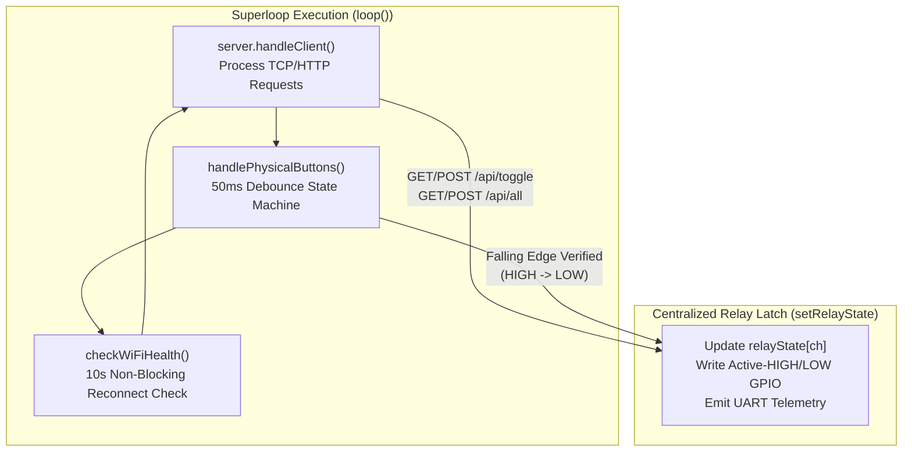

# 01 — Dual-Channel Web-Controlled Smart Switch & RESTful Node

**Difficulty Level:** Beginner (Edge HTTP Server & Non-Blocking GPIO State Sync)  
**Target Architectures:** Espressif ESP32 (Xtensa Dual-Core LX6) & ESP8266 (Xtensa Single-Core L106)

---

## 1. Architectural Overview & System Design

This project implements a deterministic, dual-channel AC/DC relay controller with an embedded HTTP/1.1 web server, asynchronous REST API, and hardware manual override switches. Rather than relying on external cloud brokers or third-party smart-home bridges, the microcontroller hosts a self-contained Single-Page Application (SPA) stored entirely in program flash memory (`PROGMEM`), ensuring sub-50 ms actuation latency over a local area network (LAN) and uninterrupted physical wall-switch functionality during network outages.

### Core Engineering Capabilities
- **Cross-Platform Hardware Abstraction:** Single-source compilation across **ESP32** (`WebServer.h`, `WiFi.h`) and **ESP8266** (`ESP8266WebServer.h`, `ESP8266WiFi.h`) resolved at compile time via preprocessor directives (`#if defined(ESP32)`).
- **Zero-Heap-Fragmentation Asset Delivery:** The HTML5/CSS3/ES6 dashboard ([`webpage.h`](./src/web_smart_switch/webpage.h)) is stored in flash ROM via `PROGMEM` and streamed directly from flash using `server.send_P()`, preserving over 280 KB of free SRAM on ESP32 and >40 KB on ESP8266.
- **Bidirectional State Synchronization:** Tactile push buttons with state-machine software debouncing (`50 ms` integration window) update the relay latch registers directly and immediately reflect across connected web clients via asynchronous `fetch()` polling.
- **RESTful JSON Control Plane:** Exposes stateless JSON endpoints (`/api/status`, `/api/toggle`, `/api/all`) with permissive CORS headers (`Access-Control-Allow-Origin: *`) for integration with Home Assistant, Node-RED, or custom automation scripts.

---

## 2. Hardware Bill of Materials (BOM) & Peripheral Interface Specs

| Component | Quantity | Interface / Protocol | Electrical Specification | Notes |
| :--- | :---: | :--- | :--- | :--- |
| **ESP32 DevKit V1** *or* **ESP8266 NodeMCU** | 1 | Wi-Fi 802.11 b/g/n + GPIO | 3.3V CMOS logic (`5V` via USB `VIN`) | Primary application & network processor |
| **2-Channel Opto-Isolated Relay Module** | 1 | Digital GPIO Output | 5V DC coil (~70 mA/ch), 250V AC / 10A contacts | Configurable `Active-LOW` or `Active-HIGH` logic |
| **Momentary Tactile Push Buttons** | 2 | Digital GPIO Input (`INPUT_PULLUP`) | 3.3V logic sink to `GND` | Local physical override per relay channel |
| **Status Indicator LEDs + 220 Ω Resistors** | 2 | Digital GPIO Output | $V_f \approx 2.0\text{V}$, $I_f \approx 6\text{ mA}$ | Visual load indicators (Wokwi simulation / bench test) |

### Pin Assignment Matrix

| Functional Signal | Module Terminal | ESP32 GPIO | ESP8266 Pin (GPIO) | Electrical Configuration |
| :--- | :--- | :---: | :---: | :--- |
| **Relay Channel 1 Output** | `IN1` | `GPIO 26` | `D1` (`GPIO 5`) | Push-pull digital output |
| **Relay Channel 2 Output** | `IN2` | `GPIO 27` | `D2` (`GPIO 4`) | Push-pull digital output |
| **Manual Switch Channel 1** | `SW1` | `GPIO 14` | `D5` (`GPIO 14`) | Internal pull-up (`INPUT_PULLUP`), active `LOW` |
| **Manual Switch Channel 2** | `SW2` | `GPIO 12` | `D6` (`GPIO 12`) | Internal pull-up (`INPUT_PULLUP`), active `LOW` |
| **Network Status LED** | `LED_WIFI` | `GPIO 2` | `D4` (`GPIO 2`) | Onboard LED (ESP8266 active-low) |

---

## 3. Firmware Architecture & Non-Blocking State Machine Design

The firmware ([`web_smart_switch.ino`](./src/web_smart_switch/web_smart_switch.ino)) avoids blocking delays inside the main execution loop to maintain deterministic button response and HTTP packet servicing:



1. **Polarity Abstraction Layer (`applyRelayPin`):** Commercial opto-isolated relay boards typically energize their coils when the input pin is pulled `LOW`, whereas simulation models energize on `HIGH`. The constant `RELAY_ACTIVE_LOW` abstracts hardware polarity so internal state variables (`relay1State`, `relay2State`) remain strictly boolean (`true` = energized).
2. **Mechanical Switch Debouncing (`handlePhysicalButtons`):** Mechanical contact bounce generates high-frequency transients lasting 5–20 ms. Each button channel tracks `lastRawReading`, `stableState`, and `lastDebounceTime` via `millis()`. A state transition is committed only when the input level remains invariant for `DEBOUNCE_DELAY_MS` (50 ms), triggering on the falling edge (`HIGH` $\rightarrow$ `LOW`).
3. **Resilient Wi-Fi Watchdog:** Every 10 seconds, the superloop evaluates `WiFi.status()`. If the station disconnects from the access point, it triggers a non-blocking `WiFi.reconnect()` while keeping physical switches operational.

---

## 4. Directory Structure

```text
01-web-smart-switch/
├── README.md                          # System architecture, BOM, build & simulation guide
├── src/
│   └── web_smart_switch/
│       ├── web_smart_switch.ino       # Main firmware source (ESP32 & ESP8266 compatible)
│       ├── webpage.h                  # PROGMEM responsive HTML5/CSS3/JS control interface
│       └── secrets.example.h          # Wi-Fi SSID & WPA2 passphrase template
├── schematics/
│   ├── diagram.json                   # Wokwi circuit netlist and hardware topology
│   └── wiring-guide.md                # Pinout specifications, schematic & AC mains safety
└── docs/
    └── api-and-serial-output.md       # REST API OpenAPI-style reference & UART boot logs
```

---

## 5. Build, Flashing & Wokwi Simulation Instructions

### A. Building & Flashing via Arduino IDE (Physical Hardware)
1. Copy the credentials template into an active header:
   ```bash
   cp src/web_smart_switch/secrets.example.h src/web_smart_switch/secrets.h
   ```
2. Open `src/web_smart_switch/secrets.h` and define your local `WIFI_SSID` and `WIFI_PASSWORD`.
3. Open [`src/web_smart_switch/web_smart_switch.ino`](./src/web_smart_switch/web_smart_switch.ino) in **Arduino IDE**.
4. Select the target board under **Tools > Board**:
   - **ESP32:** `DOIT ESP32 DEVKIT V1` (or `ESP32 Dev Module`)
   - **ESP8266:** `NodeMCU 1.0 (ESP-12E Module)` or `LOLIN(WEMOS) D1 R2 & mini`
5. Wire the relay module and push buttons according to [`schematics/wiring-guide.md`](./schematics/wiring-guide.md).
6. Compile and upload (`Ctrl+U`), then open the **Serial Monitor** at **`115200` baud** to obtain the assigned IPv4 address.

### B. Building & Flashing via Arduino CLI
```bash
# Compile and upload for ESP32
arduino-cli compile --fqbn esp32:esp32:esp32 src/web_smart_switch
arduino-cli upload -p /dev/ttyUSB0 --fqbn esp32:esp32:esp32 src/web_smart_switch

# Compile and upload for ESP8266
arduino-cli compile --fqbn esp8266:esp8266:nodemcuv2 src/web_smart_switch
arduino-cli upload -p /dev/ttyUSB0 --fqbn esp8266:esp8266:nodemcuv2 src/web_smart_switch
```

### C. Running in Wokwi Simulator
1. No `secrets.h` file is required; when `secrets.h` is absent, the preprocessor `__has_include("secrets.h")` guard automatically falls back to the virtual access point `Wokwi-GUEST`.
2. Open the project in **Wokwi for VS Code** or paste [`web_smart_switch.ino`](./src/web_smart_switch/web_smart_switch.ino), [`webpage.h`](./src/web_smart_switch/webpage.h), and [`schematics/diagram.json`](./schematics/diagram.json) into the [Wokwi ESP32 Simulator](https://wokwi.com/projects/new/esp32).
3. Start the simulation and press the tactile push buttons or use Wokwi's local HTTP port forwarding to interact with the web dashboard and REST endpoints.
