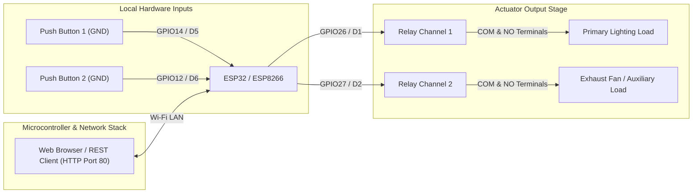

# Hardware Wiring & Electrical Guide — 01 Web-Controlled Smart Switch

This document details the electrical interconnections between the microcontroller (**ESP32 DevKit V1** or **ESP8266 NodeMCU**), the 2-channel opto-isolated relay module, and the tactile manual override switches.

---

## 1. Pinout Mapping Table (ESP32 vs. ESP8266)

The firmware in [`web_smart_switch.ino`](../src/web_smart_switch/web_smart_switch.ino) automatically selects the appropriate pin definitions at compile time based on the target architecture:

| Component | Module Terminal | ESP32 (DevKit V1) | ESP8266 (NodeMCU) | Electrical Function & Notes |
| :--- | :--- | :--- | :--- | :--- |
| **Relay Channel 1** | `IN1` | `GPIO 26` | `D1` (`GPIO 5`) | Digital control signal for Relay 1 driver |
| **Relay Channel 2** | `IN2` | `GPIO 27` | `D2` (`GPIO 4`) | Digital control signal for Relay 2 driver |
| **Relay Power Supply** | `VCC` | `VIN` (5V USB) | `VIN` / `VU` (5V) | 5V DC rail for relay coil energization |
| **Relay Ground** | `GND` | `GND` | `GND` | Common signal and power reference |
| **Push Button 1** | Terminal 1 | `GPIO 14` | `D5` (`GPIO 14`) | Internal pull-up enabled (`INPUT_PULLUP`) |
| **Push Button 2** | Terminal 1 | `GPIO 12` | `D6` (`GPIO 12`) | Internal pull-up enabled (`INPUT_PULLUP`) |
| **Push Button Common** | Terminal 2 | `GND` | `GND` | Active-LOW switch closure to ground (`0V`) |
| **Wi-Fi Status LED** | Anode | `GPIO 2` (Onboard) | `LED_BUILTIN` (`D4`) | Blinks during association; solid when connected |

---

## 2. System Block & Signal Flow Diagram



---

## 3. Relay Driver Polarity: Active-LOW vs. Active-HIGH

- **Opto-Isolated Relay Modules (Active-LOW):** Most commercial 5V relay modules use an PC817 optocoupler and PNP transistor driver stage that energizes the relay coil when the `IN` pin is driven `LOW` (`0V`) and de-energizes when driven `HIGH` (`3.3V`). When using an Active-LOW module on physical hardware, set the polarity flag in [`web_smart_switch.ino`](../src/web_smart_switch/web_smart_switch.ino):
  ```cpp
  const bool RELAY_ACTIVE_LOW = true;
  ```
- **Wokwi Simulation & Direct NPN Driver Modules (Active-HIGH):** For the Wokwi simulation circuit ([`diagram.json`](./diagram.json)) or Active-HIGH MOSFET/NPN relay modules, leave `RELAY_ACTIVE_LOW = false`.

---

## 4. High-Voltage AC Mains Safety Precautions (110V–240V AC)

> [!CAUTION]
> **ELECTRICAL SHOCK AND FIRE HAZARD:**
> If connecting the relay output screw terminals (`COM` and `NO`) to high-voltage AC mains appliances (**110V–240V AC**):
> 1. **Disconnect AC Mains Power:** Always isolate the circuit breaker or unplug the mains cord before wiring or modifying relay screw terminals.
> 2. **Switch Only the Line/Phase Conductor:** Route the **Live/Phase (`L`)** wire through the `COM` (Common) and `NO` (Normally Open) terminals. Never switch only the Neutral (`N`) conductor, as doing so leaves the load energized with respect to earth when turned off.
> 3. **Dielectric Isolation & Enclosure:** Mount the relay PCB inside an insulated, flame-retardant enclosure (ABS/polycarbonate) with proper strain relief so exposed high-voltage solder traces on the underside of the PCB cannot be touched.
> 4. **Bench Prototyping:** When testing firmware and REST API functionality on a breadboard, always use low-voltage DC indicator loads (5V/12V LEDs or DC fans) before connecting AC mains.
