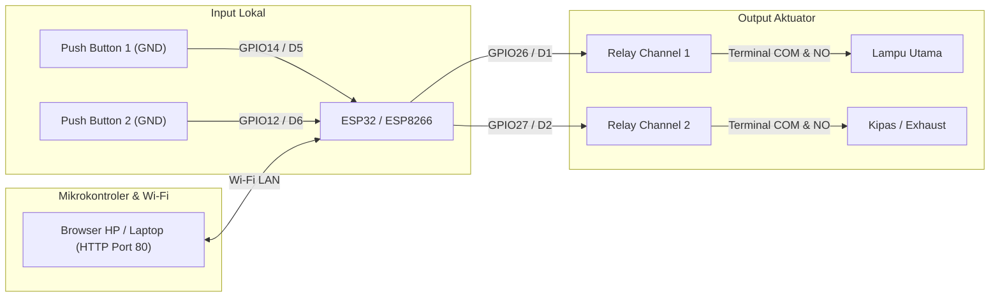

# Panduan Pengkabelan (Wiring Guide) — 01 Web-Controlled Smart Switch

Dokumen ini menjelaskan koneksi pin antara mikrokontroler (**ESP32** atau **ESP8266 NodeMCU**), Modul Relay 2-Channel, dan Tombol Fisik (*Push Button*).

---

## 1. Tabel Pinout (ESP32 vs ESP8266)

Kode program di [`web_smart_switch.ino`](../src/web_smart_switch/web_smart_switch.ino) secara otomatis memilih konfigurasi pin berikut berdasarkan board yang dipilih di Arduino IDE:

| Komponen | Pin Modul | Pin ESP32 (DevKit V1) | Pin ESP8266 (NodeMCU) | Keterangan |
| :--- | :--- | :--- | :--- | :--- |
| **Relay Channel 1** | `IN1` | `GPIO 26` | `D1` (`GPIO 5`) | Output digital kontrol Relay 1 |
| **Relay Channel 2** | `IN2` | `GPIO 27` | `D2` (`GPIO 4`) | Output digital kontrol Relay 2 |
| **Relay Power** | `VCC` | `VIN` (5V USB) | `VIN` / `VU` (5V) | Tegangan kerja koil relay 5V |
| **Relay Ground** | `GND` | `GND` | `GND` | Ground bersama |
| **Push Button 1** | Kaki 1 | `GPIO 14` | `D5` (`GPIO 14`) | Mode `INPUT_PULLUP` internal |
| **Push Button 2** | Kaki 1 | `GPIO 12` | `D6` (`GPIO 12`) | Mode `INPUT_PULLUP` internal |
| **Push Button GND** | Kaki 2 | `GND` | `GND` | Ditekan = terhubung ke `GND` (`LOW`) |
| **Indikator Wi-Fi** | Anoda | `GPIO 2` (Onboard) | `LED_BUILTIN` (`D4`) | Berkedip saat *connecting*, menyala saat terhubung |

---

## 2. Diagram Blok Rangkaian



---

## 3. Catatan Penting: Active-LOW vs Active-HIGH Relay

- Sebagian besar modul relay optocoupler di pasaran bersifat **Active-LOW** (relay menyala ketika pin `IN` diberi logika `LOW` / `0V`).
- Jika menggunakan modul relay fisik Active-LOW, ubah konstanta pada baris kode [`web_smart_switch.ino`](../src/web_smart_switch/web_smart_switch.ino):
  ```cpp
  const bool RELAY_ACTIVE_LOW = true;
  ```
- Untuk simulasi Wokwi ([`diagram.json`](./diagram.json)) atau modul relay Active-HIGH, biarkan bernilai `false`.

---

## 4. Peringatan Keamanan Tegangan Tinggi (AC 220V)

> **PERINGATAN KESELAMATAN:**
> Jika Anda menghubungkan terminal output relay (`COM` dan `NO`) ke beban listrik rumah tangga **AC 220V**:
> 1. **Cabut steker listrik** dari sumber PLN sebelum memasang atau memodifikasi kabel pada terminal sekrup relay.
> 2. Hanya putus jalur **Fasa (Live / L)** melalui terminal `COM` dan `NO` (Normally Open) pada relay.
> 3. Gunakan kotak pelindung (*enclosure* plastik/akrilik) agar bagian bawah PCB modul relay yang bertegangan tinggi tidak tersentuh tangan.
> 4. Untuk tahap belajar awal, sangat disarankan menggunakan beban tegangan rendah (LED + resistor atau lampu DC 5V/12V).
