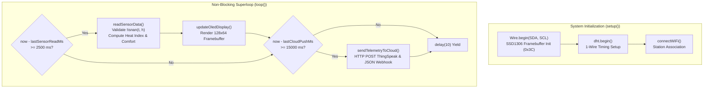

# 02 — Real-Time Environmental & Psychrometric Monitor (I2C OLED + Cloud Telemetry)

**Difficulty Level:** Beginner–Intermediate (1-Wire/I2C Sensor Acquisition, Psychrometric Computation & Cloud Uplink)  
**Target Architectures:** Espressif ESP32 & ESP8266

---

## 1. Architectural Overview & System Design

This project implements an environmental telemetry node that samples ambient temperature and relative humidity, computes the apparent temperature (**Heat Index** via Rothfusz regression), renders real-time psychrometric comfort diagnostics on a local **SSD1306 128×64 I2C OLED** display, and asynchronously dispatches telemetry frames to **ThingSpeak** and/or a custom **HTTP JSON webhook** (such as ThingsBoard).

### Core Engineering Capabilities
- **Dual-Target Hardware Abstraction:** Compiles cleanly for **ESP32** (`WiFi.h`, `HTTPClient.h`) and **ESP8266** (`ESP8266WiFi.h`, `ESP8266HTTPClient.h`) using conditional preprocessor directives.
- **Decoupled Dual-Timer Scheduling:** Uses independent non-blocking `millis()` timers for local sensor sampling + OLED framebuffer rendering (`2,500 ms` period) and remote cloud HTTP transmission (`15,000 ms` period, aligned with ThingSpeak's rate limit).
- **Offline-Resilient Edge Display:** Continues operating as an autonomous digital thermohygrometer and thermal comfort analyzer even when Wi-Fi connectivity is unavailable or degraded.
- **Psychrometric Heat Index & Comfort Classification:** Evaluates temperature (`°C`), relative humidity (`%RH`), and apparent heat index to classify indoor environmental quality (`NYAMAN (IDEAL)`, `PANAS/LEMBAP`, `SEJUK/DINGIN`, `NORMAL`).

---

## 2. Hardware Bill of Materials (BOM) & Peripheral Interface Specs

| Component | Quantity | Interface / Protocol | Electrical Specification | Notes |
| :--- | :---: | :--- | :--- | :--- |
| **ESP32 DevKit V1** *or* **ESP8266 NodeMCU** | 1 | I2C + 1-Wire + Wi-Fi | 3.3V logic (`5V` via USB `VIN`) | Main controller & HTTP client |
| **DHT22 (AM2302) Sensor** | 1 | Proprietary Single-Wire | 3.3V–5V DC; -40 to +80 °C (±0.5 °C), 0–100 %RH (±2%) | Requires 4.7 kΩ–10 kΩ pull-up on `DATA` if bare 4-pin |
| **0.96" OLED Display (SSD1306)** | 1 | I2C (`0x3C` default) | 3.3V DC (~15 mA), 128×64 monochrome pixels | Local real-time status & telemetry display |
| **BME280 Sensor** *(Optional)* | 1 | I2C (`0x76` / `0x77`) | 3.3V DC | Optional drop-in upgrade on shared I2C bus |

### Pin Assignment Matrix

| Functional Signal | Module Terminal | ESP32 GPIO | ESP8266 Pin (GPIO) | Electrical Configuration |
| :--- | :--- | :---: | :---: | :--- |
| **DHT22 Data Line** | `DATA` / `SDA` | `GPIO 15` | `D5` (`GPIO 14`) | Digital bidirectional single-wire bus |
| **OLED I2C Data** | `SDA` | `GPIO 21` | `D2` (`GPIO 4`) | Open-drain I2C Serial Data |
| **OLED I2C Clock** | `SCL` / `SCK` | `GPIO 22` | `D1` (`GPIO 5`) | Open-drain I2C Serial Clock |
| **Wi-Fi Status Indicator** | `LED_WIFI` | `GPIO 2` | `D4` (`GPIO 2`) | Onboard status LED |

---

## 3. Firmware Architecture & Non-Blocking State Machine Design

The firmware ([`weather_room_monitor.ino`](./src/weather_room_monitor/weather_room_monitor.ino)) separates high-frequency local UI updates from network I/O operations:



1. **NaN Fault Filtering (`readSensorData`):** Single-wire sensors like the DHT22 are timing-sensitive and can occasionally return `NaN` on checksum mismatches. The acquisition routine validates both `isnan(t)` and `isnan(h)` before mutating state variables or updating the display.
2. **SSD1306 Framebuffer Rendering (`updateOledDisplay`):** Constructs a structured 3-zone layout in the 1 KB SRAM display buffer—top status bar (Wi-Fi RSSI in dBm and cloud sync counter), center dual-column primary telemetry (`TextSize 2`), and bottom psychrometric summary—before committing via burst I2C transfer (`display.display()`).
3. **Dual-Protocol Cloud Uplink (`sendTelemetryToCloud`):** Formats both `application/x-www-form-urlencoded` payloads for ThingSpeak (`field1`–`field4`) and `application/json` payloads for custom webhooks/ThingsBoard.

---

## 4. Directory Structure

```text
02-weather-room-monitor/
├── README.md                              # System architecture, BOM, build & simulation guide
├── src/
│   └── weather_room_monitor/
│       ├── weather_room_monitor.ino       # Main firmware source (ESP32 & ESP8266)
│       └── secrets.example.h              # Wi-Fi credentials & ThingSpeak/Webhook API template
├── schematics/
│   ├── diagram.json                       # Wokwi circuit netlist (ESP32 + DHT22 + SSD1306 OLED)
│   └── wiring-guide.md                    # Pinout table, I2C bus topology & address troubleshooting
└── docs/
    └── cloud-and-serial-output.md         # OLED layout, ThingSpeak mapping & UART telemetry logs
```

---

## 5. Build, Flashing & Wokwi Simulation Instructions

### Required Arduino Libraries
Install the following libraries via **Arduino IDE Library Manager** (`Sketch > Include Library > Manage Libraries...`) or `arduino-cli`:
1. **`DHT sensor library`** by *Adafruit* (plus **`Adafruit Unified Sensor`**)
2. **`Adafruit SSD1306`** by *Adafruit*
3. **`Adafruit GFX Library`** by *Adafruit*

### A. Building & Flashing via Arduino IDE (Physical Hardware)
1. Create your local configuration header from the template:
   ```bash
   cp src/weather_room_monitor/secrets.example.h src/weather_room_monitor/secrets.h
   ```
2. Edit `src/weather_room_monitor/secrets.h` to configure `WIFI_SSID`, `WIFI_PASSWORD`, `THINGSPEAK_API_KEY`, and optionally `CUSTOM_JSON_ENDPOINT`.
3. Open [`src/weather_room_monitor/weather_room_monitor.ino`](./src/weather_room_monitor/weather_room_monitor.ino) in **Arduino IDE**, select your target board (`DOIT ESP32 DEVKIT V1` or `NodeMCU 1.0`), and wire the hardware per [`schematics/wiring-guide.md`](./schematics/wiring-guide.md).
4. Upload the sketch and monitor telemetry at **`115200` baud**.

### B. Building & Flashing via Arduino CLI
```bash
arduino-cli lib install "DHT sensor library" "Adafruit Unified Sensor" "Adafruit SSD1306" "Adafruit GFX Library"
arduino-cli compile --fqbn esp32:esp32:esp32 src/weather_room_monitor
arduino-cli upload -p /dev/ttyUSB0 --fqbn esp32:esp32:esp32 src/weather_room_monitor
```

### C. Running in Wokwi Simulator
1. Open the [Wokwi ESP32 Simulator](https://wokwi.com/projects/new/esp32) or **Wokwi for VS Code**.
2. Load [`weather_room_monitor.ino`](./src/weather_room_monitor/weather_room_monitor.ino) and [`schematics/diagram.json`](./schematics/diagram.json), ensuring `DHT sensor library`, `Adafruit SSD1306`, and `Adafruit GFX Library` are listed in the project libraries.
3. Start the simulation (`Wokwi-GUEST` is used automatically when `secrets.h` is omitted). Click the **DHT22** component during simulation to dynamically vary temperature and humidity sliders and observe instant updates on the OLED display.
