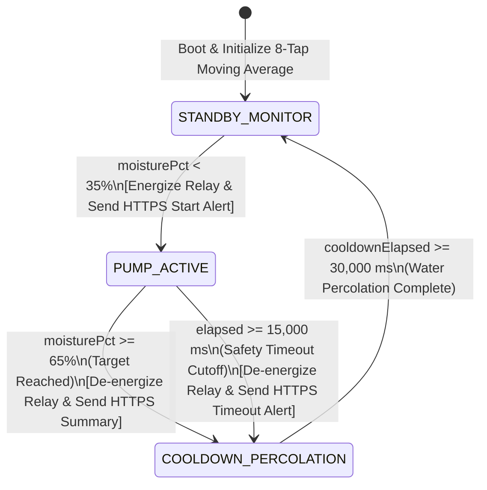

# 03 — Closed-Loop Smart Plant Irrigation System (Hysteresis Control & HTTPS Webhooks)

**Difficulty Level:** Intermediate (ADC Moving-Average Filtering, Dual-Threshold Hysteresis FSM & HTTPS REST Notifications)  
**Target Architectures:** Espressif ESP32 (12-bit SAR ADC) & ESP8266 (10-bit SAR ADC)

---

## 1. Architectural Overview & System Design

This project implements an autonomous closed-loop soil moisture regulation system with multi-stage digital signal conditioning, hysteresis pump actuation, anti-flooding safety timers, and encrypted HTTPS push notifications to **Telegram Bot API** and **Discord Webhooks**.

### Core Engineering Capabilities
- **Two-Stage ADC Noise Rejection:** Analog capacitive soil sensors suffer from high-frequency power-supply ripple and soil-contact transients. The firmware applies a burst oversampling routine (8 sub-samples at `2 ms` intervals per reading) feeding an 8-tap circular **Moving Average Filter** before linear calibration mapping (`0%–100%`).
- **Dual-Threshold Schmitt-Trigger Hysteresis:** Prevents relay contact chattering around a single setpoint by decoupling the turn-on threshold (`MOISTURE_LOW_THRESHOLD = 35%`) from the turn-off saturation threshold (`MOISTURE_HIGH_THRESHOLD = 65%`).
- **Percolation Cooldown & Maximum Run-Time Interlocks:** Enforces a strict hardware run-time cap (`MAX_PUMP_DURATION_MS = 15,000 ms`) to prevent reservoir depletion or root flooding if the sensor is dislodged, followed by a mandatory soil percolation cooldown window (`PUMP_COOLDOWN_MS = 30,000 ms`) allowing water to diffuse evenly through the substrate before re-evaluating moisture.
- **Zero-Dependency HTTPS Webhook Engine:** Dispatches real-time event alerts directly to `api.telegram.org` and Discord over TLS (`WiFiClientSecure` + `HTTPClient`) using only built-in core libraries.

---

## 2. Hardware Bill of Materials (BOM) & Peripheral Interface Specs

| Component | Quantity | Interface / Protocol | Electrical Specification | Notes |
| :--- | :---: | :--- | :--- | :--- |
| **ESP32 DevKit V1** *or* **ESP8266 NodeMCU** | 1 | SAR ADC + Digital GPIO + Wi-Fi | 3.3V logic (`5V` via USB `VIN`) | Main controller |
| **Capacitive Soil Moisture Sensor v1.2 / v2.0** | 1 | Analog Voltage Output (`AOUT`) | 3.3V–5V DC (~5 mA); 1.2V–3.0V analog output | Corrosion-resistant capacitive sensing |
| **1-Channel 5V Opto-Isolated Relay Module** | 1 | Digital GPIO Output | 5V DC coil (~70 mA); 10A contact rating | Switches DC power to submersible pump |
| **Mini 5V DC Submersible Water Pump** | 1 | Relay Dry Contact (`COM`/`NO`) | 3V–5V DC, 300–600 mA inrush current | Inductive load; requires flyback diode |
| **1N4007 / 1N5819 Flyback Diode** | 1 | Parallel across Pump Terminals | $V_{RRM} = 1000\text{V}$, $I_F = 1\text{A}$ | Clamps inductive back-EMF transients |

### Pin Assignment Matrix

| Functional Signal | Module Terminal | ESP32 GPIO | ESP8266 Pin (GPIO) | Electrical Configuration |
| :--- | :--- | :---: | :---: | :--- |
| **Soil Moisture Analog Out** | `AOUT` / `SIG` | `GPIO 34` (`ADC1_CH6`) | `A0` (`ADC0`) | High-impedance analog input |
| **Water Pump Relay Driver** | `IN` | `GPIO 26` | `D1` (`GPIO 5`) | Push-pull digital output |
| **Wi-Fi Status Indicator** | `LED_WIFI` | `GPIO 2` | `D4` (`GPIO 2`) | Onboard status LED |

---

## 3. Firmware Architecture & Non-Blocking State Machine Design

The irrigation controller ([`smart_plant_watering.ino`](./src/smart_plant_watering/smart_plant_watering.ino)) operates as a three-state finite state machine (`STANDBY_MONITOR`, `MENYIRAM / PUMP_ACTIVE`, and `COOLDOWN_PERCOLATION`):



1. **ADC Resolution & Inverse Dielectric Mapping (`adcToMoisturePercent`):** Because water has a relative permittivity ($\varepsilon_r \approx 80$) much higher than dry soil ($\varepsilon_r \approx 3–5$), increased moisture increases sensor capacitance and **lowers** the output voltage of the 555-timer oscillator on the capacitive sensor board. The firmware maps `[ADC_DRY_VALUE .. ADC_WET_VALUE]` inversely onto `[0% .. 100%]` and clamps out-of-range values with `constrain()`.
2. **Offline Autonomous Guarantee:** The hysteresis control loop (`evaluateWateringLogic`) executes every `2,000 ms` independently of network status. If Wi-Fi drops, pump actuation and safety cutoffs remain 100% functional while HTTPS notifications gracefully log `[NOTIFY] Wi-Fi belum terhubung`.

---

## 4. Directory Structure

```text
03-smart-plant-watering/
├── README.md                                  # System architecture, BOM, FSM & build instructions
├── src/
│   └── smart_plant_watering/
│       ├── smart_plant_watering.ino           # Main firmware source (ESP32 & ESP8266)
│       └── secrets.example.h                  # Wi-Fi, Telegram Bot Token & Discord Webhook template
├── schematics/
│   ├── diagram.json                           # Wokwi circuit netlist (ESP32 + Potentiometer + Relay)
│   └── wiring-guide.md                        # Pinout, 2-point ADC calibration & flyback diode protection
└── docs/
    └── notification-and-calibration.md        # @BotFather setup, Discord Webhook & UART logs
```

---

## 5. Build, Flashing & Wokwi Simulation Instructions

### A. Building & Flashing via Arduino IDE (Physical Hardware)
1. Create your local credentials file from the template:
   ```bash
   cp src/smart_plant_watering/secrets.example.h src/smart_plant_watering/secrets.h
   ```
2. Edit `src/smart_plant_watering/secrets.h` with your `WIFI_SSID`, `WIFI_PASSWORD`, `TELEGRAM_BOT_TOKEN`, `TELEGRAM_CHAT_ID`, or `DISCORD_WEBHOOK_URL` (refer to [`docs/notification-and-calibration.md`](./docs/notification-and-calibration.md)).
3. Open [`src/smart_plant_watering/smart_plant_watering.ino`](./src/smart_plant_watering/smart_plant_watering.ino) in **Arduino IDE**, select **DOIT ESP32 DEVKIT V1** or **NodeMCU 1.0 (ESP-12E Module)**, and upload.
4. Perform the 2-point dry/wet calibration procedure documented in [`schematics/wiring-guide.md`](./schematics/wiring-guide.md).

### B. Building & Flashing via Arduino CLI
```bash
# No external third-party libraries required (uses built-in WiFiClientSecure & HTTPClient)
arduino-cli compile --fqbn esp32:esp32:esp32 src/smart_plant_watering
arduino-cli upload -p /dev/ttyUSB0 --fqbn esp32:esp32:esp32 src/smart_plant_watering
```

### C. Running in Wokwi Simulator
1. Open the [Wokwi ESP32 Simulator](https://wokwi.com/projects/new/esp32) or **Wokwi for VS Code**.
2. Load [`smart_plant_watering.ino`](./src/smart_plant_watering/smart_plant_watering.ino) and [`schematics/diagram.json`](./schematics/diagram.json), then start the simulation.
3. Adjust the **Potentiometer** (which emulates the capacitive soil sensor analog voltage on `GPIO 34`):
   - Rotate toward high ADC counts (`> 2600`) to simulate **dry soil (`< 35%`)** and trigger automatic pump actuation.
   - Rotate toward low ADC counts (`< 2000`) to simulate **saturated soil (`>= 65%`)** and observe automatic pump shutoff and transition into the 30-second percolation cooldown state.
