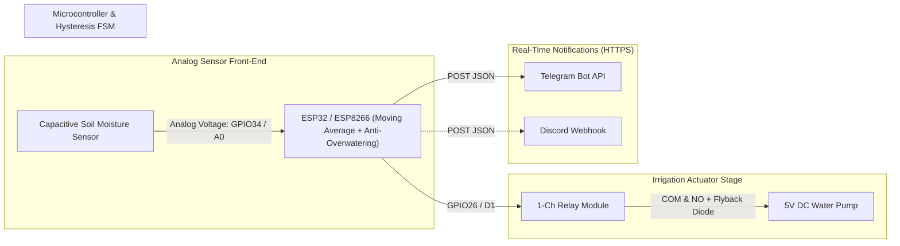

# Hardware Wiring, Sensor Calibration & Inductive Load Protection — 03 Smart Plant Watering System

This document details the electrical connections between the microcontroller (**ESP32** or **ESP8266 NodeMCU**), the **Capacitive Soil Moisture Sensor v1.2 / v2.0**, the **1-Channel Opto-Isolated Relay Module**, and the **5V DC Submersible Water Pump**.

---

## 1. Pinout Mapping Table (ESP32 vs. ESP8266)

The firmware in [`smart_plant_watering.ino`](../src/smart_plant_watering/smart_plant_watering.ino) automatically selects the following pin definitions based on the target board:

| Component | Module Terminal | ESP32 (DevKit V1) | ESP8266 (NodeMCU) | Electrical Function & Notes |
| :--- | :--- | :--- | :--- | :--- |
| **Capacitive Soil Sensor** | `VCC` | `3V3` (3.3V) | `3V3` (3.3V) | Regulated supply rail (3.3V–5V DC) |
| **Capacitive Soil Sensor** | `GND` | `GND` | `GND` | Common ground reference |
| **Capacitive Soil Sensor** | `AOUT` / `SIG` | `GPIO 34` (`ADC1_CH6`) | `A0` (`ADC0`) | Analog voltage output (Dry = High V, Wet = Low V) |
| **Water Pump Relay** | `IN` | `GPIO 26` | `D1` (`GPIO 5`) | Digital output driving relay optocoupler |
| **Water Pump Relay** | `VCC` | `VIN` (5V USB) | `VIN` / `VU` (5V) | 5V DC supply for relay coil |
| **Water Pump Relay** | `GND` | `GND` | `GND` | Common ground reference |
| **DC Submersible Pump** | Positive (`+` Red) | Relay `NO` Terminal | Relay `NO` Terminal | Normally Open contact (connected to `+5V` on `COM`) |
| **DC Submersible Pump** | Negative (`-` Black) | 5V Power Supply `GND` | 5V Power Supply `GND` | Pump return path |
| **Wi-Fi Status LED** | Anode | `GPIO 2` (Onboard) | `LED_BUILTIN` (`D4`) | Flashes during connection; solid when associated |

> [!IMPORTANT]
> **ESP32 ADC1 vs. ADC2 Hardware Constraint:**  
> On the ESP32, always connect analog sensors to **ADC1** pins (`GPIO 32`, `33`, `34`, `35`, `36`, or `39`) when the Wi-Fi radio is enabled. The **ADC2** peripheral shares internal arbiter hardware with the Wi-Fi MAC/baseband driver and cannot take deterministic readings while Wi-Fi is active.

---

## 2. System Block & Control Loop Diagram



---

## 3. Two-Point Dielectric Calibration Procedure (`ADC_DRY_VALUE` & `ADC_WET_VALUE`)

Unlike resistive fork probes that corrode rapidly due to DC electrolysis, a **Capacitive Soil Moisture Sensor** forms a fringing-field capacitor with the surrounding soil dielectric:
- In **dry air** ($\varepsilon_r \approx 1$), sensor capacitance is minimal and the onboard peak detector outputs a **high analog voltage** (large ADC count).
- In **water** ($\varepsilon_r \approx 80$), sensor capacitance increases significantly and the output voltage **drops** (small ADC count).

Perform the following 2-point calibration to map your specific sensor's range accurately to `0% – 100%`:

1. **Record the Dry Baseline (`ADC_DRY_VALUE` — 0%):**
   - Wipe the sensor blade completely dry and hold it in open air.
   - Open the **Serial Monitor** (`115200` baud) and note the stabilized `ADC Rata-rata` value (typical ESP32 12-bit reading: `~3200`; typical ESP8266 10-bit reading: `~820`).
2. **Record the Saturated Baseline (`ADC_WET_VALUE` — 100%):**
   - Submerge the sensor blade into a cup of water **up to the white restriction line** *(never submerge the exposed SMD electronics above the white line)*.
   - Record the stabilized `ADC Rata-rata` reading (typical ESP32 reading: `~1400`; typical ESP8266 reading: `~380`).
3. **Update Calibration Constants in [`smart_plant_watering.ino`](../src/smart_plant_watering/smart_plant_watering.ino):**
   ```cpp
   const int ADC_DRY_VALUE = 3200; // Replace with your measured dry air count
   const int ADC_WET_VALUE = 1400; // Replace with your measured submerged water count
   ```

---

## 4. Flyback Diode Snubber & DC Pump Power Supply Design

A brushed DC submersible water pump is an **inductive load** ($V = L \frac{di}{dt}$). When the relay contacts open to cut current to the motor windings, the collapsing magnetic field induces a high-voltage reverse spike (**back-EMF**) that causes contact arcing and radiates electromagnetic interference (EMI) capable of resetting the microcontroller.

### Guidelines for Glitch-Free Pump Switching:
1. **Install a Parallel Flyback Diode (`1N4007` or `1N5819` Schottky):**
   - Connect the diode in **reverse bias** directly across the DC pump terminals:
   - **Cathode (silver band)** to the **Positive (`+` Red)** pump lead (connected to Relay `NO`).
   - **Anode** to the **Negative (`-` Black)** pump lead (`GND`).
2. **Power Rail Decoupling:**
   - Mini 5V submersible pumps draw `300 mA – 600 mA` stall/inrush current at startup. If the ESP32 experiences a brownout reset (`rst:0x1 (POWERON_RESET)` or `BROWNOUT_RST`) when the pump turns on, power the pump's `COM` terminal from a dedicated 5V/1A DC supply and tie its `GND` to the ESP32 `GND`.
