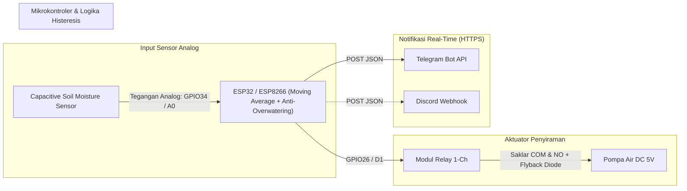

# Panduan Pengkabelan & Kalibrasi Sensor — 03 Smart Plant Watering System

Dokumen ini menjelaskan koneksi pin antara mikrokontroler (**ESP32** atau **ESP8266 NodeMCU**), **Capacitive Soil Moisture Sensor v1.2 / v2.0**, **Modul Relay 1-Channel**, dan **Pompa Air Mini Submersible DC**.

---

## 1. Tabel Pinout (ESP32 vs ESP8266)

Kode program di [`smart_plant_watering.ino`](../src/smart_plant_watering/smart_plant_watering.ino) secara otomatis memilih konfigurasi pin berikut berdasarkan board yang dipilih di Arduino IDE:

| Komponen | Pin Modul | Pin ESP32 (DevKit V1) | Pin ESP8266 (NodeMCU) | Keterangan |
| :--- | :--- | :--- | :--- | :--- |
| **Sensor Tanah Kapasitif** | `VCC` | `3V3` (3.3V) | `3V3` (3.3V) | Tegangan suplai sensor (3.3V – 5V) |
| **Sensor Tanah Kapasitif** | `GND` | `GND` | `GND` | Ground bersama |
| **Sensor Tanah Kapasitif** | `AOUT` / `SIG` | `GPIO 34` (`ADC1_CH6`) | `A0` (`ADC0`) | Output tegangan analog (kering = tinggi, basah = rendah) |
| **Relay Pompa Air** | `IN` | `GPIO 26` | `D1` (`GPIO 5`) | Output digital pemicu koil relay |
| **Relay Pompa Air** | `VCC` | `VIN` (5V USB) | `VIN` / `VU` (5V) | Suplai daya modul relay 5V |
| **Relay Pompa Air** | `GND` | `GND` | `GND` | Ground bersama |
| **Pompa Air DC (Beban)** | Kabel `+` (Merah) | Terminal `NO` Relay | Terminal `NO` Relay | *Normally Open* (terhubung ke `COM` `+5V` saat aktif) |
| **Pompa Air DC (Beban)** | Kabel `-` (Hitam) | `GND` Catu Daya 5V | `GND` Catu Daya 5V | Ground catu daya pompa |
| **Indikator Wi-Fi** | Anoda | `GPIO 2` (Onboard) | `LED_BUILTIN` (`D4`) | Berkedip saat *connecting*, menyala saat terhubung |

> **Penting untuk Pengguna ESP32:**  
> Selalu gunakan pin kelompok **ADC1** (`GPIO 32`, `33`, `34`, `35`, `36`, atau `39`) untuk membaca sensor analog ketika Wi-Fi aktif. Pin kelompok **ADC2** tidak dapat digunakan bersamaan dengan driver Wi-Fi ESP32.

---

## 2. Diagram Blok Rangkaian & Alur Kerja



---

## 3. Cara Kalibrasi Nilai `ADC_DRY_VALUE` dan `ADC_WET_VALUE`

Berbeda dengan sensor resistif murah yang mudah berkarat, **Capacitive Soil Moisture Sensor** bekerja dengan mengukur perubahan kapasitansi dielektrik tanah:
- Saat **kering di udara**, sensor mengeluarkan tegangan analog **tinggi** (nilai ADC besar).
- Saat **basah di dalam air**, sensor mengeluarkan tegangan analog **rendah** (nilai ADC kecil).

Agar persentase `0% – 100%` akurat untuk sensor milikmu, lakukan kalibrasi 2 titik berikut:

1. **Ukur Nilai Kering (`ADC_DRY_VALUE` — 0%):**
   - Biarkan sensor kering di udara terbuka (lap hingga kering).
   - Buka **Serial Monitor** (`115200` baud) dan catat angka `ADC Rata-rata` yang muncul (contoh pada ESP32: `3200`, pada ESP8266: `820`).
2. **Ukur Nilai Basah (`ADC_WET_VALUE` — 100%):**
   - Celupkan bilah sensor ke dalam segelas air **hingga batas garis putih** *(jangan merendam komponen elektronik di bagian atas batas garis!)*.
   - Catat angka `ADC Rata-rata` yang stabil (contoh pada ESP32: `1400`, pada ESP8266: `380`).
3. **Perbarui Konstanta di [`smart_plant_watering.ino`](../src/smart_plant_watering/smart_plant_watering.ino):**
   ```cpp
   const int ADC_DRY_VALUE = 3200; // Ganti dengan hasil ukur kering
   const int ADC_WET_VALUE = 1400; // Ganti dengan hasil ukur basah
   ```

---

## 4. Proteksi Dioda Flyback & Catu Daya Pompa Air DC

Motor pompa air DC merupakan **beban induktif**. Saat aliran listrik ke pompa diputus oleh relay, kumparan motor menghasilkan lonjakan tegangan balik (*back-EMF*) yang dapat menyebabkan mikrokontroler *reset* mendadak atau merusak kontak relay.

### Tips Rangkaian Pompa yang Stabil:
1. **Pasang Dioda Flyback (`1N4007` atau `1N5819`):**
   - Pasang secara paralel tepat di kedua kabel terminal pompa air DC secara *reverse-biased*:
   - **Katoda (ujung bergaris perak)** ke kabel **Positif (`+`)** pompa.
   - **Anoda** ke kabel **Negatif (`-`)** pompa.
2. **Gunakan Sumber 5V Terpisah bila Pompa Berdaya Besar:**
   - Pompa celup mini 5V menarik arus awal (*inrush current*) sekitar `300 mA – 600 mA`. Jika ESP32 mengalami *brownout reset* saat pompa menyala, gunakan adaptor 5V eksternal untuk jalur `COM` pompa dan hubungkan `GND` adaptor ke `GND` ESP32.
