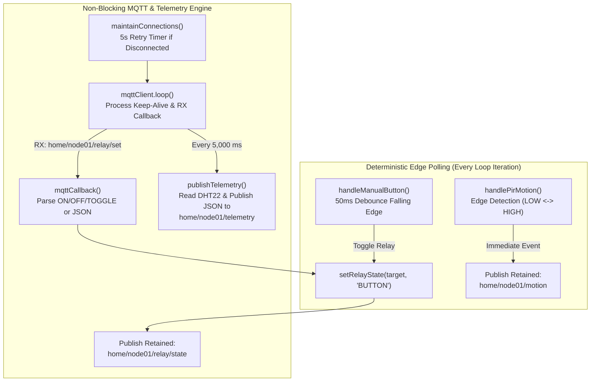

# 04 — Asynchronous MQTT Home Automation Hub (Pub/Sub, LWT & Home Assistant)

**Difficulty Level:** Intermediate (Publish-Subscribe Messaging, Last Will & Testament, Retained State Sync)  
**Target Architectures:** Espressif ESP32 & ESP8266

---

## 1. Architectural Overview & System Design

Unlike HTTP polling architectures that incur high TCP connection overhead and latency, **MQTT (Message Queuing Telemetry Transport)** provides a lightweight, event-driven publish-subscribe transport over a persistent TCP socket. This project builds an industrial-grade smart-home sensor and actuator node (`home/node01`) integrating ambient environmental telemetry (**DHT22**), pyroelectric human motion detection (**PIR HC-SR501**), and bidirectional relay actuation with physical manual override, designed for drop-in integration with **Home Assistant**, **Node-RED**, and **Eclipse Mosquitto / EMQX**.

### Core Engineering Capabilities
- **Dual-Target Hardware Abstraction:** Compiles natively for **ESP32** and **ESP8266** (`NodeMCU` / `Wemos D1 Mini`) via preprocessor conditional compilation.
- **Last Will and Testament (LWT) Availability Tracking:** Registers a broker-side LWT message (`"offline"`, `QoS 1`, `Retained = true`) on `home/node01/status` during the `CONNECT` handshake and immediately overwrites it with `"online"` (`Retained = true`) upon connection. If the node loses power or drops off Wi-Fi unexpectedly, the broker notifies all subscribers automatically.
- **Non-Blocking Reconnection & Local Autonomy:** Both Wi-Fi and MQTT broker reconnections use `millis()` timers (`5,000 ms` retry interval), ensuring physical wall switches and PIR motion interrupts remain responsive even during complete broker outages.
- **Multi-Format Command Parser & Retained State Synchronization:** The command subscription topic (`home/node01/relay/set`) accepts both plain-text commands (`"ON"`, `"OFF"`, `"TOGGLE"`) and JSON payloads (`{"state":"ON"}`). Any relay state change—whether initiated via MQTT or physical push button—publishes the authoritative state to `home/node01/relay/state` (`Retained = true`).

---

## 2. Hardware Bill of Materials (BOM) & Peripheral Interface Specs

| Component | Quantity | Interface / Protocol | Electrical Specification | Notes |
| :--- | :---: | :--- | :--- | :--- |
| **ESP32 DevKit V1** *or* **ESP8266 NodeMCU** | 1 | Wi-Fi + GPIO + 1-Wire | 3.3V logic (`5V` via USB `VIN`) | MQTT client & edge controller |
| **DHT22 (AM2302) Sensor** | 1 | Digital Single-Wire | 3.3V DC; -40 to +80 °C, 0–100 %RH | Ambient temperature & humidity telemetry |
| **HC-SR501 PIR Motion Sensor** | 1 | Digital GPIO Input | 5V DC supply (`VIN`), 3.3V CMOS output (`HIGH` = motion) | Pyroelectric infrared occupancy detector |
| **1-Channel 5V Relay Module** | 1 | Digital GPIO Output | 5V DC coil, 250V AC / 10A contacts | Primary lighting or appliance load switch |
| **Momentary Push Button** | 1 | Digital GPIO Input (`INPUT_PULLUP`) | Active-LOW switch to `GND` | Local manual wall-switch override |

### Pin Assignment Matrix

| Functional Signal | Module Terminal | ESP32 GPIO | ESP8266 Pin (GPIO) | Electrical Configuration |
| :--- | :--- | :---: | :---: | :--- |
| **DHT22 Data Bus** | `DATA` / `SDA` | `GPIO 4` | `D4` (`GPIO 2`) | Digital 1-Wire input/output |
| **PIR Motion Output** | `OUT` | `GPIO 27` | `D6` (`GPIO 12`) | Digital input (`HIGH` on motion trigger) |
| **Relay Control Output** | `IN` | `GPIO 26` | `D1` (`GPIO 5`) | Push-pull digital output |
| **Manual Override Button** | `SW` | `GPIO 14` | `D5` (`GPIO 14`) | Internal pull-up (`INPUT_PULLUP`), active `LOW` |
| **MQTT Broker Status LED** | `LED_STATUS` | `GPIO 2` | `LED_BUILTIN` | Solid ON when MQTT session is active |

---

## 3. Firmware Architecture & Non-Blocking State Machine Design

The firmware ([`mqtt_home_automation.ino`](./src/mqtt_home_automation/mqtt_home_automation.ino)) runs a cooperative event loop that services hardware edge transitions immediately while maintaining the MQTT keep-alive session:



1. **Unique Client ID Generation:** To prevent MQTT broker session kick-outs (`rc=-2` / socket reset due to duplicate Client IDs), the firmware appends the lower 24 bits of the factory MAC address (`iotlab-node01-A4CF12`) during `mqttClient.connect()`.
2. **Buffer Sizing for JSON Payloads:** `PubSubClient` defaults to a 256-byte packet buffer; the firmware explicitly invokes `mqttClient.setBufferSize(512)` during `setup()` to accommodate rich JSON telemetry frames without silent truncation.

---

## 4. Directory Structure

```text
04-mqtt-home-automation/
├── README.md                              # System architecture, BOM, FSM & build instructions
├── src/
│   └── mqtt_home_automation/
│       ├── mqtt_home_automation.ino       # Main firmware source (ESP32 & ESP8266)
│       └── secrets.example.h              # Wi-Fi & MQTT Broker configuration template
├── schematics/
│   ├── diagram.json                       # Wokwi circuit netlist (ESP32 + DHT22 + PIR + Relay)
│   └── wiring-guide.md                    # Pinout table, Pub/Sub topology & AC safety guide
└── docs/
    └── mqtt-topics-and-nodered.md         # Topic schema, Mosquitto CLI, Home Assistant YAML & Node-RED JSON
```

---

## 5. Build, Flashing & Wokwi Simulation Instructions

### Required Arduino Libraries
Install via **Arduino IDE Library Manager** or `arduino-cli`:
1. **`PubSubClient`** by *Nick O'Leary*
2. **`DHT sensor library`** by *Adafruit* (plus **`Adafruit Unified Sensor`**)

### A. Building & Flashing via Arduino IDE (Physical Hardware)
1. Copy the configuration template:
   ```bash
   cp src/mqtt_home_automation/secrets.example.h src/mqtt_home_automation/secrets.h
   ```
2. Edit `src/mqtt_home_automation/secrets.h` with your `WIFI_SSID`, `WIFI_PASSWORD`, `MQTT_BROKER` (your local Mosquitto IP or `broker.emqx.io`), and `NODE_ID`.
3. Open [`src/mqtt_home_automation/mqtt_home_automation.ino`](./src/mqtt_home_automation/mqtt_home_automation.ino), select **DOIT ESP32 DEVKIT V1** or **NodeMCU 1.0**, and upload.
4. Refer to [`docs/mqtt-topics-and-nodered.md`](./docs/mqtt-topics-and-nodered.md) for `mosquitto_sub`/`mosquitto_pub` CLI commands, Home Assistant `configuration.yaml`, and Node-RED flow import JSON.

### B. Building & Flashing via Arduino CLI
```bash
arduino-cli lib install "PubSubClient" "DHT sensor library" "Adafruit Unified Sensor"
arduino-cli compile --fqbn esp32:esp32:esp32 src/mqtt_home_automation
arduino-cli upload -p /dev/ttyUSB0 --fqbn esp32:esp32:esp32 src/mqtt_home_automation
```

### C. Running in Wokwi Simulator
1. Open the [Wokwi ESP32 Simulator](https://wokwi.com/projects/new/esp32) or **Wokwi for VS Code**.
2. Load [`mqtt_home_automation.ino`](./src/mqtt_home_automation/mqtt_home_automation.ino) and [`schematics/diagram.json`](./schematics/diagram.json), and add `PubSubClient` and `DHT sensor library` in the Library Manager.
3. Start the simulation (`Wokwi-GUEST` and `broker.emqx.io:1883` are used automatically).
4. From your workstation terminal, toggle the simulated relay in real time by executing:
   ```bash
   mosquitto_pub -h broker.emqx.io -t "home/node01/relay/set" -m "ON"
   ```
