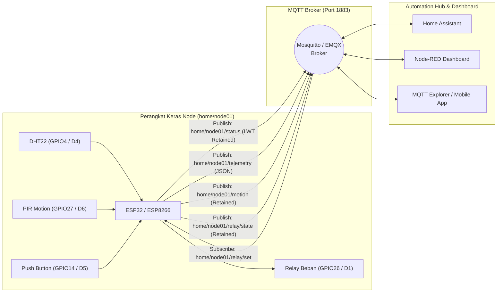

# Panduan Pengkabelan (Wiring Guide) — 04 MQTT Home Automation Hub

Dokumen ini menjelaskan pengkabelan antara mikrokontroler (**ESP32** atau **ESP8266 NodeMCU**), sensor suhu & kelembapan **DHT22**, sensor gerak **PIR HC-SR501**, modul **Relay**, dan tombol fisik **Manual Override**, serta arsitektur topik MQTT.

---

## 1. Tabel Pinout (ESP32 vs ESP8266)

Kode program di [`mqtt_home_automation.ino`](../src/mqtt_home_automation/mqtt_home_automation.ino) secara otomatis memilih konfigurasi pin berikut berdasarkan arsitektur board:

| Komponen | Pin Modul | Pin ESP32 (DevKit V1) | Pin ESP8266 (NodeMCU) | Keterangan |
| :--- | :--- | :--- | :--- | :--- |
| **Sensor DHT22** | `VCC` (`+`) | `3V3` (3.3V) | `3V3` (3.3V) | Catu daya sensor suhu & kelembapan |
| **Sensor DHT22** | `DATA` / `SDA` | `GPIO 4` | `D4` (`GPIO 2`) | Jalur data *single-wire* (disarankan resistor pull-up 10kΩ ke 3.3V jika menggunakan DHT22 bare-4-pin) |
| **Sensor DHT22** | `GND` (`-`) | `GND` | `GND` | Ground bersama |
| **Sensor PIR HC-SR501** | `VCC` | `VIN` (5V) | `VIN` / `VU` (5V) | Catu daya sensor gerak PIR (5V DC) |
| **Sensor PIR HC-SR501** | `OUT` | `GPIO 27` | `D6` (`GPIO 12`) | Output logika `3.3V` (`HIGH` saat ada gerakan) |
| **Sensor PIR HC-SR501** | `GND` | `GND` | `GND` | Ground bersama |
| **Modul Relay** | `VCC` | `VIN` (5V) | `VIN` / `VU` (5V) | Catu daya koil relay 5V |
| **Modul Relay** | `IN` | `GPIO 26` | `D1` (`GPIO 5`) | Output digital kontrol beban lampu |
| **Modul Relay** | `GND` | `GND` | `GND` | Ground bersama |
| **Push Button Override** | Kaki 1 | `GPIO 14` | `D5` (`GPIO 14`) | Mode `INPUT_PULLUP` internal |
| **Push Button Override** | Kaki 2 | `GND` | `GND` | Ditekan = terhubung ke `GND` (`LOW`) |
| **Indikator Status MQTT** | Anoda | `GPIO 2` (Onboard) | `LED_BUILTIN` | Menyala saat terhubung ke MQTT Broker |

---

## 2. Diagram Topologi Arsitektur MQTT Hub

---

## 3. Desain Arsitektur Publish-Subscribe & Last Will (LWT)

1. **Decoupled Communication:** Node ESP32/ESP8266 tidak perlu mengetahui alamat IP dashboard (Home Assistant, Node-RED, atau aplikasi smartphone). Ia cukup terhubung ke satu **MQTT Broker**.
2. **Last Will and Testament (LWT):** Saat mikrokontroler melakukan *handshake* koneksi ke broker, ia mendaftarkan pesan wasiat (`"offline"`, `retained = true`) pada topik `home/node01/status`. Begitu koneksi berhasil, node langsung menimpanya dengan pesan `"online"` (`retained = true`). Apabila listrik padam atau Wi-Fi node terputus tiba-tiba, MQTT Broker otomatis menyiarkan `"offline"` ke seluruh dashboard.
3. **Retained State Sync:** Status aktual relay dipublikasikan ke `home/node01/relay/state` dengan flag `retained = true`. Saat saklar ditekan secara manual melalui tombol fisik dinding maupun lewat perintah MQTT `home/node01/relay/set`, status terbaru di dashboard akan langsung sinkron.

---

## 4. Peringatan Keselamatan Tegangan Tinggi (AC 220V)

> [!WARNING]
> Jika terminal output relay (`COM` dan `NO`) dihubungkan ke lampu atau peralatan listrik **AC 220V**:
> 1. **Matikan MCB atau cabut steker listrik** sebelum menyambung kabel pada terminal sekrup relay.
> 2. Hanya putuskan jalur **Fasa (Live / L)** melalui terminal `COM` dan `NO` relay.
> 3. Gunakan kotak pelindung (*enclosure* isolator) agar jalur PCB relay bertegangan tinggi tidak tersentuh.
