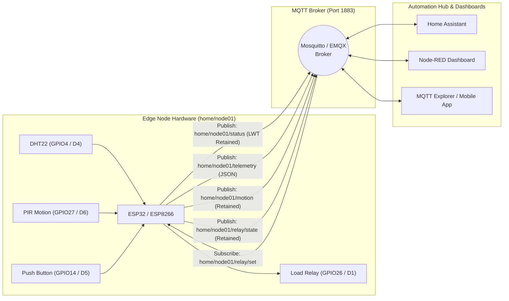

# Hardware Wiring & Publish-Subscribe Topology — 04 MQTT Home Automation Hub

This document details the electrical wiring between the microcontroller (**ESP32** or **ESP8266 NodeMCU**), the **DHT22** temperature/humidity sensor, the **HC-SR501 PIR** motion sensor, the **Relay Module**, and the physical **Manual Override** push button, along with the MQTT broker topology.

---

## 1. Pinout Mapping Table (ESP32 vs. ESP8266)

The firmware in [`mqtt_home_automation.ino`](../src/mqtt_home_automation/mqtt_home_automation.ino) automatically selects the following pin mapping based on the target board architecture:

| Component | Module Pin | ESP32 (DevKit V1) | ESP8266 (NodeMCU) | Electrical Function & Notes |
| :--- | :--- | :--- | :--- | :--- |
| **DHT22 Sensor** | `VCC` (`+`) | `3V3` (3.3V) | `3V3` (3.3V) | Regulated 3.3V supply rail |
| **DHT22 Sensor** | `DATA` / `SDA` | `GPIO 4` | `D4` (`GPIO 2`) | Single-wire digital data bus (add 10 kΩ pull-up to 3.3V if using bare 4-pin sensor) |
| **DHT22 Sensor** | `GND` (`-`) | `GND` | `GND` | Common ground reference |
| **PIR HC-SR501 Sensor** | `VCC` | `VIN` (5V) | `VIN` / `VU` (5V) | 5V DC supply required by HC-SR501 onboard regulator |
| **PIR HC-SR501 Sensor** | `OUT` | `GPIO 27` | `D6` (`GPIO 12`) | 3.3V CMOS logic output (`HIGH` when motion detected) |
| **PIR HC-SR501 Sensor** | `GND` | `GND` | `GND` | Common ground reference |
| **Relay Module** | `VCC` | `VIN` (5V) | `VIN` / `VU` (5V) | 5V DC supply for relay coil |
| **Relay Module** | `IN` | `GPIO 26` | `D1` (`GPIO 5`) | Digital output controlling relay driver |
| **Relay Module** | `GND` | `GND` | `GND` | Common ground reference |
| **Override Push Button** | Terminal 1 | `GPIO 14` | `D5` (`GPIO 14`) | Internal pull-up (`INPUT_PULLUP`), active `LOW` |
| **Override Push Button** | Terminal 2 | `GND` | `GND` | Ground reference (`0V` when pressed) |
| **MQTT Status LED** | Anode | `GPIO 2` (Onboard) | `LED_BUILTIN` | Solid ON when connected to the MQTT Broker |

---

## 2. MQTT Publish-Subscribe Architecture Diagram

---

## 3. Publish-Subscribe Design & Last Will and Testament (LWT)

1. **Spatial & Temporal Decoupling:** The edge node (`ESP32`/`ESP8266`) does not need to know the IP addresses or ports of downstream consumers (Home Assistant, Node-RED, or mobile dashboards). It establishes a single outbound TCP connection to the **MQTT Broker**.
2. **Last Will and Testament (LWT):** During the MQTT `CONNECT` packet exchange, the microcontroller registers an LWT payload (`"offline"`, `retained = true`) on `home/node01/status`. Immediately after `CONNACK` succeeds, the node publishes `"online"` (`retained = true`) to the same topic. If power fails or Wi-Fi drops and the keep-alive timer (`15 seconds`) expires on the broker, the broker automatically broadcasts `"offline"` to all subscribed dashboards.
3. **Authoritative Retained State Sync:** Whenever the relay changes state—either via a local button press or an inbound command on `home/node01/relay/set`—the node publishes the resulting state (`"ON"` or `"OFF"`) to `home/node01/relay/state` with `retained = true`. Newly connected dashboards immediately receive the current relay state upon subscribing without waiting for the next telemetry cycle.

---

## 4. High-Voltage AC Mains Safety Precautions (110V–240V AC)

> [!WARNING]
> If connecting the relay output terminals (`COM` and `NO`) to **110V–240V AC** lighting or appliances:
> 1. **De-energize the Circuit:** Turn off the main circuit breaker or unplug the AC cord before wiring the relay screw terminals.
> 2. **Switch the Phase (`L`) Conductor Only:** Wire only the **Live/Phase (`L`)** conductor through the `COM` and `NO` contacts.
> 3. **Protective Enclosure:** House the relay module inside an insulated enclosure to prevent accidental contact with high-voltage PCB traces.
