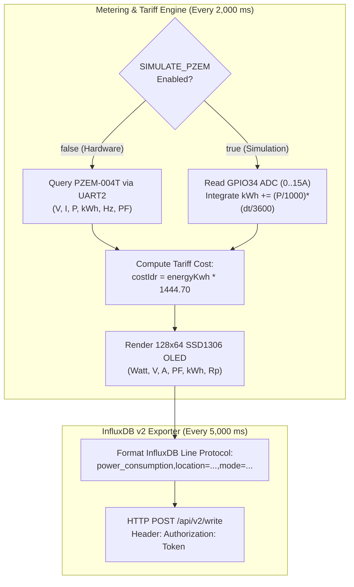

# 05 — Single-Phase Smart Energy Meter (Modbus-RTU PZEM-004T v3.0 & InfluxDB v2)

**Difficulty Level:** Intermediate (Modbus-RTU over UART2, Real-Power & Billing Integration, InfluxDB v2 Line Protocol)  
**Target Architecture:** Espressif ESP32 (`HardwareSerial` UART2 + I2C SSD1306 OLED)

---

## 1. Architectural Overview & System Design

This project implements a single-phase AC smart energy analyzer and billing estimator using an **ESP32** microcontroller interfaced with a **Peacefair PZEM-004T v3.0 (100A split-core CT)** power metering module over opto-isolated UART (`Modbus-RTU`). The system acquires six fundamental AC electrical parameters, computes cumulative energy expenditure based on configurable utility tariff rates (Indonesian PLN tariff in **IDR / Rp**), renders live power telemetry on a local **0.96" SSD1306 I2C OLED**, and streams high-precision time-series records via **InfluxDB v2 Line Protocol** for visualization in **Grafana**.

To enable safe bench testing and classroom simulation without exposing users to **220V AC** mains voltage, the firmware includes a deterministic **Hardware-in-the-Loop Simulation Mode (`SIMULATE_PZEM`)** driven by an analog potentiometer on `GPIO 34`.

### Core Engineering Capabilities
- **6-Parameter AC Metrology:** Polls RMS Voltage ($V_{\text{rms}}$), RMS Current ($I_{\text{rms}}$), Active Power ($P = V \cdot I \cdot \cos\varphi$), Cumulative Active Energy ($\text{kWh}$), Line Frequency ($f$ in $\text{Hz}$), and Power Factor ($\cos\varphi$) over `HardwareSerial(2)` (`RX2 = GPIO 16`, `TX2 = GPIO 17`).
- **Utility Tariff Billing Engine:** Continuously computes estimated electricity cost in **Indonesian Rupiah (IDR)** using configurable utility tariff tiers (defaulting to PLN R-1 Non-Subsidized tariff at `Rp 1,444.70 / kWh`).
- **Compile-Time Dual Mode (`SIMULATE_PZEM`):** Toggling `#define SIMULATE_PZEM` switches between physical Modbus-RTU acquisition (`false`) and a realistic synthetic AC load model (`true`) that models sag voltage, reactive power factor variation ($0.85 \le \cos\varphi \le 0.98$), and time-integrated energy accumulation ($\Delta E = \frac{P}{1000} \cdot \frac{\Delta t}{3600}$).
- **Zero-Overhead InfluxDB v2 Ingestion:** Constructs native InfluxDB Line Protocol payloads (`measurement,tags fields`) and dispatches them over HTTP `POST /api/v2/write` with token-based authentication.

---

## 2. Hardware Bill of Materials (BOM) & Peripheral Interface Specs

| Component | Quantity | Interface / Protocol | Electrical Specification | Notes |
| :--- | :---: | :--- | :--- | :--- |
| **ESP32 DevKit V1** | 1 | `UART2` + `I2C` + `ADC1` + Wi-Fi | 3.3V CMOS logic (`5V` via USB `VIN`) | Primary telemetry processor |
| **Peacefair PZEM-004T v3.0 + 100A CT** | 1 | UART TTL (`9600 8N1` Modbus-RTU) | HV Side: 80–260V AC, 0–100A; LV Side: 3.3V/5V opto-isolated | Galvanically isolated via onboard optocouplers |
| **0.96" OLED Display (SSD1306)** | 1 | I2C (`0x3C`) | 3.3V DC, 128×64 monochrome | Local real-time wattmeter & billing display |
| **10 kΩ Linear Potentiometer** | 1 | Analog Input (`ADC1_CH6`) | 0V–3.3V analog wiper | Used in Wokwi / bench simulation (`0–15 A` load) |

### Pin Assignment Matrix

| Functional Signal | Module Terminal | ESP32 GPIO | Electrical Configuration |
| :--- | :--- | :---: | :--- |
| **PZEM-004T UART Transmit** | `TX` | `GPIO 16` (`RX2`) | UART2 Receiver (3.3V logic when PZEM `VCC` = `3V3`) |
| **PZEM-004T UART Receive** | `RX` | `GPIO 17` (`TX2`) | UART2 Transmitter |
| **OLED I2C Data** | `SDA` | `GPIO 21` | Open-drain I2C Data |
| **OLED I2C Clock** | `SCL` | `GPIO 22` | Open-drain I2C Clock |
| **Simulated Load Wiper** | `SIG` | `GPIO 34` (`ADC1_CH6`) | 12-bit SAR ADC input (`SIMULATE_PZEM = true`) |
| **Status Indicator LED** | `LED_PIN` | `GPIO 2` | Onboard status LED |

---

## 3. Firmware Architecture & Non-Blocking State Machine Design

The firmware ([`smart_energy_meter.ino`](./src/smart_energy_meter/smart_energy_meter.ino)) decouples high-rate local metering and OLED rendering (`2,000 ms`) from time-series database ingestion (`5,000 ms`):



---

## 4. Directory Structure

```text
05-smart-energy-meter/
├── README.md                              # System architecture, BOM, metrology & build guide
├── src/
│   └── smart_energy_meter/
│       ├── smart_energy_meter.ino         # Main ESP32 firmware (PZEM-004T / Sim + InfluxDB v2)
│       └── secrets.example.h              # Wi-Fi & InfluxDB v2 configuration template
├── schematics/
│   ├── diagram.json                       # Wokwi circuit netlist (ESP32 + SSD1306 + Potentiometer)
│   └── wiring-guide.md                    # High-voltage AC CT wiring, opto-isolation & UART guide
└── docs/
    └── influxdb-and-grafana-setup.md      # Docker Compose stack, Line Protocol spec & Flux queries
```

---

## 5. Build, Flashing & Wokwi Simulation Instructions

### Required Arduino Libraries
Install via **Arduino IDE Library Manager** or `arduino-cli`:
1. **`Adafruit SSD1306`** by *Adafruit*
2. **`Adafruit GFX Library`** by *Adafruit*
3. **`PZEM004Tv30`** by *Jakub Mandula* *(required when compiling for physical PZEM-004T hardware with `SIMULATE_PZEM false`)*

### A. Building & Flashing via Arduino IDE (Physical Hardware)
1. Copy the configuration template:
   ```bash
   cp src/smart_energy_meter/secrets.example.h src/smart_energy_meter/secrets.h
   ```
2. Populate `src/smart_energy_meter/secrets.h` with your Wi-Fi credentials and InfluxDB v2 parameters (`INFLUXDB_URL`, `INFLUXDB_TOKEN`, `INFLUXDB_ORG`, `INFLUXDB_BUCKET`) as detailed in [`docs/influxdb-and-grafana-setup.md`](./docs/influxdb-and-grafana-setup.md).
3. Open [`src/smart_energy_meter/smart_energy_meter.ino`](./src/smart_energy_meter/smart_energy_meter.ino):
   - Set `#define SIMULATE_PZEM false` when wired to a physical **PZEM-004T v3.0** sensor.
   - Leave `#define SIMULATE_PZEM true` for safe low-voltage potentiometer testing.
4. Select **DOIT ESP32 DEVKIT V1**, upload the firmware, and monitor output at **`115200` baud**.

### B. Building & Flashing via Arduino CLI
```bash
arduino-cli lib install "Adafruit SSD1306" "Adafruit GFX Library" "PZEM004Tv30"
arduino-cli compile --fqbn esp32:esp32:esp32 src/smart_energy_meter
arduino-cli upload -p /dev/ttyUSB0 --fqbn esp32:esp32:esp32 src/smart_energy_meter
```

### C. Running in Wokwi Simulator
1. Open the [Wokwi ESP32 Simulator](https://wokwi.com/projects/new/esp32) or **Wokwi for VS Code**.
2. Load [`smart_energy_meter.ino`](./src/smart_energy_meter/smart_energy_meter.ino) and [`schematics/diagram.json`](./schematics/diagram.json), and include `Adafruit SSD1306` and `Adafruit GFX Library`.
3. Start the simulation and rotate the **Potentiometer** knob to vary the simulated AC current (`0–15 A`) and observe real-time Active Power (`W`), Cumulative Energy (`kWh`), and Billing (`Rp`) updates on the OLED display and UART console.
