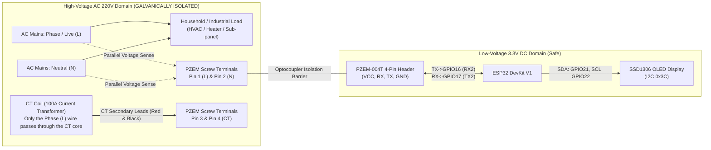

# Hardware Wiring & High-Voltage CT Safety Guide — 05 Smart Energy Meter (PZEM-004T v3.0)

This document specifies the electrical interconnections between the **ESP32**, the **Peacefair PZEM-004T v3.0 (100A Split-Core Current Transformer)** module, the **SSD1306 I2C OLED** display, and the Wokwi load simulation potentiometer.

---

## 1. ESP32 Pinout Mapping Table

The firmware in [`smart_energy_meter.ino`](../src/smart_energy_meter/smart_energy_meter.ino) uses the following pin assignments:

| Component | Module Terminal | ESP32 (DevKit V1) | Electrical Function & Notes |
| :--- | :--- | :--- | :--- |
| **PZEM-004T v3.0 (LV TTL)** | `5V` (`VCC`) | `3V3` or `VIN` (5V)* | Low-voltage optocoupler supply (*Connect to `3V3` so PZEM `TX` operates at 3.3V CMOS logic*) |
| **PZEM-004T v3.0 (LV TTL)** | `RX` | `GPIO 17` (`TX2`) | HardwareSerial UART2 Transmit (`ESP32 TX2` $\rightarrow$ `PZEM RX`) |
| **PZEM-004T v3.0 (LV TTL)** | `TX` | `GPIO 16` (`RX2`) | HardwareSerial UART2 Receive (`PZEM TX` $\rightarrow$ `ESP32 RX2`) |
| **PZEM-004T v3.0 (LV TTL)** | `GND` | `GND` | Galvanically isolated low-voltage DC ground |
| **OLED SSD1306 (0.96")** | `VCC` | `3V3` (3.3V) | I2C OLED display power supply |
| **OLED SSD1306 (0.96")** | `GND` | `GND` | Common DC ground |
| **OLED SSD1306 (0.96")** | `SDA` | `GPIO 21` | I2C Serial Data |
| **OLED SSD1306 (0.96")** | `SCL` | `GPIO 22` | I2C Serial Clock |
| **Potentiometer (Wokwi Sim)** | `SIG` | `GPIO 34` (`ADC1_CH6`) | Active when `SIMULATE_PZEM = true` to emulate `0–15 A` AC load |

> [!TIP]
> **3.3V Logic Level Compatibility with PZEM-004T v3.0:**
> The TTL communication header on the PZEM-004T v3.0 drives its output through passive internal optocouplers pulled up to the header's `5V` (`VCC`) pin. By powering the PZEM 4-pin header's `VCC` pin from the ESP32's **`3V3` (3.3V)** rail instead of `5V`, the `TX` return signal from the PZEM is clamped directly to **3.3V**, making it 100% safe for ESP32 GPIO pins without an external logic-level shifter.

---

## 2. Low-Voltage UART & High-Voltage AC 220V Wiring Topology

---

## 3. Current Transformer (CT) Clamp Installation Rules

1. **Clamp Only a Single Conductor (Phase/Live Only):**
   Route **only the Live/Phase (`L`) wire** (or only the Neutral wire, never both) through the aperture of the Current Transformer ring. If both Live and Neutral conductors pass through the CT core together, their opposing magnetic fields ($\vec{B}_L + \vec{B}_N = 0$) cancel out according to Ampère's law, resulting in a constant **`0.00 A`** reading regardless of load power.
2. **Never Open-Circuit a Live CT Secondary Winding:**
   Always fasten the red and black secondary leads of the CT coil securely to screw terminals `3` and `4` on the PZEM-004T **before** clamping the CT around an energized AC conductor. An open-circuited current transformer secondary under load develops dangerously high peak voltages across its leads.

---

## 4. High-Voltage AC Mains Safety Precautions (220V AC)

> [!CAUTION]
> **LETHAL HIGH-VOLTAGE HAZARD (220V AC MAINS):**
> 1. The high-voltage side of the PZEM-004T v3.0 connects directly across **220V AC mains** at screw terminals `1` and `2`. **Switch off the main Miniature Circuit Breaker (MCB)** and verify zero potential with a multimeter before wiring.
> 2. Never touch the high-voltage shunt resistor or PCB traces while energized. Always keep the PZEM-004T inside its protective snap-fit plastic enclosure.
> 3. For firmware development, InfluxDB/Grafana dashboard testing, or classroom demonstrations without high-voltage exposure, set **`#define SIMULATE_PZEM true`** and vary the analog voltage on `GPIO 34`.
