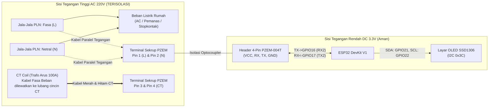

# Panduan Pengkabelan (Wiring Guide) — 05 Smart Energy Meter (PZEM-004T v3.0)

Dokumen ini menjelaskan pengkabelan antara **ESP32**, modul sensor daya **Peacefair PZEM-004T v3.0 (100A CT Coil)**, layar **OLED SSD1306 I2C**, serta komponen simulasi beban di Wokwi.

---

## 1. Tabel Pinout ESP32

Kode program di [`smart_energy_meter.ino`](../src/smart_energy_meter/smart_energy_meter.ino) menggunakan konfigurasi pin berikut:

| Komponen | Pin Modul | Pin ESP32 (DevKit V1) | Keterangan |
| :--- | :--- | :--- | :--- |
| **PZEM-004T v3.0 (LV TTL)** | `5V` (`VCC`) | `3V3` atau `VIN` (5V)* | Catu daya sisi logika optocoupler PZEM (*Disarankan `3V3` agar level sinyal TX aman untuk GPIO ESP32*) |
| **PZEM-004T v3.0 (LV TTL)** | `RX` | `GPIO 17` (`TX2`) | Komunikasi Serial UART2 (ESP32 `TX2` -> PZEM `RX`) |
| **PZEM-004T v3.0 (LV TTL)** | `TX` | `GPIO 16` (`RX2`) | Komunikasi Serial UART2 (PZEM `TX` -> ESP32 `RX2`) |
| **PZEM-004T v3.0 (LV TTL)** | `GND` | `GND` | Ground sisi logika bertegangan rendah |
| **OLED SSD1306 (0.96")** | `VCC` | `3V3` (3.3V) | Catu daya layar OLED I2C |
| **OLED SSD1306 (0.96")** | `GND` | `GND` | Ground bersama |
| **OLED SSD1306 (0.96")** | `SDA` | `GPIO 21` | Jalur Data I2C |
| **OLED SSD1306 (0.96")** | `SCL` | `GPIO 22` | Jalur Clock I2C |
| **Potensiometer (Simulasi Wokwi)** | `SIG` | `GPIO 34` (`ADC1_CH6`) | Hanya digunakan saat `SIMULATE_PZEM = true` untuk menyimulasikan arus `0 - 15 A` |

> [!TIP]
> **Tips Kompatibilitas Tegangan Logika PZEM-004T v3.0 dengan ESP32:**
> Sisi komunikasi TTL pada PZEM-004T v3.0 menggunakan *optocoupler* pasif internal. Jika pin `5V` pada header 4-pin PZEM dihubungkan ke pin **`3V3` (3.3V)** pada ESP32, maka tegangan sinyal balasan `TX` dari PZEM otomatis bekerja pada level **3.3V** yang 100% aman bagi GPIO ESP32 tanpa perlu *logic level shifter* tambahan.

---

## 2. Diagram Pengkabelan Sisi Tegangan Rendah (UART) & Sisi Tegangan Tinggi (AC 220V)

---

## 3. Aturan Pemasangan Cincin CT (*Current Transformer*)

1. **Hanya 1 Kabel (Fasa / Live) yang Masuk ke Cincin CT:**
   Jangan memasukkan kabel Fasa dan Netral sekaligus ke dalam lubang cincin CT! Jika kedua kabel dimasukkan bersamaan, medan magnet yang dihasilkan saling meniadakan sehingga pembacaan arus (`Ampere`) akan selalu bernilai **`0.00 A`**.
2. **Jangan Membuka Sambungan Kabel CT Saat Berbeban:**
   Pastikan kabel merah dan hitam dari cincin CT sudah terpasang kencang pada terminal sekrup nomor `3` dan `4` di modul PZEM-004T **sebelum** mengaliri arus listrik AC 220V pada beban.

---

## 4. Peringatan Keselamatan Tegangan Tinggi (AC 220V)

> [!CAUTION]
> **BAHAYA SENGATAN LISTRIK TEGANGAN TINGGI (AC 220V):**
> 1. Modul PZEM-004T v3.0 terhubung langsung ke jala-jala listrik **PLN AC 220V** pada terminal sekrupnya. **Wajib mematikan MCB utama** atau mencabut steker listrik sebelum merangkai kabel!
> 2. Jangan pernah menyentuh bagian bawah PCB PZEM-004T saat terhubung ke listrik AC 220V. Gunakan *case* / kotak pelindung plastik bawaan PZEM-004T.
> 3. Untuk belajar pemrograman, pengujian dashboard InfluxDB/Grafana, atau demonstrasi kelas tanpa risiko tegangan tinggi, gunakan mode **`#define SIMULATE_PZEM true`** dengan memutar potensiometer pada `GPIO 34`.
