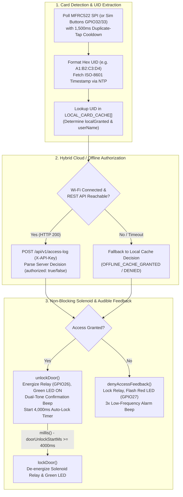

# 06 — RFID Smart Door Lock with REST Audit Logging & Offline Cache Fallback

**Difficulty Level:** Intermediate (SPI MFRC522 Interfacing, NTP ISO-8601 Timekeeping, FastAPI Audit Backend & Offline Failover)  
**Target Architecture:** Espressif ESP32 (VSPI + SNTP + HTTP REST Client + Non-Blocking Solenoid Driver)

---

## 1. Architectural Overview & System Design

This project implements an enterprise-style **13.56 MHz HF RFID (ISO/IEC 14443A MIFARE) Access Control Terminal** using an **ESP32** and an **MFRC522** SPI transceiver. Upon detecting a proximity card or keyfob, the terminal extracts the card's Unique Identifier (UID), stamps the event with an **ISO-8601** wall-clock timestamp synchronized via **SNTP (`pool.ntp.org`)**, and dispatches an authenticated HTTP `POST` request (`X-API-Key`) to a **Python FastAPI + SQLite** backend server for central authorization and audit logging.

To guarantee high availability during Wi-Fi dropouts or backend server maintenance, the firmware implements a **Hybrid Cloud + Local Cache Failover Architecture**: if the HTTP REST transaction times out or is unreachable, the ESP32 seamlessly falls back to an onboard **Local Whitelist Cache (`LOCAL_CARD_CACHE[]`)** so authorized personnel are never locked out.

### Core Engineering Capabilities
- **SPI MFRC522 Cryptographic Session Teardown:** Reads 4-byte, 7-byte, or 10-byte UIDs over hardware VSPI (`SCK=18`, `MISO=19`, `MOSI=23`, `CS=5`) and immediately executes `PICC_HaltA()` and `PCD_StopCrypto1()` to prevent duplicate reads while a card remains against the bezel.
- **RFC 3339 / ISO-8601 SNTP Timestamping:** Synchronizes the ESP32 internal RTC against `pool.ntp.org` and `time.google.com` (`UTC+7` offset) to generate forensic audit timestamps (`YYYY-MM-DDTHH:MM:SS+07:00`).
- **Authenticated REST API + Offline Cache Failover:** Transmits JSON audit payloads to `/api/v1/access-log` with an `X-API-Key` header (`2,500 ms` HTTP timeout) and automatically evaluates the local ROM whitelist when offline.
- **Non-Blocking Auto-Relock State Machine:** Energizes the 12V DC solenoid relay for `UNLOCK_DURATION_MS` (`4,000 ms`) using `millis()` tracking while driving dual status LEDs (Green/Red) and acoustic PWM feedback (`tone()`).

---

## 2. Hardware Bill of Materials (BOM) & Peripheral Interface Specs

| Component | Quantity | Interface / Protocol | Electrical Specification | Notes |
| :--- | :---: | :--- | :--- | :--- |
| **ESP32 DevKit V1** | 1 | Hardware VSPI + GPIO + Wi-Fi | 3.3V CMOS logic | Primary access controller |
| **MFRC522 13.56 MHz RFID Reader** | 1 | 4-Wire SPI (`Mode 0`, up to 10 MHz) | **3.3V DC strict** (`26 mA` active) | ISO/IEC 14443A MIFARE reader + tags |
| **1-Channel 5V Opto-Isolated Relay** | 1 | Digital GPIO Output | 5V DC coil, 10A/250VAC contacts | Switches 12V DC rail to solenoid lock |
| **12V DC Fail-Secure Solenoid Lock** | 1 | Relay Dry Contact (`COM`/`NO`) | 12V DC, `0.8A–1.2A` pull-in current | Retracts deadbolt latch when energized |
| **1N4007 Rectifier Diode** | 1 | Parallel Reverse-Biased across Solenoid | $V_{RRM} = 1000\text{V}$, $I_F = 1\text{A}$ | Suppresses inductive kickback on relock |
| **Green & Red LEDs + 220 Ω Resistors** | 2 | Digital GPIO Output | 3.3V GPIO drive | Visual Granted / Denied indicators |
| **Piezo Buzzer** | 1 | PWM / Digital GPIO Output | 3.3V–5V acoustic transducer | Audible access granted/alarm tones |

### Pin Assignment Matrix

| Functional Signal | Module Terminal | ESP32 GPIO (VSPI) | Reference ESP8266 Pin | Electrical Configuration |
| :--- | :--- | :---: | :---: | :--- |
| **MFRC522 Power Supply** | `3.3V` (`VCC`) | `3V3` (3.3V) | `3V3` (3.3V) | **Strict 3.3V DC** (5V destroys MFRC522 IC) |
| **MFRC522 Hardware Reset** | `RST` | `GPIO 22` | `D3` (`GPIO 0`) | Digital output reset control |
| **SPI Chip Select (SS)** | `SDA` (`SS`/`CS`) | `GPIO 5` | `D8` (`GPIO 15`) | Active-LOW SPI Slave Select |
| **SPI Serial Clock** | `SCK` | `GPIO 18` | `D5` (`GPIO 14`) | VSPI Hardware Clock |
| **SPI Master Out Slave In** | `MOSI` | `GPIO 23` | `D7` (`GPIO 13`) | VSPI MOSI |
| **SPI Master In Slave Out** | `MISO` | `GPIO 19` | `D6` (`GPIO 12`) | VSPI MISO |
| **Solenoid Relay Driver** | `IN` | `GPIO 26` | `D1` (`GPIO 5`) | Push-pull digital output |
| **Access Granted LED (Green)**| Anode (`+`) | `GPIO 25` | `D2` (`GPIO 4`) | Digital output via 220 Ω series resistor |
| **Access Denied LED (Red)** | Anode (`+`) | `GPIO 27` | `D0` (`GPIO 16`) | Digital output via 220 Ω series resistor |
| **Acoustic Buzzer** | Positive (`+`) | `GPIO 14` | `RX` (`GPIO 3`) | PWM tone output |
| **Simulated Valid Card Btn** | Terminal 1 | `GPIO 32` | — | Wokwi simulation input (`INPUT_PULLUP`) |
| **Simulated Denied Card Btn** | Terminal 1 | `GPIO 33` | — | Wokwi simulation input (`INPUT_PULLUP`) |

---

## 3. Firmware Architecture & Non-Blocking State Machine Design

The access controller ([`rfid_smart_door_lock.ino`](./src/rfid_smart_door_lock/rfid_smart_door_lock.ino)) processes RFID card scans and manages door relocking asynchronously:



---

## 4. Directory Structure

```text
06-rfid-smart-door-lock/
├── README.md                              # System architecture, BOM, hybrid failover & build guide
├── src/
│   └── rfid_smart_door_lock/
│       ├── rfid_smart_door_lock.ino       # Main ESP32 firmware (MFRC522 + NTP + REST API + Cache)
│       └── secrets.example.h              # Wi-Fi & REST API endpoint/key template
├── schematics/
│   ├── diagram.json                       # Wokwi circuit netlist (ESP32 + Sim Buttons + Relay + LEDs)
│   └── wiring-guide.md                    # SPI RC522 pinout & 12V Solenoid + 1N4007 flyback protection
└── docs/
    └── backend-api-and-logs.md            # Production Python FastAPI + SQLite backend & UART logs
```

---

## 5. Build, Flashing & Wokwi Simulation Instructions

### Required Arduino Libraries
Install via **Arduino IDE Library Manager** or `arduino-cli`:
1. **`MFRC522`** by *GithubCommunity* (Miguel Balboa)

### A. Building & Flashing via Arduino IDE (Physical Hardware)
1. Copy the configuration template:
   ```bash
   cp src/rfid_smart_door_lock/secrets.example.h src/rfid_smart_door_lock/secrets.h
   ```
2. Edit `src/rfid_smart_door_lock/secrets.h` with your `WIFI_SSID`, `WIFI_PASSWORD`, `API_ENDPOINT_URL`, and `API_SECRET_KEY`.
3. *(Optional)* Start the Python FastAPI + SQLite audit backend on your workstation following [`docs/backend-api-and-logs.md`](./docs/backend-api-and-logs.md).
4. Open [`src/rfid_smart_door_lock/rfid_smart_door_lock.ino`](./src/rfid_smart_door_lock/rfid_smart_door_lock.ino), select **DOIT ESP32 DEVKIT V1**, wire the MFRC522 and solenoid relay per [`schematics/wiring-guide.md`](./schematics/wiring-guide.md), and upload.

### B. Building & Flashing via Arduino CLI
```bash
arduino-cli lib install "MFRC522"
arduino-cli compile --fqbn esp32:esp32:esp32 src/rfid_smart_door_lock
arduino-cli upload -p /dev/ttyUSB0 --fqbn esp32:esp32:esp32 src/rfid_smart_door_lock
```

### C. Running in Wokwi Simulator
1. Open the [Wokwi ESP32 Simulator](https://wokwi.com/projects/new/esp32) or **Wokwi for VS Code**.
2. Load [`rfid_smart_door_lock.ino`](./src/rfid_smart_door_lock/rfid_smart_door_lock.ino) and [`schematics/diagram.json`](./schematics/diagram.json), and add the `MFRC522` library.
3. Start the simulation and wait for the `[NTP]` synchronization message in the Serial Monitor:
   - Press the **Green Push Button (`GPIO 32`)** to simulate tapping an **Authorized Master Card (`A1:B2:C3:D4`)** — the solenoid relay and Green LED energize for 4 seconds with a rising confirmation tone before auto-locking.
   - Press the **Red Push Button (`GPIO 33`)** to simulate tapping an **Unauthorized Card (`DE:AD:BE:EF`)** — the Red LED flashes rapidly accompanied by a 3-pulse rejection alarm.
