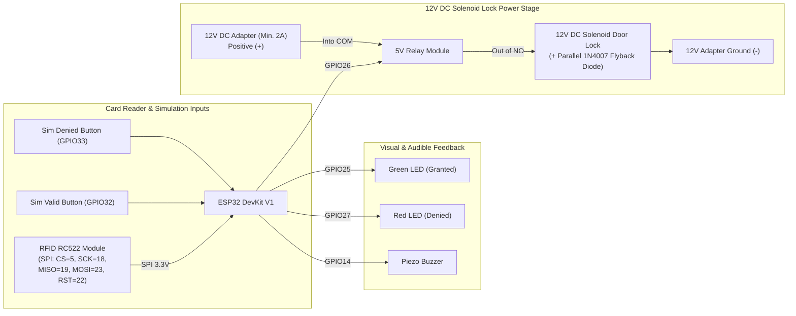

# Hardware Wiring & Solenoid Inductive Snubber Guide — 06 RFID Smart Door Lock

This document specifies the **SPI** bus connections for the **MFRC522 (13.56 MHz)** RFID transceiver, the **12V DC Solenoid Door Lock** driver stage with **1N4007** flyback diode protection, and the visual/audible user feedback peripherals.

---

## 1. SPI MFRC522 & Actuator Pinout Table

The firmware in [`rfid_smart_door_lock.ino`](../src/rfid_smart_door_lock/rfid_smart_door_lock.ino) uses the ESP32 hardware **VSPI** bus (with reference pin mappings provided for ESP8266 adaptation):

| Component | Module Pin | ESP32 (VSPI Default) | Reference ESP8266 (NodeMCU) | Electrical Function & Notes |
| :--- | :--- | :---: | :---: | :--- |
| **RFID RC522** | `3.3V` (`VCC`) | `3V3` (3.3V) | `3V3` (3.3V) | **Strict 3.3V DC!** Never connect to `5V (VIN)` or the MFRC522 IC will be damaged |
| **RFID RC522** | `RST` | `GPIO 22` | `D3` (`GPIO 0`) | Hardware reset line for MFRC522 |
| **RFID RC522** | `GND` | `GND` | `GND` | Common ground reference |
| **RFID RC522** | `IRQ` | *(Unconnected)* | *(Unconnected)* | Optional interrupt pin (unused in polling mode) |
| **RFID RC522** | `MISO` | `GPIO 19` | `D6` (`GPIO 12`) | SPI Master In Slave Out |
| **RFID RC522** | `MOSI` | `GPIO 23` | `D7` (`GPIO 13`) | SPI Master Out Slave In |
| **RFID RC522** | `SCK` | `GPIO 18` | `D5` (`GPIO 14`) | SPI Serial Clock |
| **RFID RC522** | `SDA` (`SS`/`CS`) | `GPIO 5` | `D8` (`GPIO 15`) | SPI Chip Select (Active-LOW) |
| **Solenoid Relay** | `IN` | `GPIO 26` | `D1` (`GPIO 5`) | Digital output driving solenoid relay coil |
| **Green LED** | Anode (`+`) | `GPIO 25` (+ 220 Ω) | `D2` (`GPIO 4`) | Access Granted indicator (Door Unlocked) |
| **Red LED** | Anode (`+`) | `GPIO 27` (+ 220 Ω) | `D0` (`GPIO 16`) | Access Denied indicator |
| **Piezo Buzzer** | Positive (`+`) | `GPIO 14` | `RX` / `GPIO 3` | Audible confirmation / rejection alarm |
| **Valid Card Sim Button** | Terminal 1 | `GPIO 32` | — | Simulates authorized UID tap (`A1:B2:C3:D4`) in Wokwi |
| **Denied Card Sim Button**| Terminal 1 | `GPIO 33` | — | Simulates unauthorized UID tap (`DE:AD:BE:EF`) in Wokwi |

---

## 2. System Block Diagram & 12V DC Solenoid Snubber Topology

---

## 3. Suppressing Inductive Kickback with a 1N4007 Flyback Diode

> [!IMPORTANT]
> **Why Does the ESP32 Reboot When the Solenoid Relocks?**
> A 12V DC solenoid door lock is a heavy inductive coil ($L$) that draws `0.8A – 1.2A` when energized. At the instant the relay contacts open to relock the door, $\frac{di}{dt}$ is large and negative, causing the collapsing magnetic field to induce a reverse voltage spike ($V = -L \frac{di}{dt}$) reaching **hundreds of volts**. Without suppression, this spike arcs across the relay contacts and couples electromagnetic interference (EMI) into the ESP32 power rails and SPI bus, triggering brownout or watchdog resets.

### Installing the 1N4007 Clamping Diode (Reverse-Biased):
1. Wire a **1N4007** rectifier diode (or **1N5819** Schottky diode) directly **in parallel** across the red and black leads of the 12V solenoid lock:
   - **Diode Cathode (silver/white band)** $\rightarrow$ Solenoid **Positive (`+12V`)** lead (connected to Relay `NO`).
   - **Diode Anode (unbanded side)** $\rightarrow$ Solenoid **Negative (`GND`)** lead.
2. When the relay opens, the induced current recirculates safely through the forward-biased diode loop and dissipates in the coil's DC resistance.
3. Always use a **dedicated 12V DC / 2A power adapter** for the solenoid power loop rather than sharing an unregulated rail with the ESP32 logic supply.
