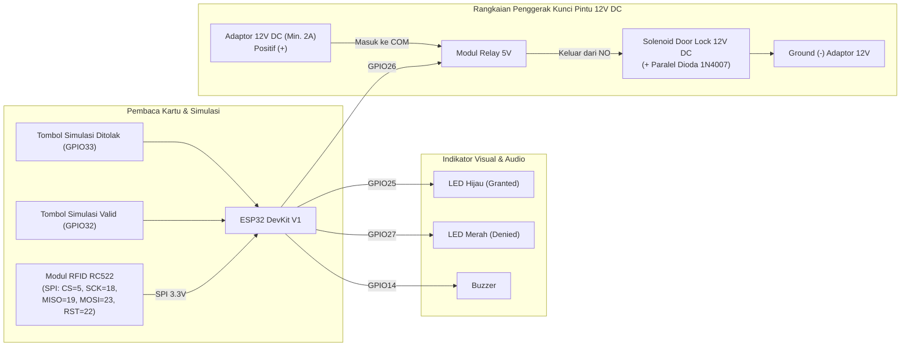

# Panduan Pengkabelan (Wiring Guide) — 06 RFID Smart Door Lock

Dokumen ini menjelaskan pengkabelan bus **SPI** untuk pembaca kartu **RFID RC522 (13.56 MHz)**, rangkaian penggerak **Solenoid Door Lock 12V DC** melalui **Relay** beserta dioda proteksi *flyback* **1N4007**, LED indikator status, dan Buzzer.

---

## 1. Tabel Pinout SPI RFID RC522 & Aktuator

Kode program di [`rfid_smart_door_lock.ino`](../src/rfid_smart_door_lock/rfid_smart_door_lock.ino) menggunakan konfigurasi pin berikut (beserta referensi pin SPI jika diadaptasi ke ESP8266):

| Komponen | Pin Modul | Pin ESP32 (VSPI Default) | Referensi ESP8266 (NodeMCU) | Keterangan |
| :--- | :--- | :--- | :--- | :--- |
| **RFID RC522** | `3.3V` (`VCC`) | `3V3` (3.3V) | `3V3` (3.3V) | **Wajib 3.3V!** Jangan dihubungkan ke 5V (`VIN`) karena dapat merusak chip MFRC522 |
| **RFID RC522** | `RST` | `GPIO 22` | `D3` (`GPIO 0`) | Pin Reset modul RC522 |
| **RFID RC522** | `GND` | `GND` | `GND` | Ground bersama |
| **RFID RC522** | `IRQ` | *(Tidak dihubungkan)* | *(Tidak dihubungkan)* | Pin interupsi (opsional, tidak dipakai) |
| **RFID RC522** | `MISO` | `GPIO 19` | `D6` (`GPIO 12`) | Master In Slave Out (SPI) |
| **RFID RC522** | `MOSI` | `GPIO 23` | `D7` (`GPIO 13`) | Master Out Slave In (SPI) |
| **RFID RC522** | `SCK` | `GPIO 18` | `D5` (`GPIO 14`) | Serial Clock (SPI) |
| **RFID RC522** | `SDA` (`SS`/`CS`) | `GPIO 5` | `D8` (`GPIO 15`) | Slave Select / Chip Select (SPI) |
| **Relay Solenoid** | `IN` | `GPIO 26` | `D1` (`GPIO 5`) | Mengaktifkan koil Solenoid Door Lock |
| **LED Hijau** | Anoda (`+`) | `GPIO 25` (+ R 220Ω) | `D2` (`GPIO 4`) | Indikator Akses Diterima (Pintu Terbuka) |
| **LED Merah** | Anoda (`+`) | `GPIO 27` (+ R 220Ω) | `D0` (`GPIO 16`) | Indikator Akses Ditolak |
| **Buzzer** | Positif (`+`) | `GPIO 14` | `RX` / `GPIO 3` | Bunyi *beep* konfirmasi akses / alarm |
| **Tombol Simulasi Valid** | Kaki 1 | `GPIO 32` | — | Simulasi tap kartu terdaftar (`A1:B2:C3:D4`) di Wokwi |
| **Tombol Simulasi Ditolak**| Kaki 1 | `GPIO 33` | — | Simulasi tap kartu asing (`DE:AD:BE:EF`) di Wokwi |

---

## 2. Diagram Blok Rangkaian & Proteksi Dioda Flyback Solenoid 12V

---

## 3. Cara Memasang Dioda Flyback (1N4007) pada Solenoid 12V DC

> [!IMPORTANT]
> **Mengapa ESP32 Sering *Restart* Sendiri Saat Solenoid Mengunci Kembali?**
> Solenoid Door Lock adalah kumparan induktor besar yang menarik arus sekitar `0.8A - 1.2A` pada tegangan `12V DC`. Saat relay memutus aliran listrik, medan magnet pada kumparan solenoid runtuh dan menghasilkan lonjakan tegangan balik (*back-EMF*) hingga ratusan volt yang dapat menyebabkan *spark* pada kontak relay dan membuat mikrokontroler ESP32 mengalami *reset* (*brownout/EMI*).

### Solusi Pemasangan Dioda 1N4007 (*Reverse-Biased*):
1. Pasang **1 buah dioda 1N4007** secara **paralel** tepat pada kabel merah dan hitam Solenoid Door Lock:
   - **Katoda Dioda (ujung yang ada gelang perak/putih)** dihubungkan ke kabel **Positif (`+12V`)** Solenoid (yang berasal dari terminal `NO` Relay).
   - **Anoda Dioda (ujung polos hitam)** dihubungkan ke kabel **Negatif (`GND`)** Solenoid.
2. Gunakan **Adaptor 12V DC terpisah** khusus untuk beban Solenoid agar lonjakan arus saat solenoid menarik tuas kunci tidak menurunkan tegangan `5V/3.3V` milik ESP32.
