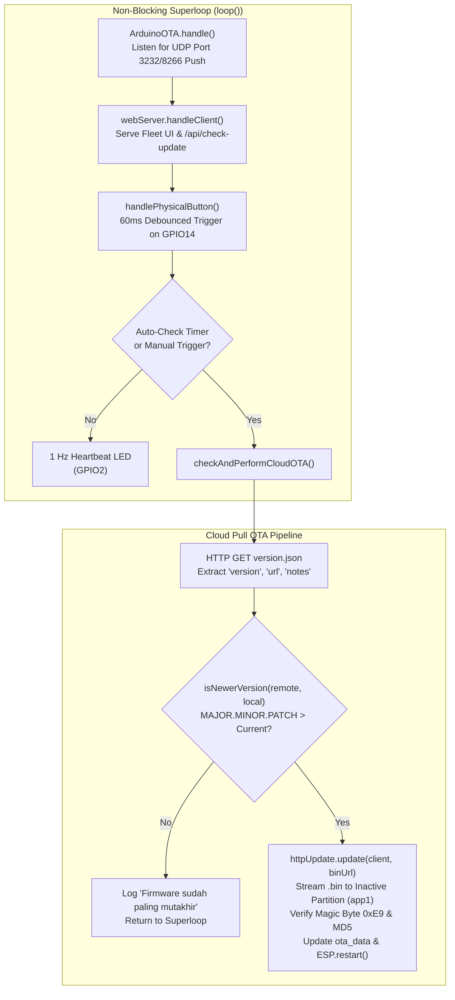

# 07 — Dual-Bank OTA Firmware Update & Fleet Diagnostic Manager

**Difficulty Level:** Advanced (Dual-Partition `app0`/`app1` Ping-Pong Flashing, Semantic Version Gating, Local mDNS Push & Cloud HTTP Pull OTA)  
**Target Architectures:** Espressif ESP32 & ESP8266

---

## 1. Architectural Overview & System Design

In production IoT deployments comprising hundreds of remote sensor nodes mounted on rooftops, agricultural fields, or factory ceilings, physical USB cable tethered reflashing is operationally infeasible. This project implements a fault-tolerant **Over-The-Air (OTA) Firmware Update & Fleet Management Architecture** supporting two complementary update mechanisms alongside a real-time web diagnostic console:

1. **Local Push OTA (`ArduinoOTA.h` over mDNS / UDP-TCP):** Enables rapid workbench and LAN deployment directly from **Arduino IDE** or `espota.py` via network port discovery (`esp-ota-node-01.local`), secured by MD5 challenge-response password authentication and real-time byte-stream progress telemetry (`0%–100%`).
2. **Cloud Pull HTTP/HTTPS OTA (`HTTPUpdate.h` / `ESP8266httpUpdate.h`):** Autonomous fleet rollout mechanism where nodes periodically poll a remote JSON release manifest (`version.json`), parse and compare **Semantic Versioning (`MAJOR.MINOR.PATCH`)** tuples, and stream the compiled `.bin` image into the inactive SPI flash partition (`app0` $\leftrightarrow$ `app1`) if a newer version is published.
3. **Web Fleet Diagnostic Console (`GET /` & `/api/info`):** Embedded HTTP server reporting the active firmware version, build timestamp, currently executing SPI flash partition address (`esp_ota_get_running_partition()`), Wi-Fi RSSI, free heap, and a manual **"Check for Update Now"** trigger (`POST /api/check-update`).

---

## 2. Hardware Bill of Materials (BOM) & Peripheral Interface Specs

| Component | Quantity | Interface / Protocol | Electrical Specification | Notes |
| :--- | :---: | :--- | :--- | :--- |
| **ESP32 DevKit V1** (4 MB Flash) *or* **ESP8266 NodeMCU** | 1 | Quad-SPI Flash + Wi-Fi + GPIO | 3.3V CMOS logic | Requires dual-OTA partition scheme (`app0` + `app1`) |
| **Momentary Tactile Push Button** | 1 | Digital GPIO Input (`INPUT_PULLUP`) | Active-LOW switch to `GND` | Hardware trigger for immediate Cloud OTA check |
| **Status / Heartbeat LED (Blue)** | 1 | Digital GPIO Output | 3.3V via 220 Ω resistor | 1 Hz heartbeat; rapid strobe during flash write |
| **Flashing Activity LED (Green)** | 1 | Digital GPIO Output | 3.3V via 220 Ω resistor | Solid ON while erasing/writing inactive OTA partition |

### Pin Assignment Matrix

| Functional Signal | Component Terminal | ESP32 GPIO | ESP8266 Pin (GPIO) | Electrical Configuration |
| :--- | :--- | :---: | :---: | :--- |
| **OTA Check Trigger Button** | Terminal 1 | `GPIO 14` | `D5` (`GPIO 14`) | Internal pull-up (`INPUT_PULLUP`), active `LOW` |
| **System Heartbeat LED** | Anode (`+`) | `GPIO 2` | `LED_BUILTIN` (`D4`) | 1 Hz normal heartbeat; fast blink during OTA |
| **OTA Flashing Active LED** | Anode (`+`) | `GPIO 26` | `D1` (`GPIO 5`) | Driven `HIGH` during flash partition programming |

---

## 3. Firmware Architecture & Non-Blocking State Machine Design

The firmware ([`ota_firmware_manager.ino`](./src/ota_firmware_manager/ota_firmware_manager.ino)) coordinates local UDP/TCP OTA listeners, HTTP manifest polling, semantic version comparison, and web diagnostics without blocking normal application execution:



1. **Deterministic Semantic Version Comparator (`isNewerVersion`):** Parses `MAJOR.MINOR.PATCH` integer triplets via `sscanf()` and performs lexicographical tuple comparison so `1.10.0` is properly evaluated as newer than `1.2.0` (avoiding naive string comparison pitfalls).
2. **Fail-Safe Dual-Bank Partitioning:** By writing incoming firmware streams exclusively to the passive OTA slot (`ota_1` while running from `ota_0`), power loss or Wi-Fi disconnection mid-transfer never corrupts the active image; the bootloader only switches the boot pointer in `ota_data` (`0xE000`) after full image checksum verification succeeds.

---

## 4. Directory Structure

```text
07-ota-firmware-manager/
├── README.md                              # System architecture, BOM, SemVer & build instructions
├── src/
│   └── ota_firmware_manager/
│       ├── ota_firmware_manager.ino       # Main Dual-OTA & Web Fleet Manager firmware
│       └── secrets.example.h              # Wi-Fi, OTA password & Manifest URL template
├── schematics/
│   ├── diagram.json                       # Wokwi circuit netlist (ESP32 + Trigger Button + LEDs)
│   └── wiring-guide.md                    # Pinout, OTA sequence diagram & SPI Flash partition map
└── docs/
    └── ota-deployment-guide.md            # Binary export guide, version.json schema & UART logs
```

---

## 5. Build, Flashing & Wokwi Simulation Instructions

### A. Initial USB Flashing & Subsequent Wireless Updates (Arduino IDE)
1. Copy the configuration template:
   ```bash
   cp src/ota_firmware_manager/secrets.example.h src/ota_firmware_manager/secrets.h
   ```
2. Edit `src/ota_firmware_manager/secrets.h` with your `WIFI_SSID`, `WIFI_PASSWORD`, `OTA_PASSWORD`, and `VERSION_MANIFEST_URL`.
3. Open [`src/ota_firmware_manager/ota_firmware_manager.ino`](./src/ota_firmware_manager/ota_firmware_manager.ino) in **Arduino IDE**.
4. Under **Tools > Partition Scheme**, select an OTA-capable layout (e.g., `Default 4MB with spiffs (1.2MB APP/1.5MB SPIFFS)` or `Minimal SPIFFS (1.9MB APP with OTA)`).
5. Perform the **first upload via USB**, then follow [`docs/ota-deployment-guide.md`](./docs/ota-deployment-guide.md) to execute subsequent updates wirelessly via **Network Port (Push OTA)** or **HTTP Manifest Server (Pull OTA)**.

### B. Building & Exporting Binary via Arduino CLI
```bash
# Compile and export .bin artifact into build/ directory for Cloud Pull OTA hosting
arduino-cli compile --fqbn esp32:esp32:esp32 --export-binaries src/ota_firmware_manager
```

### C. Running in Wokwi Simulator
1. Open the [Wokwi ESP32 Simulator](https://wokwi.com/projects/new/esp32) or **Wokwi for VS Code**.
2. Load [`ota_firmware_manager.ino`](./src/ota_firmware_manager/ota_firmware_manager.ino) and [`schematics/diagram.json`](./schematics/diagram.json).
3. Start the simulation and press the blue **"Check OTA Update"** push button (`GPIO 14`) to observe the HTTP manifest fetch and semantic version verification workflow in the Serial Monitor.
