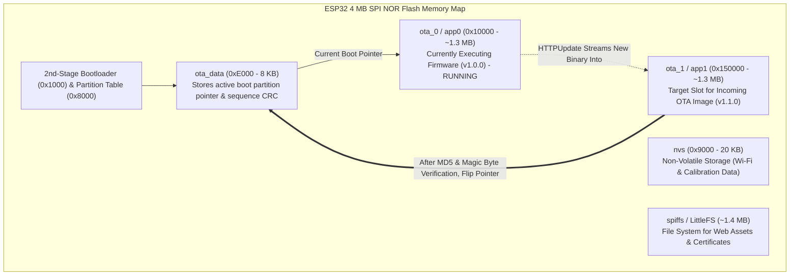

# Hardware Wiring & Dual-Bank Flash Partition Architecture — 07 OTA Firmware Manager

This document details the hardware pin configuration, the **Over-The-Air (OTA)** protocol sequence diagram, the **ESP32 Dual-Bank SPI Flash Partition Table** (`app0` / `app1` / `ota_data`), and production security practices for remote fleet updates.

---

## 1. Hardware Pinout Mapping Table (ESP32 vs. ESP8266)

| Component | Component Terminal | ESP32 (DevKit V1) | ESP8266 (NodeMCU) | Electrical Function & Notes |
| :--- | :--- | :---: | :---: | :--- |
| **OTA Trigger Button** | Terminal 1 | `GPIO 14` | `D5` (`GPIO 14`) | `INPUT_PULLUP` mode (active `LOW`, triggers immediate `version.json` check) |
| **OTA Trigger Ground** | Terminal 2 | `GND` | `GND` | Common ground reference |
| **Status / Heartbeat LED** | Anode (`+`) | `GPIO 2` (via 220 Ω) | `LED_BUILTIN` (`D4`) | 1 Hz heartbeat during normal operation; rapid strobe during OTA transfer |
| **Flashing Activity LED** | Anode (`+`) | `GPIO 26` (via 220 Ω) | `D1` (`GPIO 5`) | Solid ON while erasing and writing the target Flash partition |
| **LED Cathodes** | Cathode (`-`) | `GND` | `GND` | Common ground reference |

---

## 2. Dual-Mode OTA Protocol Sequence Diagram (`sequenceDiagram`)

The diagram below contrasts **Method 1 (Local Push OTA)** initiated from Arduino IDE over LAN UDP/TCP against **Method 2 (Cloud Pull HTTP/HTTPS OTA)** initiated autonomously by the node against a release server:

```mermaid
sequenceDiagram
    autonumber
    participant Dev as Developer / Release Server
    participant Node as ESP32 / ESP8266 (Active Partition: app0)
    participant Flash as Passive OTA Partition (app1 & ota_data)

    rect rgb(30, 41, 59)
    Note over Dev,Flash: Method 1: Local Push OTA (ArduinoOTA via LAN UDP/TCP)
    Dev->>Node: Send UDP Invitation (Port 3232/8266) + MD5 Challenge
    Node-->>Dev: Authentication Challenge (Nonce)
    Dev->>Node: Transmit MD5 Hash of OTA Password
    Node-->>Dev: Auth OK -> Open TCP Streaming Socket
    Dev->>Flash: Stream Compiled .bin in Chunks (0% -> 100%)
    Flash-->>Node: Verify Full Image MD5 Checksum & Magic Byte (0xE9)
    Node->>Flash: Update ota_data -> Set Boot Partition Pointer to app1
    Node->>Node: ESP.restart() -> Boot into New Firmware!
    end

    rect rgb(15, 52, 67)
    Note over Dev,Flash: Method 2: Cloud Pull HTTP/HTTPS OTA (Fleet Manager)
    Node->>Dev: HTTP GET /version.json (Periodic Timer / Button Trigger)
    Dev-->>Node: 200 OK {"version":"1.1.0", "url":"http://.../fw.bin"}
    Node->>Node: Compare SemVer: Remote (1.1.0) > Local (1.0.0)
    Node->>Dev: HTTP GET /ota_firmware_manager.ino.bin
    Dev-->>Flash: Stream Binary .bin Directly to Passive Partition app1
    Flash-->>Node: Validate Image Integrity & Update ota_data Sector
    Node->>Node: Automatic Reboot into v1.1.0 (Partition app1)
    end
```

---

## 3. ESP32 Dual-Bank Ping-Pong Flash Partition Layout

To guarantee that an IoT device **never bricks** if power fails or Wi-Fi drops mid-download, the ESP32 uses a **Dual-OTA Ping-Pong Partition Table (`app0` and `app1`)**:

1. **Isolation During Execution (`app0` Active):** While firmware `v1.0.0` executes out of `app0` (`0x10000`), all incoming OTA blocks are erased and written strictly to the passive partition **`app1` (`0x150000`)**. The running code in `app0` remains untouched.
2. **Power-Failure Immunity Mid-Download:** If network connectivity drops or power is lost at `45%` download progress, the `ota_data` sector (`0xE000`) **is not modified**. Upon reboot, the bootloader inspects `ota_data` and boots cleanly back into `app0` (`v1.0.0`).
3. **Atomic Cutover on Completion:** Only after 100% of the `.bin` stream is written to `app1` and passes header magic byte (`0xE9`) and MD5 digest validation does `esp_ota_set_boot_partition()` update `ota_data` to point to `app1`, followed by `ESP.restart()`.

---

## 4. Production OTA Security & Fleet Management Best Practices

1. **Enforce `ArduinoOTA` Authentication:** Always set a strong password via `ArduinoOTA.setPassword()` on LAN-accessible devices to prevent unauthorized firmware injection on shared networks.
2. **Always Retain the OTA Subsystem in New Builds:** Ensure every compiled `.bin` image uploaded to your release server retains the OTA update client logic. Flashing a bare sketch without OTA support onto a ceiling-mounted node will permanently lock out future wireless updates, requiring physical USB recovery.
3. **Transport Encryption & Cryptographic Image Signing:** For internet-facing production fleets, pair `HTTPUpdate` with `WiFiClientSecure` (X.509 Root CA verification as demonstrated in Project 10) and enable **ESP32 Secure Boot v2** image signing so Man-in-the-Middle (MitM) attackers cannot spoof `version.json` or serve tampered binaries.
