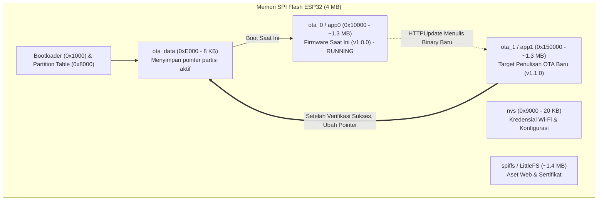

# Panduan Pengkabelan & Arsitektur Partisi Flash — 07 OTA Firmware Manager

Dokumen ini menjelaskan konfigurasi pin perangkat keras, diagram alur sekuens **Over-The-Air (OTA)**, skema partisi memori Flash (`app0` / `app1` / `ota_data`), serta arsitektur keamanan pembaruan firmware jarak jauh.

---

## 1. Tabel Pinout Hardware (ESP32 vs ESP8266)

| Komponen | Pin Komponen | Pin ESP32 (DevKit V1) | Pin ESP8266 (NodeMCU) | Fungsi & Keterangan |
| :--- | :--- | :--- | :--- | :--- |
| **Tombol Trigger OTA** | Kaki 1 | `GPIO 14` | `D5` (`GPIO 14`) | Mode `INPUT_PULLUP` (ditekan = `LOW`, memicu cek `version.json`) |
| **Tombol Trigger GND** | Kaki 2 | `GND` | `GND` | Ground referensi tombol |
| **LED Status / Heartbeat** | Anoda (`+`) | `GPIO 2` (via Resistor 220Ω) | `LED_BUILTIN` (`D4`) | Berkedip 1 Hz saat normal, berkedip cepat saat transfer OTA |
| **LED Indikator Flashing** | Anoda (`+`) | `GPIO 26` (via Resistor 220Ω) | `D1` (`GPIO 5`) | Menyala penuh selama proses unduh & penulisan partisi Flash |
| **Katoda LED** | Katoda (`-`) | `GND` | `GND` | Ground bersama |

---

## 2. Diagram Alur Sekuens Dual-Mode OTA (`sequenceDiagram`)

Berikut adalah perbandingan alur kerja antara **Metode 1 (Local Push OTA)** dari Arduino IDE dan **Metode 2 (Cloud Pull HTTP OTA)** dari server manifest/GitHub Releases:

```mermaid
sequenceDiagram
    autonumber
    participant Dev as Developer / Server Rilis
    participant Node as ESP32 / ESP8266 (Partisi Aktif: app0)
    participant Flash as Partisi OTA Cadangan (app1 & ota_data)

    rect rgb(30, 41, 59)
    Note over Dev,Flash: Metode 1: Local Push OTA (ArduinoOTA via LAN UDP/TCP)
    Dev->>Node: Kirim UDP Invitation (Port 3232/8266) + MD5 Challenge
    Node-->>Dev: Tantangan Autentikasi (Nonce)
    Dev->>Node: Kirim Hash Password OTA
    Node-->>Dev: Auth OK -> Buka Sesi Streaming TCP
    Dev->>Flash: Stream Binary .bin per-chunk (0% -> 100%)
    Flash-->>Node: Verifikasi Checksum MD5 & Magic Byte (0xE9)
    Node->>Flash: Update ota_data -> Set Boot Partition ke app1
    Node->>Node: ESP.restart() -> Boot ke Firmware Baru!
    end

    rect rgb(15, 52, 67)
    Note over Dev,Flash: Metode 2: Cloud Pull HTTP/HTTPS OTA (Fleet Manager)
    Node->>Dev: HTTP GET /version.json (Berkala / Tombol Ditekan)
    Dev-->>Node: 200 OK {"version":"1.1.0", "url":"http://.../fw.bin"}
    Node->>Node: Bandingkan SemVer: Remote (1.1.0) > Lokal (1.0.0)
    Node->>Dev: HTTP GET /ota_firmware_manager.ino.bin
    Dev-->>Flash: Stream Binary .bin langsung ke partisi app1
    Flash-->>Node: Validasi Image & Update Tabel ota_data
    Node->>Node: Otomatis Reboot ke v1.1.0 (Partisi app1)
    end
```

---

## 3. Skema Partisi Memori Flash ESP32 (Dual-Bank Ping-Pong)

Agar perangkat IoT **tidak mengalami *brick*** apabila listrik mati atau koneksi Wi-Fi terputus di tengah pengunduhan firmware, ESP32 menggunakan skema **Dual-OTA Partition (`app0` dan `app1`)**:

1. **Saat Firmware v1.0.0 Berjalan di `app0`**: Seluruh kode baru yang diunduh melalui OTA ditulis ke partisi pasif **`app1`**, sehingga kode di `app0` sama sekali tidak tersentuh.
2. **Apabila Koneksi Putus di Tengah Jalan (misal baru 45%)**: Pointer di `ota_data` **tidak diubah**. Jika ESP32 di-*restart*, *bootloader* tetap memuat `app0` (v1.0.0) dengan aman.
3. **Setelah 100% Terunduh & Lulus Checksum**: Barulah sektor `ota_data` diperbarui untuk menunjuk ke `app1`, diikuti panggilan `ESP.restart()`.

---

## 4. Praktik Terbaik & Manajemen Keamanan OTA

1. **Wajib Menggunakan Password `ArduinoOTA`**: Jangan biarkan `ArduinoOTA` tanpa password pada jaringan produksi agar pihak tak berwenang di Wi-Fi yang sama tidak dapat menginjeksi firmware berbahaya.
2. **Jangan Ubah Konfigurasi Pin atau Menghapus Kode OTA di Firmware Baru**: Pastikan binary `.bin` yang Anda unggah ke server **tetap menyertakan library OTA**! Jika Anda mengunggah sketch `Blink` biasa tanpa kode OTA, maka pembaruan berikutnya harus dilakukan secara fisik melalui kabel USB.
3. **Gunakan HTTPS & Signed Binary untuk Produksi**: Pada implementasi skala besar, kombinasikan `HTTPUpdate` dengan `WiFiClientSecure` (seperti pada Proyek 10) agar manifest `version.json` dan binary `.bin` tidak dapat dimodifikasi melalui serangan *Man-in-the-Middle (MitM)*.
