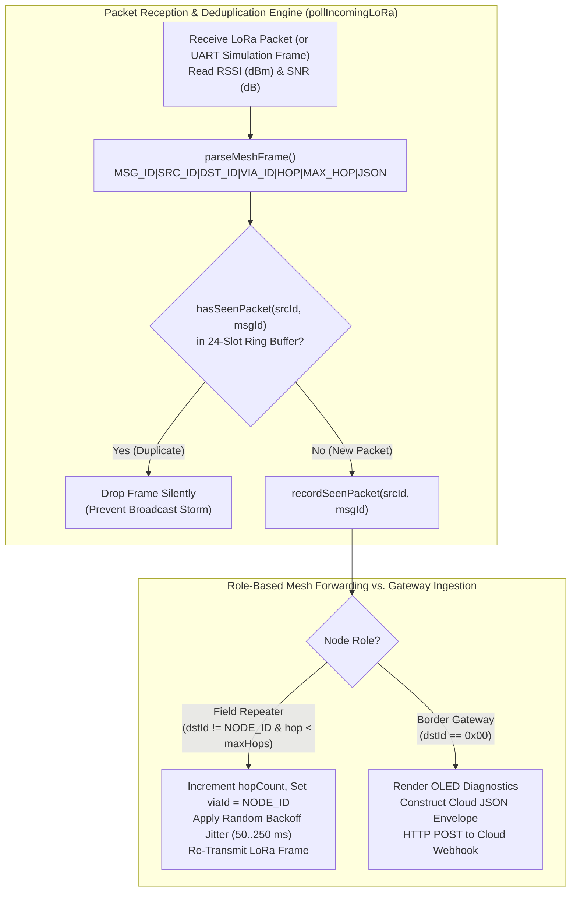

# 08 — Multi-Hop LoRa Mesh Environmental & Flood Telemetry Network

**Difficulty Level:** Advanced (Sub-GHz Chirp Spread Spectrum RF, Multi-Hop Mesh Routing, Ring-Buffer Deduplication & Cloud Gateway)  
**Target Architecture:** Espressif ESP32 + Semtech SX1278 (`433 MHz`) / SX1276 / RFM95W (`915 MHz`) SPI Transceiver

---

## 1. Architectural Overview & System Design

When deploying hydrological **Flood Early Warning Systems (FEWS)** along river valleys or microclimate stations across remote forestry and agricultural estates, neither Wi-Fi nor cellular coverage is available. This project implements a long-range, self-relaying **Sub-GHz LoRa Mesh Telemetry Network** divided into two specialized firmware targets:

1. **Field Sensor & Autonomous Mesh Repeater Node ([`lora_mesh_node.ino`](./src/lora_mesh_node/lora_mesh_node.ino)):**
   - Measures river surface elevation via an **HC-SR04** ultrasonic time-of-flight rangefinder (`SENSOR_MOUNT_HEIGHT_CM - distance_cm`) alongside ambient temperature and relative humidity via a **DHT22** sensor.
   - Encapsulates telemetry into a deterministic 7-field mesh frame (`MSG_ID|SRC_ID|DST_ID|VIA_ID|HOP|MAX_HOP|JSON`) and transmits it over a **Semtech SX127x** LoRa radio (`SF9`, `125 kHz` bandwidth, Coding Rate `4/5`, sync word `0x34`).
   - Operates simultaneously as an **Intelligent Multi-Hop Repeater**: inspects overheard frames against a 24-slot **Deduplication Ring Buffer** `(srcId, msgId)` to prevent broadcast storms, increments `hopCount`, updates `viaId`, and re-broadcasts after a randomized CSMA-style backoff jitter (`50–250 ms`).
2. **LoRa-to-Cloud Border Gateway ([`lora_mesh_gateway.ino`](./src/lora_mesh_gateway/lora_mesh_gateway.ino)):**
   - Demodulates inbound mesh frames addressed to `GATEWAY_ID (0x00)`, extracts physical-layer link quality metrics (**RSSI** in $\text{dBm}$ and **SNR** in $\text{dB}$), renders live diagnostics on a **0.96" SSD1306 I2C OLED**, and forwards a rich JSON envelope over Wi-Fi HTTP `POST` to a cloud webhook.

---

## 2. Hardware Bill of Materials (BOM) & Peripheral Interface Specs

| Component | Quantity | Interface / Protocol | Electrical Specification | Notes |
| :--- | :---: | :--- | :--- | :--- |
| **ESP32 DevKit V1** | 2+ | Hardware VSPI + I2C + GPIO | 3.3V CMOS logic | 1× Field Node(s), 1× Border Gateway |
| **Semtech SX1278 (433 MHz) / RFM95W (915 MHz)** | 2+ | 4-Wire SPI + `RST` + `DIO0` | **Strict 3.3V DC** (~120 mA TX peak at +17 dBm) | Requires tuned $\lambda/4$ or SMA whip antenna |
| **HC-SR04 Ultrasonic Sensor** | 1 | Digital Pulse (`TRIG` / `ECHO`) | 5V DC supply; acoustic 40 kHz transducer | River water-level distance sensing (Node) |
| **DHT22 (AM2302) Sensor** | 1 | Digital Single-Wire | 3.3V DC; -40 to +80 °C, 0–100 %RH | Ambient weather telemetry (Node) |
| **0.96" OLED Display (SSD1306)** | 2 | I2C (`0x3C`) | 3.3V DC, 128×64 monochrome | Local status display on both Node and Gateway |

### Pin Assignment Matrix (Node & Gateway)

| Functional Signal | Module Terminal | ESP32 GPIO | Electrical Configuration |
| :--- | :--- | :---: | :--- |
| **LoRa SPI Clock** | `SCK` | `GPIO 18` (`VSPI SCK`) | Hardware SPI Clock |
| **LoRa SPI MISO** | `MISO` | `GPIO 19` (`VSPI MISO`) | Hardware SPI Master In Slave Out |
| **LoRa SPI MOSI** | `MOSI` | `GPIO 23` (`VSPI MOSI`) | Hardware SPI Master Out Slave In |
| **LoRa SPI Chip Select** | `NSS` / `CS` | `GPIO 5` (`VSPI SS`) | Active-LOW Chip Select |
| **LoRa Hardware Reset** | `RST` | `GPIO 14` | Digital output reset strobe |
| **LoRa Interrupt Pin** | `DIO0` (`G0`) | `GPIO 26` | `RxDone` / `TxDone` interrupt signal |
| **HC-SR04 Ultrasonic Trigger**| `TRIG` | `GPIO 12` | 10 µs output pulse (Sensor Node) |
| **HC-SR04 Ultrasonic Echo** | `ECHO` | `GPIO 13` | Echo pulse-width input (Sensor Node) |
| **DHT22 Data Line** | `SDA` / `DATA` | `GPIO 4` | 1-Wire digital bus (Sensor Node) |
| **OLED I2C Bus** | `SDA` & `SCL` | `GPIO 21` & `GPIO 22` | I2C display bus (`0x3C`) |

---

## 3. Firmware Architecture & Non-Blocking State Machine Design

Both the Field Node and Border Gateway implement a loop-free mesh routing engine with ring-buffer packet deduplication:



---

## 4. Directory Structure

```text
08-lora-mesh-telemetry/
├── README.md                                  # System architecture, BOM, mesh routing & build guide
├── src/
│   ├── lora_mesh_node/
│   │   └── lora_mesh_node.ino                 # Field Sensor & Multi-Hop Repeater firmware
│   └── lora_mesh_gateway/
│       ├── lora_mesh_gateway.ino              # LoRa-to-WiFi Cloud Border Gateway firmware
│       └── secrets.example.h                  # Gateway Wi-Fi & Cloud Webhook URL template
├── schematics/
│   ├── diagram.json                           # Wokwi circuit netlist (ESP32 + HC-SR04 + DHT22 + OLED)
│   └── wiring-guide.md                        # SX127x SPI pinout, mesh topology & RF Link Budget math
└── docs/
    └── mesh-protocol-and-range-test.md        # Mesh frame format, SF7-SF12 trade-offs & multi-hop logs
```

---

## 5. Build, Flashing & Wokwi Simulation Instructions

### Required Arduino Libraries
Install via **Arduino IDE Library Manager** or `arduino-cli`:
1. **`LoRa`** by *Sandeep Mistry*
2. **`DHT sensor library`** by *Adafruit* (plus **`Adafruit Unified Sensor`**)
3. **`Adafruit SSD1306`** & **`Adafruit GFX Library`** by *Adafruit*

### A. Building & Flashing via Arduino IDE / CLI
1. **Field Sensor / Repeater Node(s):**
   - Open [`src/lora_mesh_node/lora_mesh_node.ino`](./src/lora_mesh_node/lora_mesh_node.ino), assign a unique `NODE_ID` per board (`0x01` for upstream sensor node, `0x02` for hilltop repeater), verify `LORA_FREQUENCY` (`433E6` or `915E6`), and flash:
     ```bash
     arduino-cli compile --fqbn esp32:esp32:esp32 src/lora_mesh_node
     arduino-cli upload -p /dev/ttyUSB0 --fqbn esp32:esp32:esp32 src/lora_mesh_node
     ```
2. **Border Gateway Node:**
   - Copy `src/lora_mesh_gateway/secrets.example.h` to `src/lora_mesh_gateway/secrets.h` and configure Wi-Fi + `CLOUD_WEBHOOK_URL`.
   - Flash [`src/lora_mesh_gateway/lora_mesh_gateway.ino`](./src/lora_mesh_gateway/lora_mesh_gateway.ino) onto the gateway ESP32:
     ```bash
     arduino-cli compile --fqbn esp32:esp32:esp32 src/lora_mesh_gateway
     arduino-cli upload -p /dev/ttyUSB1 --fqbn esp32:esp32:esp32 src/lora_mesh_gateway
     ```

### B. Running in Wokwi Simulator (Built-In RF Fallback & Frame Injection)
1. Because browser simulators do not model physical Sub-GHz RF propagation, both sketches automatically enter **Simulation Mode (`loraHardwareReady = false`)** if no physical SX127x transceiver responds on the SPI bus.
2. Load [`lora_mesh_node.ino`](./src/lora_mesh_node/lora_mesh_node.ino) and [`schematics/diagram.json`](./schematics/diagram.json) in Wokwi, adjust the **HC-SR04 distance slider** below `80 cm` (`waterLevel >= 220 cm`), and observe the `SIAGA_BANJIR` alert on the OLED and Serial Monitor.
3. You can also test multi-hop packet relaying directly via the **Serial Monitor** by pasting a simulated raw mesh frame (e.g., `205|3|0|3|0|3|{"t":25.4,"h":80.0,"dist":60.0,"water":240.0,"alert":true}`) and pressing Enter.
