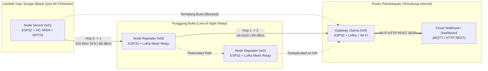

# Panduan Pengkabelan, Topologi Mesh & Perhitungan Link Budget — 08 LoRa Mesh

Dokumen ini menjelaskan koneksi antarmuka **SPI** antara **ESP32** dan modul radio **LoRa SX1278 (433 MHz) / RFM95 (915 MHz)**, koneksi sensor deteksi banjir (**HC-SR04** + **DHT22**), arsitektur topologi **Multi-Hop Mesh**, serta panduan antena dan perhitungan **Link Budget**.

---

## 1. Tabel Pinout SPI LoRa SX1278 / RFM95 & Sensor ke ESP32

> [!CAUTION]
> Modul Transceiver LoRa **SX1276 / SX1278 / RFM95W bekerja pada tegangan logika dan catu daya murni `3.3V`**. Jangan pernah menghubungkan pin `VCC` modul LoRa ke `5V (VIN)` karena akan langsung merusak IC RF Semtech!

| Kategori | Nama Pin Modul | Pin ESP32 (DevKit V1) | Fungsi & Keterangan |
| :--- | :--- | :--- | :--- |
| **Modul LoRa (SPI)** | `VCC` / `3.3V` | `3V3` | Catu daya wajib **3.3V** (Arus puncak TX ~120 mA) |
| **Modul LoRa (SPI)** | `GND` | `GND` | Ground bersama |
| **Modul LoRa (SPI)** | `SCK` (Clock) | `GPIO 18` (`VSPI SCK`) | Jalur Clock SPI |
| **Modul LoRa (SPI)** | `MISO` | `GPIO 19` (`VSPI MISO`) | Master In Slave Out |
| **Modul LoRa (SPI)** | `MOSI` | `GPIO 23` (`VSPI MOSI`) | Master Out Slave In |
| **Modul LoRa (SPI)** | `NSS` / `CS` | `GPIO 5` (`VSPI SS`) | Chip Select (Active-LOW) |
| **Modul LoRa (SPI)** | `RST` (Reset) | `GPIO 14` | Hardware Reset Transceiver |
| **Modul LoRa (SPI)** | `DIO0` (`G0`) | `GPIO 26` | Interrupt `TxDone` / `RxDone` |
| **Ultrasonik HC-SR04** | `TRIG` | `GPIO 12` | Output pulsa pemicu ultrasonik (10 µs) |
| **Ultrasonik HC-SR04** | `ECHO` | `GPIO 13` | Input pembacaan lebar pulsa pantulan |
| **Sensor Suhu DHT22** | `SDA` / `DATA` | `GPIO 4` | Data digital 1-Wire |
| **Layar OLED SSD1306** | `SDA` & `SCL` | `GPIO 21` & `GPIO 22` | Bus I2C (Alamat `0x3C`) |

---

## 2. Diagram Topologi LoRa Mesh Multi-Hop

Ketika sebuah **Node Sensor Hulu (`0x01`)** berada di lembah sungai yang terhalang bukit sehingga sinyalnya tidak dapat menjangkau **Gateway (`0x00`)** secara langsung (*Non-Line-of-Sight*), **Node Repeater (`0x02`)** yang ditempatkan di punggung bukit akan menangkap paket tersebut, memeriksa *Deduplication Ring Buffer*, menaikkan `hopCount`, lalu memancarkannya kembali ke Gateway:

---

## 3. Desain Antena & Perhitungan Link Budget

### a. Panjang Antena Quarter-Wave ($\lambda / 4$ Whip Antenna)
Jangan pernah menyalakan transmisi (`LoRa.endPacket()`) tanpa antena terpasang pada konektor U.FL/SMA karena pantulan gelombang berdiri (*Standing Wave Ratio* / VSWR tinggi) dapat membakar penguat akhir (PA) modul RF. Jika membuat antena kawat tunggal ($\lambda / 4$ monopole), gunakan rumus panjang gelombang:

$$\text{Panjang Antena } (L) = \frac{c}{4 \times f} \times 0.95$$

- **Untuk Frekuensi 433 MHz (`SX1278`)**: $L \approx 16.4\text{ cm}$
- **Untuk Frekuensi 915 MHz (`RFM95 / SX1276`)**: $L \approx 7.8\text{ cm}$

### b. Contoh Perhitungan Link Budget (SF9, BW 125 kHz)
- **Daya Pancar (`Tx Power`)**: $+17\text{ dBm}$
- **Gain Antena Pemancar & Penerima ($G_{tx} + G_{rx}$)**: $+2\text{ dBi} + 2\text{ dBi} = +4\text{ dB}$
- **Sensitivitas Penerima LoRa pada `SF9 / 125 kHz`**: $-129\text{ dBm}$
- **Maximum Coupling Loss (Total Anggaran Link)**:
  $$\text{Link Budget} = 17\text{ dBm} + 4\text{ dB} - (-129\text{ dBm}) = 150\text{ dB}$$
Dengan *Fade Margin* sebesar $20\text{ dB}$, sistem tetap memiliki *Path Loss* terizinkan sebesar **$130\text{ dB}$**, yang mampu menjangkau **2 – 5 km di area pedesaan/perkebunan** dan hingga **10+ km pada kondisi Line-of-Sight (LoS)** per loncatan (*hop*).
