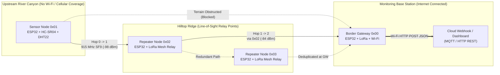

# Hardware Wiring, Multi-Hop Topology & RF Link Budget — 08 LoRa Mesh Telemetry

This document details the **VSPI** hardware interface between the **ESP32** and the **Semtech SX1278 (433 MHz) / RFM95W (915 MHz)** LoRa transceiver, the flood-monitoring sensor connections (**HC-SR04** + **DHT22**), the **Multi-Hop Mesh** relay topology, and $\lambda/4$ antenna sizing with **RF Link Budget** equations.

---

## 1. SPI LoRa SX1278 / RFM95W & Sensor Pinout Table

> [!CAUTION]
> **STRICT 3.3V SUPPLY REQUIREMENT:**
> Semtech **SX1276 / SX1278 / RFM95W** LoRa transceiver ICs operate strictly at **`3.3V` CMOS logic and power (`1.8V–3.7V` absolute maximum)**. Never connect the module's `VCC` (`3.3V`) pin to the ESP32 `5V (VIN)` rail, as doing so will permanently destroy the RF front-end!

| Subsystem | Module Pin | ESP32 (DevKit V1) | Electrical Function & Notes |
| :--- | :--- | :---: | :--- |
| **LoRa Transceiver (SPI)** | `VCC` / `3.3V` | `3V3` | Regulated **3.3V DC** supply (~120 mA peak during +17 dBm TX) |
| **LoRa Transceiver (SPI)** | `GND` | `GND` | Common ground reference |
| **LoRa Transceiver (SPI)** | `SCK` (Clock) | `GPIO 18` (`VSPI SCK`) | Hardware SPI Serial Clock |
| **LoRa Transceiver (SPI)** | `MISO` | `GPIO 19` (`VSPI MISO`) | Hardware SPI Master In Slave Out |
| **LoRa Transceiver (SPI)** | `MOSI` | `GPIO 23` (`VSPI MOSI`) | Hardware SPI Master Out Slave In |
| **LoRa Transceiver (SPI)** | `NSS` / `CS` | `GPIO 5` (`VSPI SS`) | SPI Chip Select (Active-LOW) |
| **LoRa Transceiver (SPI)** | `RST` (Reset) | `GPIO 14` | Hardware transceiver reset strobe |
| **LoRa Transceiver (SPI)** | `DIO0` (`G0`) | `GPIO 26` | Hardware interrupt line (`TxDone` / `RxDone`) |
| **Ultrasonic HC-SR04** | `TRIG` | `GPIO 12` | 10 µs ultrasonic trigger output pulse |
| **Ultrasonic HC-SR04** | `ECHO` | `GPIO 13` | Echo return pulse-width measurement input |
| **DHT22 Sensor** | `SDA` / `DATA` | `GPIO 4` | 1-Wire digital temperature & humidity bus |
| **SSD1306 OLED Display** | `SDA` & `SCL` | `GPIO 21` & `GPIO 22` | I2C bus (Slave address `0x3C`) |

---

## 2. Multi-Hop LoRa Mesh Network Topology

When an upstream **River Sensor Node (`0x01`)** is deployed down in a canyon or behind dense terrain that blocks direct **Line-of-Sight (LoS)** propagation to the **Border Gateway (`0x00`)**, an intermediate **Hilltop Repeater Node (`0x02`)** receives the frame, verifies via its *Deduplication Ring Buffer* that `(srcId=0x01, msgId)` has not yet been relayed, increments `hopCount`, sets `viaId = 0x02`, and re-transmits the frame to the Gateway:

---

## 3. Quarter-Wave Antenna Sizing & RF Link Budget Analysis

### a. Quarter-Wave ($\lambda / 4$) Monopole Whip Antenna Calculation
Never invoke `LoRa.endPacket()` without a properly matched $50\ \Omega$ antenna connected to the U.FL/SMA port, as severe impedance mismatch (high VSWR) reflects RF power back into the power amplifier (PA) stage and can permanently damage the transceiver. To fabricate a quarter-wave ($\lambda / 4$) solid-core wire whip antenna with a standard velocity factor ($v_f \approx 0.95$):

$$\text{Antenna Length } (L) = \frac{c}{4 \times f} \times 0.95$$

- **For 433 MHz (`SX1278`)**: $L = \frac{2.998 \times 10^8}{4 \times 433 \times 10^6} \times 0.95 \approx \mathbf{16.4\text{ cm}}$
- **For 915 MHz (`RFM95W / SX1276`)**: $L = \frac{2.998 \times 10^8}{4 \times 915 \times 10^6} \times 0.95 \approx \mathbf{7.8\text{ cm}}$

### b. Sub-GHz Link Budget Calculation (`SF9`, `BW = 125 kHz`)
- **Transmitter Output Power ($P_{\text{tx}}$)**: $+17\text{ dBm}$ (`PA_BOOST` pin)
- **Combined TX + RX Antenna Gain ($G_{\text{tx}} + G_{\text{rx}}$)**: $+2\text{ dBi} + 2\text{ dBi} = +4\text{ dB}$
- **LoRa Receiver Demodulation Sensitivity at `SF9 / 125 kHz` ($S_{\text{rx}}$)**: $-129\text{ dBm}$ ($\text{SNR}_{\text{limit}} = -12.5\text{ dB}$)
- **Maximum Coupling Loss (Total Link Budget)**:
  $$\text{Link Budget} = P_{\text{tx}} + G_{\text{tx}} + G_{\text{rx}} - S_{\text{rx}} = 17\text{ dBm} + 4\text{ dB} - (-129\text{ dBm}) = \mathbf{150\text{ dB}}$$

Allocating a conservative $20\text{ dB}$ **Multipath & Foliage Fade Margin** yields an allowable free-space/propagation path loss of **$130\text{ dB}$**, supporting reliable **2–5 km non-line-of-sight (NLoS)** rural/forestry hops and **10+ km line-of-sight (LoS)** range per hop.
