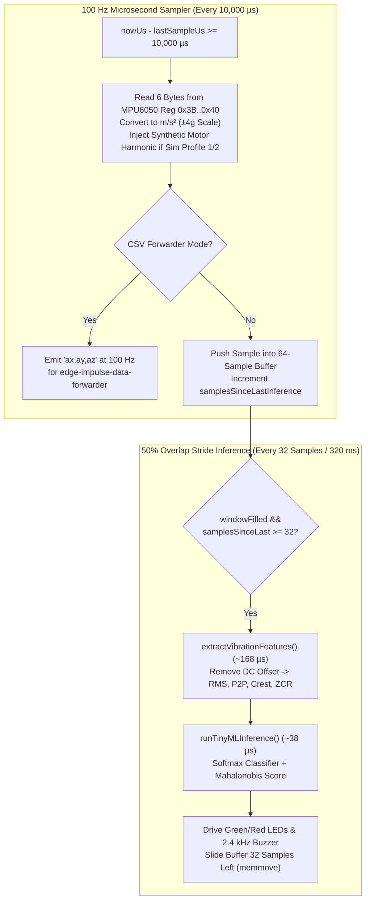

# 09 — Edge AI Vibration Anomaly Detection (TinyML Predictive Maintenance)

**Difficulty Level:** Advanced (100 Hz Fast-I2C IMU Sampling, Sliding-Window DSP Feature Extraction & Dual-Head TinyML Inference)  
**Target Architecture:** Espressif ESP32 + InvenSense MPU6050 6-DoF MEMS IMU (`400 kHz` Fast-I2C)

---

## 1. Architectural Overview & System Design

Streaming raw high-frequency tri-axial accelerometer waveforms (`100 Hz × 3 axes`) continuously to the cloud saturates network bandwidth and depletes node battery reserves. **Edge AI (TinyML)** solves this by performing Digital Signal Processing (DSP) feature extraction and neural/statistical inference directly on the **ESP32** in under **250 microseconds (`< 0.25 ms`)**, transmitting only compact anomaly alerts when mechanical degradation is detected.

This project implements a real-time **Predictive Maintenance & Vibration Health Monitor** for rotating industrial machinery (induction motors, centrifugal pumps, HVAC blowers, and bearings):

1. **Deterministic 100 Hz Sliding-Window Acquisition:** Polls tri-axial linear acceleration ($a_x, a_y, a_z$ in $\text{m/s}^2$, configured for $\pm 4g$ full-scale range and $44\text{ Hz}$ on-chip Digital Low-Pass Filter) from the **MPU6050** over `400 kHz` Fast-I2C every `10,000 µs` (`micros()`) into a 64-sample circular window (`640 ms` duration) with a **50% overlap stride** (`32 samples / 320 ms`).
2. **On-Device DSP Feature Pipeline ([`anomaly_model.h`](./src/edge_ai_anomaly_detection/anomaly_model.h)):** Performs orientation-invariant **DC Gravity Offset Removal** ($a_{\text{ac}}[n] = a[n] - \mu$) followed by time-domain spectral feature extraction: per-axis and composite **Root Mean Square (RMS)**, **Peak-to-Peak ($P_{2P}$)**, **Variance ($\sigma^2$)**, **Crest Factor ($|a|_{\max} / \text{RMS}$)** for impulsive bearing spall detection, and **Zero-Crossing Rate (ZCR)**.
3. **Dual-Head TinyML Inference Engine:** Combines a 3-class **Dense Softmax Neural Classifier** (`IDLE`, `NORMAL_OPERATION`, `ANOMALY_DETECTED`) with an unsupervised **Mahalanobis-Style Weighted Centroid Distance Detector** (`anomalyScore`) capable of flagging out-of-distribution mechanical faults not seen during supervised training.
4. **Runtime Mode Switching (Inference vs. Edge Impulse CSV Forwarder):** Supports live UART switching (`'m'` command) between real-time TinyML inference and raw `100 Hz` CSV streaming compatible with `edge-impulse-data-forwarder`.

---

## 2. Hardware Bill of Materials (BOM) & Peripheral Interface Specs

| Component | Quantity | Interface / Protocol | Electrical Specification | Notes |
| :--- | :---: | :--- | :--- | :--- |
| **ESP32 DevKit V1** | 1 | Fast-I2C (`400 kHz`) + Hardware FPU | 3.3V CMOS logic, 240 MHz Xtensa LX6 | Executes DSP + TinyML in `~205 µs` |
| **MPU6050 6-Axis MEMS IMU** | 1 | I2C (`0x68` when `AD0 = LOW`) | 3.3V DC; $\pm 4g$ range ($8192\text{ LSB}/g$), $44\text{ Hz}$ DLPF | Direct register-level driver (zero external libs) |
| **Momentary Push Button** | 1 | Digital GPIO Input (`INPUT_PULLUP`) | Active-LOW switch to `GND` | Cycles built-in synthetic fault profiles (`0/1/2`) |
| **Green LED (Normal) + 220 Ω** | 1 | Digital GPIO Output | 3.3V GPIO drive | Solid ON during `IDLE` or `NORMAL_OPERATION` |
| **Red LED (Anomaly) + 220 Ω** | 1 | Digital GPIO Output | 3.3V GPIO drive | Driven `HIGH` on `ANOMALY_DETECTED` |
| **Piezo Alarm Buzzer** | 1 | PWM Tone Output | 2.4 kHz acoustic alert | Pulses during mechanical anomaly detection |

### Pin Assignment Matrix

| Functional Signal | Module Terminal | ESP32 GPIO | Electrical Configuration |
| :--- | :--- | :---: | :--- |
| **MPU6050 I2C Data** | `SDA` | `GPIO 21` | Open-drain I2C Serial Data (`400 kHz`) |
| **MPU6050 I2C Clock** | `SCL` | `GPIO 22` | Open-drain I2C Serial Clock (`0x68`) |
| **Fault Profile Cycle Button**| Terminal 1 | `GPIO 14` | Internal pull-up (`INPUT_PULLUP`), active `LOW` |
| **Normal Health LED (Green)** | Anode (`+`) | `GPIO 26` | Digital output via 220 Ω resistor |
| **Anomaly Alarm LED (Red)** | Anode (`+`) | `GPIO 27` | Digital output via 220 Ω resistor |
| **Acoustic Alarm Buzzer** | Positive (`+`) | `GPIO 25` | 2.4 kHz tone output on anomaly |

---

## 3. Firmware Architecture & Non-Blocking State Machine Design

The firmware ([`edge_ai_anomaly_detection.ino`](./src/edge_ai_anomaly_detection/edge_ai_anomaly_detection.ino) and [`anomaly_model.h`](./src/edge_ai_anomaly_detection/anomaly_model.h)) uses microsecond-accurate scheduling (`micros()`) to maintain phase-locked `100 Hz` sampling without blocking button or serial command parsing:



---

## 4. Directory Structure

```text
09-edge-ai-anomaly-detection/
├── README.md                                          # System architecture, BOM, DSP/TinyML & build guide
├── src/
│   └── edge_ai_anomaly_detection/
│       ├── edge_ai_anomaly_detection.ino              # 100 Hz IMU acquisition, fault simulator & scheduler
│       └── anomaly_model.h                            # Header-only DSP feature extractor & Dual-Head TinyML model
├── schematics/
│   ├── diagram.json                                   # Wokwi circuit netlist (ESP32 + MPU6050 + LEDs + Buzzer)
│   └── wiring-guide.md                                # Fast-I2C pinout, TinyML pipeline & mechanical mounting guide
└── docs/
    └── edge-impulse-workflow.md                       # Edge Impulse Studio training guide & UART inference logs
```

---

## 5. Build, Flashing & Wokwi Simulation Instructions

### Zero External Library Dependencies
Because [`edge_ai_anomaly_detection.ino`](./src/edge_ai_anomaly_detection/edge_ai_anomaly_detection.ino) communicates directly with the MPU6050 I2C registers (`0x6B` Power Management, `0x1A` DLPF, `0x1C` Accel Config, `0x3B` Burst Data) using the built-in `Wire.h` library and embeds the pre-trained DSP + TinyML weights inside [`anomaly_model.h`](./src/edge_ai_anomaly_detection/anomaly_model.h), **no external third-party libraries are required**.

### A. Building & Flashing via Arduino IDE / CLI
```bash
arduino-cli compile --fqbn esp32:esp32:esp32 src/edge_ai_anomaly_detection
arduino-cli upload -p /dev/ttyUSB0 --fqbn esp32:esp32:esp32 src/edge_ai_anomaly_detection
```

### B. Interactive Testing & Running in Wokwi Simulator
1. Open the [Wokwi ESP32 Simulator](https://wokwi.com/projects/new/esp32) or **Wokwi for VS Code** with [`edge_ai_anomaly_detection.ino`](./src/edge_ai_anomaly_detection/edge_ai_anomaly_detection.ino), [`anomaly_model.h`](./src/edge_ai_anomaly_detection/anomaly_model.h), and [`schematics/diagram.json`](./schematics/diagram.json).
2. Open the **Serial Monitor (`115200` baud)** and test all three machine health regimes either by pressing the hardware push button on **`GPIO 14`** or by sending single-character commands over UART:
   - **`'0'`**: Pure physical MPU6050 sensor input (`IDLE` when stationary; Green LED ON).
   - **`'1'`**: Injects a synthetic **30 Hz balanced induction motor harmonic** (`NORMAL_OPERATION`, $\text{RMS} \approx 1.13\text{ m/s}^2$, $\text{Crest} \approx 1.58$; Green LED ON).
   - **`'2'`**: Injects a synthetic **shaft unbalance + impulsive bearing spall profile** (`ANOMALY_DETECTED`, $\text{RMS} \approx 4.55\text{ m/s}^2$, $\text{Crest} > 3.1$, $\text{AnomalyScore} > 2.4$; Red LED + 2.4 kHz Buzzer triggered).
   - **`'m'`**: Toggles between real-time TinyML Inference Mode and raw `100 Hz` `ax,ay,az` CSV Data Forwarder Mode.
