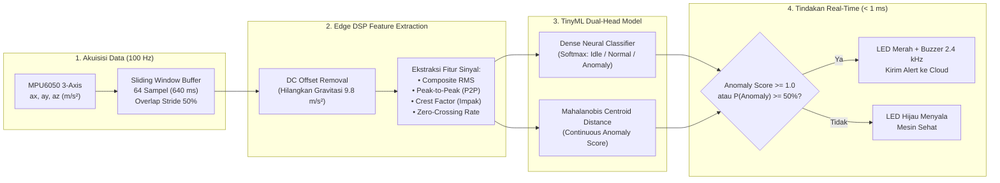

# Panduan Pengkabelan & Arsitektur Pipeline TinyML — 09 Edge AI Anomaly Detection

Dokumen ini menjelaskan koneksi bus **I2C** antara **ESP32** dan sensor akselerometer/giroskop **MPU6050**, pemasangan mekanis sensor pada motor/pompa industri untuk *Predictive Maintenance*, serta diagram pipeline **Edge AI (TinyML)**.

---

## 1. Tabel Pinout Hardware (ESP32 + MPU6050)

| Komponen | Pin Modul | Pin ESP32 (DevKit V1) | Fungsi & Keterangan |
| :--- | :--- | :--- | :--- |
| **MPU6050 IMU** | `VCC` | `3V3` | Catu daya modul sensor (3.3V) |
| **MPU6050 IMU** | `GND` | `GND` | Ground bersama |
| **MPU6050 IMU** | `SDA` | `GPIO 21` | Jalur Data I2C (Fast Mode 400 kHz) |
| **MPU6050 IMU** | `SCL` | `GPIO 22` | Jalur Clock I2C (Alamat default `0x68`) |
| **MPU6050 IMU** | `AD0` | `GND` / Terbuka | Biarkan `LOW` untuk alamat `0x68` |
| **Tombol Mode/Simulasi** | Kaki 1 | `GPIO 14` | Mode `INPUT_PULLUP` (Mengganti profil getaran uji) |
| **LED Hijau (Normal)** | Anoda (`+`) | `GPIO 26` (via 220Ω) | Menyala saat status `IDLE` atau `NORMAL_OPERATION` |
| **LED Merah (Anomaly)** | Anoda (`+`) | `GPIO 27` (via 220Ω) | Menyala saat `ANOMALY_DETECTED` |
| **Buzzer Alarm** | Positif (`+`) | `GPIO 25` | Mengeluarkan nada peringatan 2.4 kHz saat anomali |

---

## 2. Diagram Pipeline Pemrosesan Sinyal & Inferensi TinyML di Edge

Mengapa memproses getaran langsung di mikrokontroler (**Edge AI**) daripada mengirim data mentah ke Cloud?
Karena sensor getaran mengambil sampel pada **100 Hz (300 angka float per detik)**. Mengirim ribuan sampel mentah tiap detik melalui Wi-Fi/LoRa akan menguras bandwidth dan baterai. Dengan **TinyML**, ESP32 cukup mengekstraksi fitur dan menjalankan inferensi dalam waktu **kurang dari 1 milidetik (`< 500 µs`)**:

---

## 3. Panduan Pemasangan Mekanis Sensor pada Mesin

Kualitas deteksi anomali getaran sangat bergantung pada kekakuan kopling mekanis (*mechanical coupling*) antara PCB **MPU6050** dan bodi mesin (motor listrik, kompresor, kipas *exhaust*, atau pompa air):

1. **Hindari Selotip Busa Tebal (*Double-Tape Foam*)**: Busa bersifat meredam frekuensi tinggi (*low-pass mechanical damper*), sehingga getaran indikasi kerusakan *bearing* (yang memiliki *Crest Factor* tinggi) tidak akan terbaca oleh sensor.
2. **Gunakan Baut Sekrup M3, Magnet Neodymium, atau Perekat Epoksi Kaku**: Tempelkan modul MPU6050 sedekat mungkin dengan rumah bantalan poros (*bearing housing*) motor.
3. **Orientasi Sumbu (`X`, `Y`, `Z`)**:
   - Karena kode di [`anomaly_model.h`](../src/edge_ai_anomaly_detection/anomaly_model.h) secara otomatis melakukan **DC Gravity Removal** (`ac = samples[i] - mean`) dan menghitung **Composite RMS** ($\sqrt{\text{RMS}_x^2 + \text{RMS}_y^2 + \text{RMS}_z^2}$), sensor tetap akurat meskipun dipasang miring atau vertikal.
