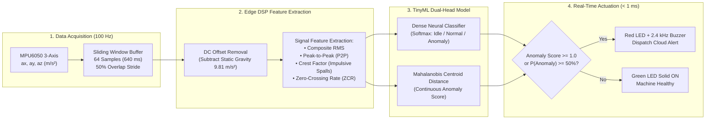

# Hardware Wiring, TinyML DSP Pipeline & Mechanical Mounting Guide — 09 Edge AI Anomaly Detection

This document details the **Fast-I2C (`400 kHz`)** hardware interface between the **ESP32** and the **MPU6050** 6-DoF MEMS Inertial Measurement Unit (IMU), illustrates the on-device **TinyML DSP & Dual-Head Inference Pipeline**, and provides mechanical coupling guidelines for industrial predictive maintenance.

---

## 1. Hardware Pinout Mapping Table (ESP32 + MPU6050)

| Component | Module Terminal | ESP32 (DevKit V1) | Electrical Function & Notes |
| :--- | :--- | :---: | :--- |
| **MPU6050 IMU** | `VCC` | `3V3` | Regulated 3.3V DC supply |
| **MPU6050 IMU** | `GND` | `GND` | Common ground reference |
| **MPU6050 IMU** | `SDA` | `GPIO 21` | I2C Serial Data (Fast Mode `400 kHz`) |
| **MPU6050 IMU** | `SCL` | `GPIO 22` | I2C Serial Clock (Default 7-bit address `0x68`) |
| **MPU6050 IMU** | `AD0` | `GND` / Floating | Keep `LOW` to select I2C address `0x68` |
| **Mode / Sim Push Button** | Terminal 1 | `GPIO 14` | `INPUT_PULLUP` mode (cycles test vibration profiles `0/1/2`) |
| **Green LED (Normal)** | Anode (`+`) | `GPIO 26` (via 220 Ω) | Illuminated during `IDLE` or `NORMAL_OPERATION` |
| **Red LED (Anomaly)** | Anode (`+`) | `GPIO 27` (via 220 Ω) | Illuminated when `ANOMALY_DETECTED` |
| **Alarm Piezo Buzzer** | Positive (`+`) | `GPIO 25` | Emits a 2.4 kHz acoustic alert burst during anomalies |

---

## 2. On-Device DSP Feature Extraction & TinyML Inference Pipeline

Why execute vibration signal processing directly on the microcontroller (**Edge AI**) instead of streaming raw sensor data to the cloud?
Sampling a 3-axis accelerometer at **100 Hz** generates **300 floating-point values per second** (`1,080,000 samples/hour`). Continuous wireless transmission of raw waveforms quickly exhausts network bandwidth and battery capacity. By running a **TinyML** pipeline locally on the ESP32, the entire 64-sample window is distilled into compact spectral features and classified in **less than 250 microseconds (`~206 µs`)**:

---

## 3. Mechanical Mounting & Acoustic Coupling Best Practices

In industrial vibration monitoring, the fidelity of high-frequency fault signatures depends critically on the stiffness of the **mechanical coupling path** between the **MPU6050** PCB and the machine housing (motor stator frame, pump volute, or bearing pillow block):

1. **Never Use Thick Foam Double-Sided Tape:** Compliant foam tape acts as a mechanical low-pass elastomer damper, attenuating high-frequency impulsive shock pulses (high **Crest Factor**) produced by early-stage rolling-element bearing spalls or gear tooth pitting.
2. **Use Rigid M3 Machine Screws, High-Pull Neodymium Magnets, or Cyanoacrylate/Epoxy Adhesive:** Mount the GY-521 (MPU6050) module rigidly as close as possible to the load-bearing shaft housing.
3. **Orientation Invariance (`X`, `Y`, `Z` Axes):**
   - Because [`anomaly_model.h`](../src/edge_ai_anomaly_detection/anomaly_model.h) subtracts the per-axis mean across each 640 ms window (`ac = samples[i] - mean`) to eliminate static gravitational acceleration ($9.80665\text{ m/s}^2$) and computes the **Composite 3D RMS** ($\sqrt{\text{RMS}_x^2 + \text{RMS}_y^2 + \text{RMS}_z^2}$), the classifier remains invariant to arbitrary mounting tilt or vertical/horizontal orientation.
