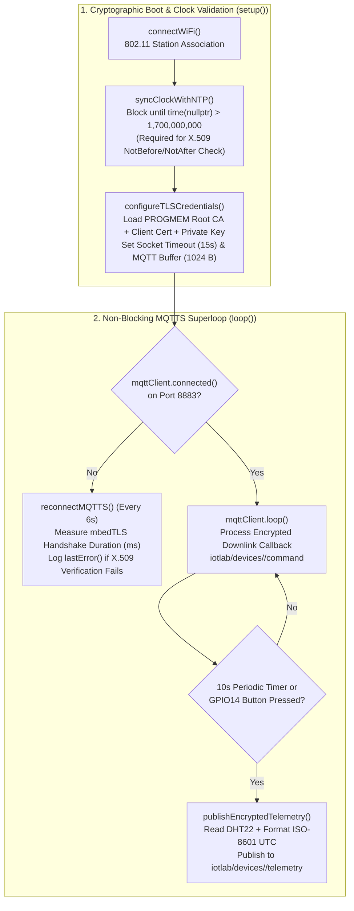

# 10 — Secure End-to-End Encrypted Telemetry (mTLS X.509 & MQTTS Port 8883)

**Difficulty Level:** Advanced (X.509 Mutual TLS Authentication, Pre-Handshake SNTP Clock Validation, mbedTLS Diagnostics & AWS IoT Core / HiveMQ Cloud)  
**Target Architecture:** Espressif ESP32 (`WiFiClientSecure` / Hardware-Accelerated `mbedTLS` + `PubSubClient`)

---

## 1. Architectural Overview & System Design

Transmitting IoT sensor telemetry or actuator commands over unencrypted MQTT (`TCP Port 1883`) exposes credentials and payloads in cleartext, leaving deployments vulnerable to passive packet sniffing (`Wireshark`), unauthorized command injection, and Man-in-the-Middle (MitM) broker spoofing. This project implements a production-grade **End-to-End Encrypted MQTTS Telemetry & Command Architecture (`TCP Port 8883`)** utilizing **TLS 1.2/1.3** and **X.509 Public Key Infrastructure (PKI)**:

1. **Mandatory Pre-Handshake SNTP Clock Synchronization (`syncClockWithNTP`):** Synchronizes the ESP32 internal RTC via UDP port `123` (`pool.ntp.org` / `time.google.com`) and verifies that the Unix epoch exceeds `1700000000` **before** initiating the TLS handshake, ensuring accurate validation of X.509 certificate validity windows (`NotBefore` and `NotAfter`).
2. **Tri-Mode Cryptographic Authentication Architecture (`configureTLSCredentials`):**
   - **AWS IoT Core Mode (Mutual TLS / mTLS X.509):** Authenticates both the cloud server (`setCACert(ROOT_CA_PEM)`) and the hardware Thing identity (`setCertificate(CLIENT_CERT_PEM)` + `setPrivateKey(PRIVATE_KEY_PEM)`) stored entirely in Flash ROM (`PROGMEM`).
   - **HiveMQ Cloud Serverless Mode (Server-Verified TLS + SASL Credentials):** Validates the broker's certificate chain against `ROOT_CA_PEM` (ISRG Root X1) and authenticates the client over the encrypted tunnel using `MQTTS_USERNAME` and `MQTTS_PASSWORD`.
   - **Wokwi Simulation Fallback Mode:** Automatically connects to `broker.emqx.io:8883` over TLS when `secrets.h` is omitted or left at template defaults, enabling immediate zero-setup simulation.
3. **ISO-8601 Time-Stamped Uplink & Secure Downlink Shadow:** Publishes environmental telemetry (**DHT22**) with UTC ISO-8601 timestamps (`2026-11-15T14:48:12Z`), monotonic sequence counters, and free heap diagnostics, while subscribing to encrypted downlink actuator commands (`{"actuator":true}`).

---

## 2. Hardware Bill of Materials (BOM) & Peripheral Interface Specs

| Component | Quantity | Interface / Protocol | Electrical Specification | Notes |
| :--- | :---: | :--- | :--- | :--- |
| **ESP32 DevKit V1** | 1 | Wi-Fi + Hardware AES/SHA/RSA Crypto | 3.3V CMOS logic (`~45 KB` SRAM used by mbedTLS) | Dual-core Xtensa LX6 with hardware crypto engine |
| **DHT22 (AM2302) Sensor** | 1 | Digital Single-Wire | 3.3V DC; -40 to +80 °C, 0–100 %RH | Environmental telemetry source |
| **Momentary Push Button** | 1 | Digital GPIO Input (`INPUT_PULLUP`) | Active-LOW switch to `GND` | Triggers immediate encrypted MQTTS publish |
| **TLS Session LED (Blue)** | 1 | Digital GPIO Output | 3.3V via 220 Ω resistor | Solid ON when Port 8883 TLS session is established |
| **Cloud Actuator LED (Green)**| 1 | Digital GPIO Output | 3.3V via 220 Ω resistor | Controlled remotely via encrypted downlink topic |

### Pin Assignment Matrix

| Functional Signal | Component Terminal | ESP32 GPIO | Electrical Configuration |
| :--- | :--- | :---: | :--- |
| **DHT22 Data Line** | `SDA` / `DATA` | `GPIO 4` | 1-Wire digital input/output |
| **Instant Publish Button** | Terminal 1 | `GPIO 14` | Internal pull-up (`INPUT_PULLUP`), active `LOW` |
| **TLS Session Status LED** | Anode (`+`) | `GPIO 2` | Blinks during Wi-Fi/NTP; solid ON when MQTTS connected |
| **Cloud Actuator Output** | Anode (`+`) | `GPIO 26` | Push-pull digital output controlled by cloud downlink |

---

## 3. Firmware Architecture & Non-Blocking State Machine Design

The firmware ([`secure_tls_telemetry.ino`](./src/secure_tls_telemetry/secure_tls_telemetry.ino)) sequences network association, SNTP clock validation, X.509 mbedTLS context initialization, and non-blocking MQTTS session management:



---

## 4. Directory Structure

```text
10-secure-tls-telemetry/
├── README.md                                      # System architecture, BOM, mTLS design & build guide
├── src/
│   └── secure_tls_telemetry/
│       ├── secure_tls_telemetry.ino               # Main ESP32 MQTTS TLS/mTLS & SNTP firmware
│       └── secrets.example.h                      # PROGMEM X.509 PEM template (Root CA, Cert, Private Key)
├── schematics/
│   ├── diagram.json                               # Wokwi circuit netlist (ESP32 + DHT22 + Button + LEDs)
│   └── wiring-guide.md                            # Pinout, mTLS sequence diagram & hardware key security
└── docs/
    └── aws-iot-and-hivemq-setup.md                # AWS IoT Core mTLS policy, HiveMQ Cloud setup & UART logs
```

---

## 5. Build, Flashing & Wokwi Simulation Instructions

### Required Arduino Libraries
Install via **Arduino IDE Library Manager** or `arduino-cli`:
1. **`PubSubClient`** by *Nick O'Leary*
2. **`DHT sensor library`** by *Adafruit* (plus **`Adafruit Unified Sensor`**)
*(Both `WiFiClientSecure.h` and `time.h` are built into the official Arduino-ESP32 core).*

### A. Building & Flashing for AWS IoT Core or HiveMQ Cloud (Physical Hardware)
1. Copy the certificate and configuration template:
   ```bash
   cp src/secure_tls_telemetry/secrets.example.h src/secure_tls_telemetry/secrets.h
   ```
2. Follow [`docs/aws-iot-and-hivemq-setup.md`](./docs/aws-iot-and-hivemq-setup.md) to populate `src/secure_tls_telemetry/secrets.h` with your X.509 PEM certificates (`ROOT_CA_PEM`, `CLIENT_CERT_PEM`, `PRIVATE_KEY_PEM`) and broker endpoint.
3. Compile and upload to your **ESP32**:
   ```bash
   arduino-cli lib install "PubSubClient" "DHT sensor library" "Adafruit Unified Sensor"
   arduino-cli compile --fqbn esp32:esp32:esp32 src/secure_tls_telemetry
   arduino-cli upload -p /dev/ttyUSB0 --fqbn esp32:esp32:esp32 src/secure_tls_telemetry
   ```

### B. Zero-Config Testing in Wokwi Simulator
1. Without creating `secrets.h`, open [`secure_tls_telemetry.ino`](./src/secure_tls_telemetry/secure_tls_telemetry.ino) and [`schematics/diagram.json`](./schematics/diagram.json) in the [Wokwi ESP32 Simulator](https://wokwi.com/projects/new/esp32) or **Wokwi for VS Code**.
2. Add `PubSubClient` and `DHT sensor library` in the Library Manager and start the simulation.
3. The ESP32 automatically synchronizes its clock via SNTP, completes a TLS handshake with `broker.emqx.io:8883`, and begins publishing encrypted ISO-8601 telemetry every 10 seconds (or immediately when you press the green push button on `GPIO 14`).
