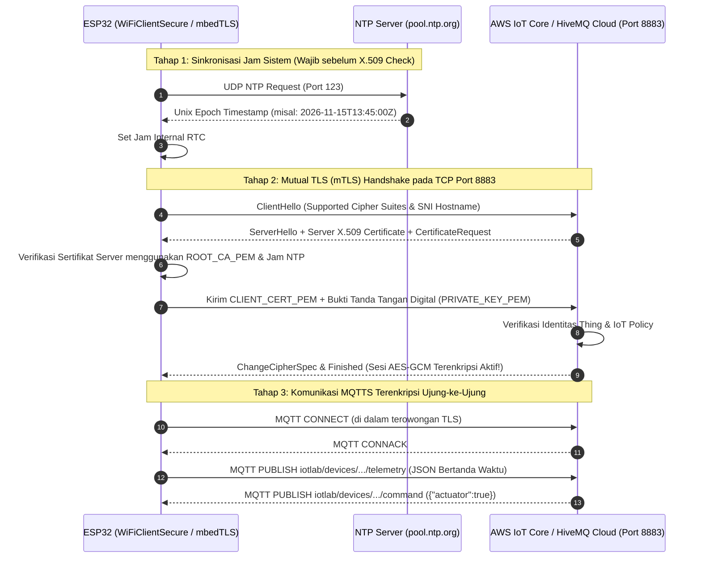

# Panduan Pengkabelan & Arsitektur Keamanan mTLS — 10 Secure TLS Telemetry

Dokumen ini menjelaskan konfigurasi pin perangkat keras pada **ESP32**, diagram sekuens jabat tangan **Mutual TLS (mTLS X.509)**, perbandingan antara **MQTT (Port 1883)** dan **MQTTS (Port 8883)**, serta praktik terbaik pengamanan kunci privat pada mikrokontroler.

---

## 1. Tabel Pinout Hardware (ESP32)

| Komponen | Pin Komponen | Pin ESP32 (DevKit V1) | Fungsi & Keterangan |
| :--- | :--- | :--- | :--- |
| **Sensor DHT22** | `VCC` | `3V3` | Catu daya sensor 3.3V |
| **Sensor DHT22** | `SDA` / `DATA` | `GPIO 4` | Data digital pembacaan suhu & kelembapan |
| **Sensor DHT22** | `GND` | `GND` | Ground bersama |
| **Tombol Publish Instan** | Kaki 1 | `GPIO 14` | Mode `INPUT_PULLUP` (Mengirim telemetri terenkripsi saat ditekan) |
| **LED Status TLS** | Anoda (`+`) | `GPIO 2` (via 220Ω) | Berkedip saat koneksi Wi-Fi, menyala penuh saat sesi TLS Port 8883 aktif |
| **LED Cloud Actuator** | Anoda (`+`) | `GPIO 26` (via 220Ω) | Dikendalikan dari Cloud melalui topik perintah terenkripsi |

---

## 2. Diagram Alur Jabat Tangan Mutual TLS (`sequenceDiagram`)

Mengapa sinkronisasi waktu **NTP (`configTime`)** wajib dijalankan sebelum koneksi TLS dimulai?
Saat ESP32 pertama kali menyala tanpa baterai RTC, jam internalnya bernilai `1 Januari 1970`. Ketika stack **mbedTLS** pada ESP32 memeriksa sertifikat X.509 milik server Cloud (yang diterbitkan misalnya pada tahun `2025` hingga `2038`), sertifikat tersebut akan dianggap **belum berlaku (`BADCERT_FUTURE`)** dan koneksi langsung ditolak!

---

## 3. Perbandingan MQTT Biasa (Port 1883) vs MQTTS (Port 8883)

| Aspek Keamanan | MQTT Standar (`Port 1883`) | MQTTS TLS + Password (`Port 8883`) | MQTTS Mutual TLS / mTLS (`Port 8883`) |
| :--- | :--- | :--- | :--- |
| **Enkripsi Payload** | Tidak ada (*Plaintext*, mudah disadap dengan Wireshark) | Terenkripsi penuh (TLS 1.2 / 1.3 AES-GCM) | Terenkripsi penuh (TLS 1.2 / 1.3 AES-GCM) |
| **Verifikasi Keaslian Server** | Tidak ada (Rentan *DNS Spoofing / MitM*) | Ya, melalui `ROOT_CA_PEM` | Ya, melalui `ROOT_CA_PEM` |
| **Autentikasi Klien (Perangkat)** | Username & Password dalam teks terbuka | Username & Password di dalam terowongan TLS | **Kriptografi Kunci Publik X.509** (`CLIENT_CERT_PEM` + `PRIVATE_KEY_PEM`) |
| **Platform Cloud Utama** | Broker lokal internal (Mosquitto LAN) | **HiveMQ Cloud**, EMQX Cloud | **AWS IoT Core**, Azure IoT Hub, Google Cloud IoT |
| **Kebutuhan RAM (Free Heap)** | Sangat ringan (~4 KB) | Menengah (~40 KB selama Handshake) | Menengah (~45 KB selama Handshake) |

---

## 4. Praktik Terbaik Penyimpanan Kunci Privat di Produksi

1. **Jangan Pernah Commit `secrets.h` ke Git**: File `.gitignore` proyek menjaga agar hanya `secrets.example.h` yang masuk ke repositori.
2. **Aktifkan ESP32 Flash Encryption & NVS Encryption**: Pada perangkat komersial yang diproduksi massal, simpan `PRIVATE_KEY_PEM` di dalam partisi **NVS Terenkripsi** atau gunakan chip *Secure Element* perangkat keras (**ATECC608A**) sehingga kunci privat tidak dapat diekstrak meskipun seseorang membongkar chip Flash SPI secara fisik.
3. **Satu Sertifikat Unik per Perangkat**: Jangan gunakan satu file `CLIENT_CERT_PEM` yang sama untuk 100 perangkat. Jika satu perangkat di lapangan dicuri, Anda cukup mencabut (*Revoke*) sertifikat perangkat tersebut di konsol AWS IoT Core tanpa mengganggu 99 perangkat lainnya.
