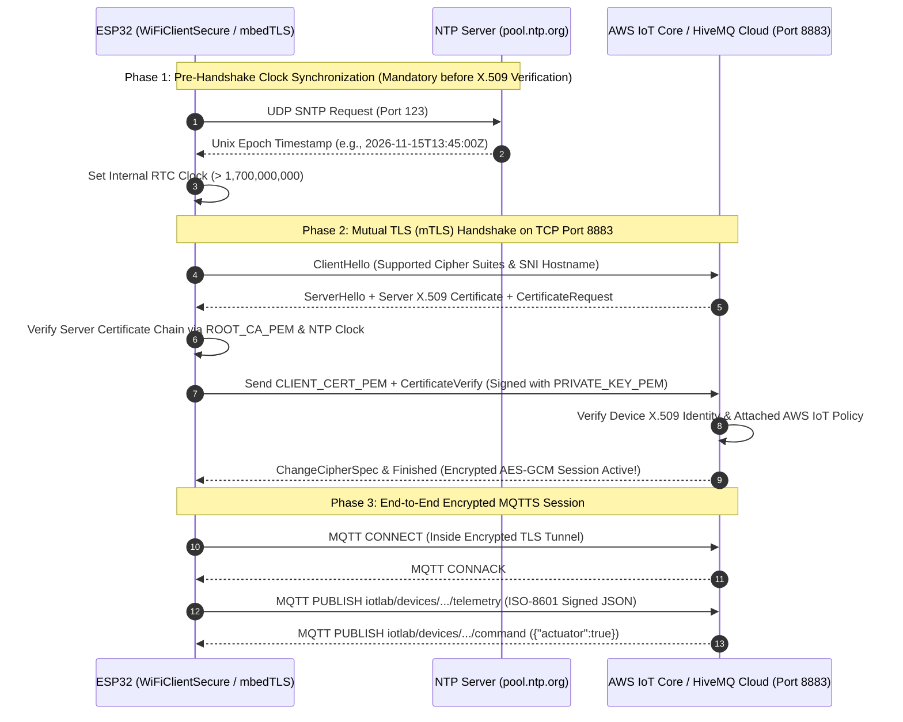

# Hardware Wiring & Mutual TLS (mTLS X.509) Security Architecture — 10 Secure TLS Telemetry

This document specifies the **ESP32** hardware pin assignments, illustrates the **Mutual TLS (mTLS X.509)** cryptographic handshake sequence, compares cleartext **MQTT (`Port 1883`)** against **MQTTS (`Port 8883`)**, and outlines production key-storage hardening practices.

---

## 1. Hardware Pinout Mapping Table (ESP32)

| Component | Component Terminal | ESP32 (DevKit V1) | Electrical Function & Notes |
| :--- | :--- | :---: | :--- |
| **DHT22 Sensor** | `VCC` | `3V3` | Regulated 3.3V DC sensor supply |
| **DHT22 Sensor** | `SDA` / `DATA` | `GPIO 4` | 1-Wire digital temperature & humidity data line |
| **DHT22 Sensor** | `GND` | `GND` | Common ground reference |
| **Instant Publish Button** | Terminal 1 | `GPIO 14` | `INPUT_PULLUP` mode (dispatches encrypted telemetry on falling edge) |
| **TLS Session Status LED** | Anode (`+`) | `GPIO 2` (via 220 Ω) | Blinks during Wi-Fi/NTP sync; solid ON when Port 8883 TLS session is active |
| **Cloud Actuator LED** | Anode (`+`) | `GPIO 26` (via 220 Ω) | Controlled remotely via encrypted downlink command topic |

---

## 2. Mutual TLS (mTLS X.509) Handshake Sequence Diagram (`sequenceDiagram`)

Why is **SNTP clock synchronization (`configTime`)** strictly required before initiating a TLS handshake?
When an ESP32 boots cold without a battery-backed RTC, its system clock defaults to the Unix Epoch (`1970-01-01T00:00:00Z`). During the TLS handshake, the **mbedTLS** X.509 verifier checks whether the current system time falls within the server certificate's validity window (`NotBefore` $\le t_{\text{now}} \le$ `NotAfter`, e.g., `2025` to `2038`). If the system clock reads `1970`, mbedTLS immediately aborts the handshake with `MBEDTLS_ERR_X509_CERT_VERIFY_FAILED` (`BADCERT_FUTURE`)!

---

## 3. Security Comparison: Cleartext MQTT (`Port 1883`) vs. MQTTS (`Port 8883`)

| Security Dimension | Standard MQTT (`Port 1883`) | MQTTS TLS + Password (`Port 8883`) | MQTTS Mutual TLS / mTLS (`Port 8883`) |
| :--- | :--- | :--- | :--- |
| **Payload Confidentiality** | None (*Cleartext*, trivially intercepted via Wireshark) | Full transport encryption (TLS 1.2 / 1.3 ECDHE-AES-GCM) | Full transport encryption (TLS 1.2 / 1.3 ECDHE-AES-GCM) |
| **Server Authenticity** | None (Vulnerable to *ARP/DNS Spoofing & MitM*) | Verified against pinned `ROOT_CA_PEM` | Verified against pinned `ROOT_CA_PEM` |
| **Client (Device) Auth** | Cleartext Username & Password | Username & Password inside TLS tunnel | **X.509 Asymmetric Cryptography** (`CLIENT_CERT_PEM` + `PRIVATE_KEY_PEM`) |
| **Primary Cloud Brokers** | Internal LAN brokers only (Mosquitto LAN) | **HiveMQ Cloud**, EMQX Cloud | **AWS IoT Core**, Azure IoT Hub, Enterprise Brokers |
| **SRAM Heap Footprint** | Minimal (~4 KB) | Moderate (~40 KB during handshake) | Moderate (~45 KB during handshake) |

---

## 4. Production Private Key Storage & Hardware Hardening

1. **Never Commit `secrets.h` to Version Control:** The repository `.gitignore` excludes `secrets.h` so only the sanitized template `secrets.example.h` is tracked in Git.
2. **Enable ESP32 Flash Encryption & NVS Encryption:** On commercial production units, store `PRIVATE_KEY_PEM` inside an **Encrypted NVS Partition** backed by eFuse keys (`Flash Encryption` + `Secure Boot v2`), or offload elliptic-curve (`ECC P-256`) signing to a dedicated hardware **Secure Element (`Microchip ATECC608B`)** over I2C so the private key can never be extracted via physical SPI flash dumping.
3. **Provision Unique Per-Device Certificates:** Never share a single `CLIENT_CERT_PEM` across an entire fleet. Provisioning a unique X.509 certificate per device allows you to revoke a single compromised or stolen field unit in the AWS IoT Core console without disrupting the remaining fleet.
