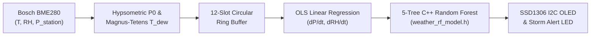

# Project 11: Edge TinyML Local Weather Predictor

> **Track II — Phase 4: Classical TinyML, Sensor Fusion & Predictive Maintenance on MCU**  
> **Target MCU:** ESP32 / ESP8266 | **Model:** 5-Tree Random Forest Classifier (`micromlgen` / `emlearn` C++ port) | **Sensors:** Bosch BME280 + SSD1306 OLED

---

## 1. Overview & Architecture

Cloud-based weather APIs provide regional forecasts on a $10\text{–}25\text{ km}$ grid, often missing localized microclimates, mountain valleys, or sudden convective squall lines—and failing completely in off-grid agricultural or maritime deployments.

This project implements a **zero-dependency, sub-15-microsecond Random Forest classifier** executing directly on an ESP32/ESP8266. By combining a **12-slot circular synoptic ring buffer**, **Ordinary Least Squares (OLS) linear regression**, and **Magnus-Tetens thermodynamic dew-point modeling**, the firmware classifies the 1–2 hour local weather trajectory into four actionable meteorological regimes:

| Class ID | Label | Synoptic Signature |
| :---: | :--- | :--- |
| `0` | `CLEAR_STABLE` | $P_0 \ge 1012\text{ hPa}$, $\Delta P / \Delta t \ge -0.35\text{ hPa/hr}$, wide dew point spread ($T - T_{\text{dew}} > 4.2\,^\circ\text{C}$) |
| `1` | `CLOUDY_TRANSITION` | Moderate pressure ($1006\text{–}1014\text{ hPa}$), gentle barometric fall or rising relative humidity trend |
| `2` | `RAIN_IMMINENT` | Boundary-layer saturation ($T - T_{\text{dew}} \le 2.85\,^\circ\text{C}$, $RH > 82\%$) coupled with falling barometric pressure |
| `3` | `STORM_FRONT_RAPID_DROP` | Steep synoptic pressure plunge ($\Delta P / \Delta t \le -2.45\text{ hPa/hr}$), triggering immediate storm warning |



---

## 2. Directory Structure

```text
11-ml-local-weather-predictor/
├── README.md
├── src/
│   └── ml_local_weather_predictor/
│       ├── ml_local_weather_predictor.ino
│       └── weather_rf_model.h
├── schematics/
│   ├── diagram.json
│   └── wiring-guide.md
└── docs/
    └── ml-pipeline-and-telemetry.md
```

---

## 3. Quick Start & Simulation (Wokwi / Arduino IDE / PlatformIO)

### Required Libraries
- `Adafruit BME280 Library` (`Adafruit_BME280.h`)
- `Adafruit Unified Sensor` (`Adafruit_Sensor.h`)
- `Adafruit GFX Library` & `Adafruit SSD1306` (`Adafruit_SSD1306.h`)
- `DHT sensor library` (`DHT.h` — used automatically when simulating in Wokwi without a physical BME280)

### Interactive Testing
1. Open `src/ml_local_weather_predictor/ml_local_weather_predictor.ino` in Arduino IDE or boot `schematics/diagram.json` in Wokwi.
2. Open the Serial Monitor at **115200 baud**.
3. Rotate the **Barometric Potentiometer (`GPIO 34`)** or press the red **Inject Storm Front (`GPIO 15`)** button (or type `STORM` in the Serial Monitor) to watch the OLS derivative $\Delta P / \Delta t$ plunge and the 5-tree Random Forest transition from `CLEAR_STABLE` $\rightarrow$ `CLOUDY_TRANSITION` $\rightarrow$ `STORM_FRONT_RAPID_DROP`.

---

## 4. Documentation Links
- [Hardware Wiring Guide](schematics/wiring-guide.md)
- [ML Pipeline, Feature Engineering & Python Training Script](docs/ml-pipeline-and-telemetry.md)
