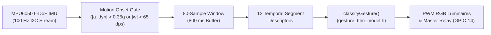

# Project 13: 6-DoF Inertial Air Gesture Controller

> **Track II — Phase 4: Classical TinyML, Sensor Fusion & Predictive Maintenance on MCU**  
> **Target MCU:** ESP32 / ESP32-S3 | **Model:** TFLM-Compatible Neural Classifier (`12 -> 8 ReLU -> 4 Softmax`) | **Sensors:** MPU6050 6-DoF IMU + RGB PWM + Master Relay

---

## 1. Overview & Architecture

Touchless human-machine interfaces (HMIs) are essential in sterile medical rooms, workshops, and smart-home wands. Using an **InvenSense MPU6050** sampled at **100 Hz**, this project implements a motion-triggered **80-sample ($800\text{ ms}$) inertial capture pipeline** that extracts **12 temporal segment descriptors** (early/late vertical acceleration means, signed pitch velocity peaks, circular phase-coupling integrals, and bimodal jerk impulse symmetry) and classifies four 3D air gestures in **66 microseconds**:

| Class ID | Gesture | Kinematic Signature | Hardware Action |
| :---: | :--- | :--- | :--- |
| `0` | `SWIPE_UP` | Early $+a_z$ upward impulse, strong $+g_y$ pitch peak ($> +110\,^\circ/\text{s}$) | Increase RGB PWM Brightness by $+25\%$ |
| `1` | `SWIPE_DOWN` | Early $-a_z$ downward impulse, strong $-g_y$ pitch peak ($< -110\,^\circ/\text{s}$) | Decrease RGB PWM Brightness by $-25\%$ |
| `2` | `CIRCLE_CW` | Phase-locked $a_x/a_y$ centripetal acceleration & roll/yaw orbital energy | Cycle RGB Color Mode (`WARM_WHITE` $\rightarrow$ `CYBER_CYAN` $\rightarrow$ `NEON_MAGENTA` $\rightarrow$ `EMERALD_GREEN`) |
| `3` | `DOUBLE_TAP` | Two high-jerk $a_z$ impact spikes ($\|\Delta a_z\| > 1.8g$) with symmetric window energy | Toggle Master Appliance Relay (`GPIO 14`) ON/OFF |



---

## 2. Directory Structure

```text
13-ml-air-gesture-controller/
├── README.md
├── src/
│   └── ml_air_gesture_controller/
│       ├── ml_air_gesture_controller.ino
│       └── gesture_tflm_model.h
├── schematics/
│   ├── diagram.json
│   └── wiring-guide.md
└── docs/
    └── ml-pipeline-and-telemetry.md
```

---

## 3. Quick Start & Interactive Wokwi Verification

1. Open `schematics/diagram.json` in Wokwi or upload `src/ml_air_gesture_controller/ml_air_gesture_controller.ino` to an ESP32.
2. You can test the full 100 Hz feature extractor + neural classifier in three ways:
   - **Physical Motion:** Wave or tap the MPU6050 sensor to trigger the motion gate automatically.
   - **Wokwi Green Pushbutton (`GPIO 15`):** Press **Trigger Air Gesture** to inject a realistic 80-sample 100 Hz waveform cycling through `SWIPE_UP`, `SWIPE_DOWN`, `CIRCLE_CW`, and `DOUBLE_TAP`.
   - **Serial Monitor (`115200 baud`):** Send `UP`, `DOWN`, `CIRCLE`, or `TAP` to trigger any gesture on demand and inspect the Softmax probability vector.

---

## 4. Documentation Links
- [Hardware Wiring Guide](schematics/wiring-guide.md)
- [ML Pipeline, Temporal Descriptors & Python Training Script](docs/ml-pipeline-and-telemetry.md)
