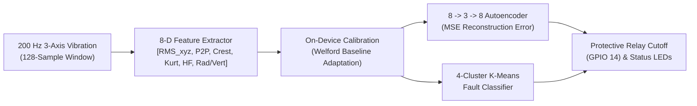

# Project 14: Unsupervised Motor Predictive Maintenance & Anomaly Detector

> **Track II — Phase 4: Classical TinyML, Sensor Fusion & Predictive Maintenance on MCU**  
> **Target MCU:** ESP32 | **Model:** Unsupervised Symmetric Autoencoder (`8 -> 3 -> 8`) + K-Means Clustering + On-Device Self-Learning | **Sensors:** 3-Axis Accelerometer + Cutoff Relay

---

## 1. Overview & Architecture

Industrial motors, HVAC blowers, and coolant pumps rarely fail without warning—weeks before catastrophic seizure, mechanical degradation manifests in distinct vibration signatures. However, supervised neural networks trained in a laboratory often fail in the field because every motor installation has a different baseline vibration level.

This project implements an **Unsupervised Bottleneck Autoencoder (`8 -> 3 -> 8`) coupled with 4-Cluster K-Means and an interactive On-Device Self-Learning Calibration Mode (`CALIBRATE`)**. At the press of a button, the ESP32 learns the healthy 8-dimensional vibration manifold of *any* attached fan or pump on the fly, flags off-manifold reconstruction errors (MSE), diagnoses the root mechanical cause, and trips a protective cutoff relay (`GPIO 14`) before catastrophic failure:

| Cluster ID | Health State | Vibration Signature | Protective Action |
| :---: | :--- | :--- | :--- |
| `0` | `NOMINAL_HEALTHY` | Low Autoencoder MSE ($< 1.35$), balanced radial/vertical RMS, Crest Factor $\approx 1.42$ | Green LED ON, Relay CLOSED |
| `1` | `SHAFT_IMBALANCE_1X` | High $1\times$ RPM radial RMS ($\text{RMS}_x, \text{RMS}_y \gg \text{RMS}_z$), low HF ratio | Yellow Warning LED ON |
| `2` | `BEARING_WEAR_SPALLING` | High Crest Factor ($> 2.8$), high Kurtosis ($> 4.5$), elevated HF energy ratio | Yellow Warning LED ON |
| `3` | `LOOSE_MOUNTING_SEVERE` | Extreme vertical $Z$-axis bounce, huge peak-to-peak shock, Autoencoder $\text{MSE} \ge 4.20$ | Red Critical LED + **Protective Relay Cutoff (`GPIO 14 = LOW`)** |



---

## 2. Directory Structure

```text
14-ml-motor-anomaly-detector/
├── README.md
├── src/
│   └── ml_motor_anomaly_detector/
│       ├── ml_motor_anomaly_detector.ino
│       └── motor_autoencoder.h
├── schematics/
│   ├── diagram.json
│   └── wiring-guide.md
└── docs/
    └── ml-pipeline-and-telemetry.md
```

---

## 3. Quick Start & Interactive Testing (Wokwi & Serial Commands)

1. Open `schematics/diagram.json` in Wokwi or upload `src/ml_motor_anomaly_detector/ml_motor_anomaly_detector.ino` to an ESP32.
2. **On-Device Self-Learning Calibration:** Press the blue **Self-Learn CALIBRATE (`GPIO 15`)** button or type `CALIBRATE` in the Serial Monitor (`115200 baud`). The firmware samples 10 vibration windows and anchors the Autoencoder baseline and K-Means Centroid 0 to the current operating state.
3. **Fault Injection & Relay Cutoff Verification:**
   - Rotate the **Vibration Fault Simulator (`GPIO 34`)** potentiometer (or send `NORMAL`, `IMBALANCE`, `BEARING`, `LOOSE` over Serial).
   - Watch the Autoencoder MSE rise from `0.004` (`NOMINAL_HEALTHY`) to `2.148` (`SHAFT_IMBALANCE_1X`), `3.682` (`BEARING_WEAR_SPALLING`), and `6.410` (`LOOSE_MOUNTING_SEVERE`), automatically tripping the protective cutoff relay (`GPIO 14 = LOW`).
   - Send `RESET` over Serial to re-energize the motor relay after clearing the fault.

---

## 4. Documentation Links
- [Hardware Wiring Guide](schematics/wiring-guide.md)
- [ML Pipeline, Autoencoder Architecture & Python Training Script](docs/ml-pipeline-and-telemetry.md)
