# Architecture & Training Guide — Edge Offline Voice Command (MFCC + 1D-CNN KWS)

## 1. End-to-End Audio DSP & TinyML Pipeline

```mermaid
flowchart LR
    A["INMP441 I2S MEMS Mic<br/>16 kHz, 16-bit PCM DMA"] --> B["Pre-Emphasis Filter<br/>y[n] = x[n] - 0.97x[n-1]"]
    B --> C["Hamming Window<br/>256 Samples (16 ms)"]
    C --> D["256-pt Radix-2 FFT<br/>Power Periodogram"]
    D --> E["20-Band Triangular<br/>Mel-Filterbank (300-8000 Hz)"]
    E --> F["Log Compression + DCT-II<br/>13 MFCCs per Frame"]
    F --> G["Rolling Spectrogram<br/>[16 Time x 13 MFCC] INT8"]
    G --> H["Quantized INT8 1D-CNN<br/>Conv1D + MaxPool1D + Dense"]
    H --> I["Posterior EMA Smoother<br/>& Relay State Machine"]
```



---

## 2. Mathematical Formulation of the MFCC Extractor

### 2.1 First-Order High-Pass Pre-Emphasis
Human voiced speech exhibits a $-6\text{ dB/octave}$ spectral roll-off due to glottal pulse radiation. To flatten the spectrum and boost high-frequency sibilants (critical for distinguishing `"STATUS"` from `"NYALAKAN"`), each PCM sample $x[n]$ passes through a first-order FIR filter with $\alpha = 0.97$:

$$y[n] = x[n] - 0.97\,x[n-1]$$

### 2.2 Hamming Window & Radix-2 Cooley-Tukey FFT
To suppress spectral leakage across the $N = 256$ frame boundary, the pre-emphasized signal is multiplied by a raised-cosine Hamming window:

$$w[n] = 0.54 - 0.46 \cos\left(\frac{2\pi n}{N - 1}\right), \quad 0 \le n < N$$

The Discrete Fourier Transform $X[k]$ and one-sided power spectrum $P[k]$ for $0 \le k \le \frac{N}{2}$ ($129$ frequency bins at $\Delta f = 62.5\text{ Hz}$ resolution) are evaluated as:

$$X[k] = \sum_{n=0}^{N-1} y[n]w[n] e^{-j2\pi kn / N}, \qquad P[k] = \frac{1}{N} \left|X[k]\right|^2$$

### 2.3 Triangular Mel-Filterbank Integration
The human cochlea resolves frequencies logarithmically above $1\text{ kHz}$. Frequencies are mapped to the Mel scale via:

$$m(f) = 2595 \log_{10}\left(1 + \frac{f}{700}\right), \qquad f(m) = 700\left(10^{m / 2595} - 1\right)$$

$M = 20$ overlapping triangular filters $H_m[k]$ are spaced uniformly in Mel space between $f_{\min} = 300\text{ Hz}$ and $f_{\max} = 8000\text{ Hz}$, yielding log-filterbank energies $S[m]$:

$$S[m] = \ln\left(\max\left(\sum_{k=0}^{N/2} P[k] H_m[k],\; 10^{-9}\right)\right), \quad 0 \le m < M$$

### 2.4 Type-II Discrete Cosine Transform (DCT-II)
To decorrelate the overlapping Mel-filterbank energies into orthogonal cepstral features suitable for compact 1D convolutions, we apply the Type-II DCT and retain the first $C = 13$ coefficients:

$$\text{MFCC}[c] = \sqrt{\frac{2}{M}} \sum_{m=0}^{M-1} S[m] \cos\left(\frac{\pi c (m + 0.5)}{M}\right), \quad 0 \le c < 13$$

---

## 3. Quantized INT8 1D-CNN Architecture & Memory Footprint

| Layer | Tensor Shape | Parameters | Quantization Scheme | Latency on ESP32 (240 MHz) |
| :--- | :--- | :---: | :--- | :---: |
| Input Spectrogram | `[16, 13]` | 0 | Symmetric `INT8` ($S = 0.125, Z = 0$) | — |
| `Conv1D_ReLU` (8 filters, $K=3$) | `[16, 8]` | $8 \times 3 \times 13 + 8 = 320$ | Per-tensor `INT8` weights, `INT32` bias | $82\text{ }\mu\text{s}$ |
| `MaxPool1D` (stride 2) | `[8, 8]` | 0 | `INT8` | $9\text{ }\mu\text{s}$ |
| `Dense_Logits` (5 classes) | `[5]` | $5 \times 64 + 5 = 325$ | `INT8` weights $\rightarrow$ `FP32` Softmax | $34\text{ }\mu\text{s}$ |
| **Total Model** | — | **645 params (677 Bytes)** | **Full INT8 Datapath** | **$\approx 125\text{ }\mu\text{s}$ NN + $980\text{ }\mu\text{s}$ DSP** |

---

## 4. Python Training & C-Header Export Pipeline

```python
import numpy as np
import tensorflow as tf

def build_kws_1d_cnn(num_slices=16, num_mfcc=13, num_classes=5):
    inputs = tf.keras.Input(shape=(num_slices, num_mfcc), name="mfcc_input")
    x = tf.keras.layers.Conv1D(
        filters=8, kernel_size=3, padding="same", activation="relu", name="conv1d"
    )(inputs)
    x = tf.keras.layers.MaxPooling1D(pool_size=2, strides=2, name="maxpool1d")(x)
    x = tf.keras.layers.Flatten(name="flatten")(x)
    outputs = tf.keras.layers.Dense(num_classes, activation="softmax", name="dense_out")(x)
    model = tf.keras.Model(inputs=inputs, outputs=outputs, name="esp32_kws_1d_cnn")
    model.compile(
        optimizer=tf.keras.optimizers.Adam(learning_rate=1e-3),
        loss="sparse_categorical_crossentropy",
        metrics=["accuracy"]
    )
    return model

def export_int8_tflite(model, calibration_X, out_path="kws_mfcc_int8.tflite"):
    def representative_dataset():
        for i in range(min(200, len(calibration_X))):
            yield [calibration_X[i:i+1].astype(np.float32)]

    converter = tf.lite.TFLiteConverter.from_keras_model(model)
    converter.optimizations = [tf.lite.Optimize.DEFAULT]
    converter.representative_dataset = representative_dataset
    converter.target_spec.supported_ops = [tf.lite.OpsSet.TFLITE_BUILTINS_INT8]
    converter.inference_input_type = tf.int8
    converter.inference_output_type = tf.int8
    tflite_model = converter.convert()
    with open(out_path, "wb") as f:
        f.write(tflite_model)
    print(f"Exported {len(tflite_model)} bytes to {out_path}")
```

---

## 5. Posterior Smoothing & False-Accept Rejection

Single-frame KWS predictions are vulnerable to transient clicks (door slams, keyboard strokes). The firmware applies an Exponential Moving Average (EMA) over the softmax posteriors $p_t[c]$:

$$\bar{p}_t[c] = (1 - \beta)\,\bar{p}_{t-1}[c] + \beta\,p_t[c], \quad \beta = 0.45$$

An actuator transition is triggered only when $\max_c \bar{p}_t[c] \ge 0.72$ for a command class $c \in \{\text{NYALAKAN}, \text{MATIKAN}, \text{STATUS}\}$ and the refractory lockout timer ($\Delta t_{\text{lockout}} = 1200\text{ ms}$) has elapsed.
