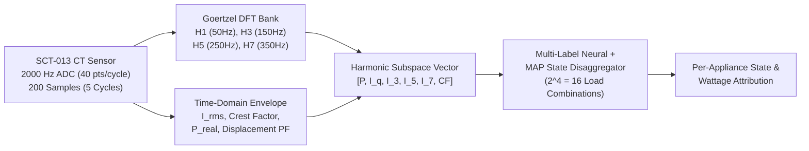

# Architecture & Training Guide — ML Energy Disaggregation (NILM)

## 1. Non-Intrusive Load Monitoring (NILM) Signal Processing Pipeline

---

## 2. Second-Order IIR Goertzel Harmonic Extraction

Rather than computing a full 200-point FFT when only odd mains harmonics ($50\text{ Hz}, 150\text{ Hz}, 250\text{ Hz}, 350\text{ Hz}$) carry load signatures, the firmware uses a **second-order Goertzel IIR filter**. For sample rate $f_s = 2000\text{ Hz}$ and window length $N = 200$ ($5$ complete $50\text{ Hz}$ cycles), the exact DFT bin index for frequency $f_m$ is $k = \frac{N f_m}{f_s} \in \{5, 15, 25, 35\}$:

$$\omega_k = \frac{2\pi k}{N}, \qquad s[n] = x[n] + 2\cos(\omega_k)\,s[n-1] - s[n-2]$$

After $N = 200$ iterations, the complexphasor $X[k]$ and RMS harmonic current $I_m$ are obtained in a single step:

$$X[k] = \frac{2}{N}\Big(s[N-1] - e^{-j\omega_k} s[N-2]\Big), \qquad I_{m,\text{rms}} = \frac{|X[k]|}{\sqrt{2}}$$

### Total Harmonic Distortion ($\text{THD}_I$) & Reactive Current ($I_q$)
From the odd harmonic RMS magnitudes $(I_1, I_3, I_5, I_7)$ and displacement power factor $\text{PF} = \cos\phi_1$, the firmware extracts:

$$\text{THD}_I = \frac{\sqrt{I_3^2 + I_5^2 + I_7^2}}{I_1} \times 100\%, \qquad I_q = I_1 \sqrt{1 - \text{PF}^2}$$

---

## 3. Orthogonal Appliance Signatures in Harmonic Phasor Space

Why can a single CT sensor separate multiple appliances running simultaneously? Because each electrical load class occupies a distinct linear vector in the 5-dimensional additive space $\mathbf{y} = [P,\; I_q,\; I_3,\; I_5,\; I_7]^\top$:

| Appliance Class | Nominal $P$ ($\text{W}$) | Reactive $I_q$ ($\text{A}$) | $I_3$ ($150\text{ Hz}$) | $I_5$ ($250\text{ Hz}$) | $I_7$ ($350\text{ Hz}$) | Physical Mechanism |
| :--- | :---: | :---: | :---: | :---: | :---: | :--- |
| `REFRIGERATOR_COMPRESSOR` | $145\text{ W}$ | $0.46\text{ A}$ | $0.06\text{ A}$ | $0.02\text{ A}$ | $0.01\text{ A}$ | Single-phase induction motor ($\text{PF} \approx 0.68$ lagging) |
| `RESISTIVE_IRON_HEATER` | $1100\text{ W}$ | $0.05\text{ A}$ | $0.02\text{ A}$ | $0.01\text{ A}$ | $0.00\text{ A}$ | Nichrome heating element ($\text{PF} \approx 0.99$, $\text{THD} < 1\%$) |
| `INVERTER_AC_SWITCHING` | $780\text{ W}$ | $0.45\text{ A}$ | $0.68\text{ A}$ | $0.42\text{ A}$ | $0.08\text{ A}$ | PFC + PWM variable-frequency compressor drive |
| `LAPTOP_SMPS_CHARGER` | $65\text{ W}$ | $0.04\text{ A}$ | $0.22\text{ A}$ | $0.16\text{ A}$ | $0.11\text{ A}$ | Uncorrected diode-bridge capacitor pulse ($\text{CF} > 2.3$, $\text{THD} > 75\%$) |

---

## 4. Multi-Label Combinatorial Disaggregation Formulation

Let $\mathbf{s} \in \{0, 1\}^4$ denote the binary activation vector of the 4 appliances ($2^4 = 16$ possible composite states), and let $\mathbf{A} \in \mathbb{R}^{5 \times 4}$ be the appliance signature matrix whose columns are the additive vectors $[P_a, I_{q,a}, I_{3,a}, I_{5,a}, I_{7,a}]^\top$.

Given the observed feature vector $\mathbf{y}$ and the neural network hidden prior $h(\mathbf{x})$, the unnormalized log-posterior of composite state $\mathbf{s}_m$ ($m \in \{0,\dots,15\}$) under diagonal covariance $\boldsymbol{\Sigma} = \text{diag}(\sigma_P^2, \sigma_q^2, \sigma_3^2, \sigma_5^2, \sigma_7^2)$ is:

$$\ell(\mathbf{s}_m) = -\frac{1}{2}\left(\mathbf{y} - \mathbf{A}\mathbf{s}_m\right)^\top \boldsymbol{\Sigma}^{-1} \left(\mathbf{y} - \mathbf{A}\mathbf{s}_m\right) + \mathbf{w}_{\text{NN}}^\top \mathbf{s}_m$$

Marginalizing the normalized softmax distribution $P(\mathbf{s}_m \mid \mathbf{y})$ over all states where appliance $a$ is active ($s_{m,a} = 1$) yields the exact per-appliance posterior probability:

$$P(s_a = 1 \mid \mathbf{y}) = \sum_{m : s_{m,a} = 1} \frac{\exp(\ell(\mathbf{s}_m))}{\sum_{j=0}^{15} \exp(\ell(\mathbf{s}_j))}$$
