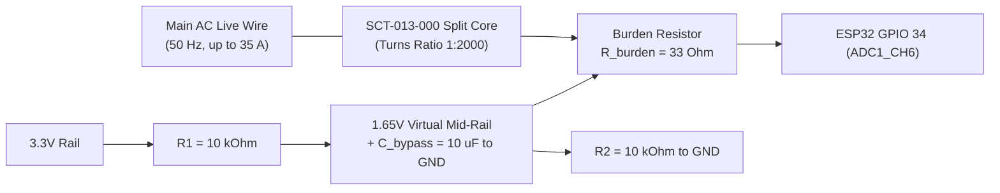

# Wiring Guide — Project 17: Non-Intrusive Load Monitoring (NILM)

## 1. Hardware Bill of Materials (BOM)

| Component | Part Number / Specification | Quantity | Function |
| :--- | :--- | :---: | :--- |
| Microcontroller | ESP32-WROOM-32D DevKitC V4 | 1 | 2,000 Hz ADC capture, Goertzel DFT filters, NILM classifier |
| Current Transformer | YHDC SCT-013-000 ($100\text{ A} : 50\text{ mA}$, $1:2000$ turns) | 1 | Non-invasive split-core AC current sensing on single main phase wire |
| Burden Resistor | $33\text{ }\Omega$, 1% Metal Film (1/2 W) | 1 | Converts CT secondary current into $\pm 1.65\text{ V}_{\text{peak}}$ voltage swing |
| Mid-Rail DC Bias Divider | $2\times 10\text{ k}\Omega$ 1% Resistors + $10\text{ }\mu\text{F}$ Capacitor | 1 | Biases AC signal at $\frac{3.3\text{ V}}{2} = 1.65\text{ V}$ for unipolar ESP32 ADC |
| OLED Display | 0.96" SSD1306 (128x64 I2C, `0x3C`) | 1 | Displays total power, $\text{THD}_I$, and 4 disaggregated appliance wattages |
| Tactile Pushbuttons | 6x6mm Momentary Switches | 4 | Interactive appliance load injectors (`FRIDGE`, `IRON`, `INV_AC`, `SMPS`) |

---

## 2. SCT-013-000 Analog Conditioning Circuit

Because the ESP32 ADC1 (`GPIO 34`) measures unipolar voltages in $[0\text{ V}, 3.3\text{ V}]$, the bipolar AC output of the SCT-013-000 current transformer must be terminated across a **burden resistor** $R_{\text{burden}}$ and biased to a **$1.65\text{ V}$ virtual mid-rail reference**:

### Burden Resistor Sizing Calculation
For a maximum residential main breaker current of $I_{\text{rms,max}} = 35\text{ A}$ ($I_{\text{peak}} = 35 \times \sqrt{2} = 49.5\text{ A}$):

$$I_{\text{sec,peak}} = \frac{I_{\text{peak}}}{N_{\text{CT}}} = \frac{49.5\text{ A}}{2000} = 24.75\text{ mA}$$

With $R_{\text{burden}} = 33\text{ }\Omega$, the peak voltage excursion around the $1.65\text{ V}$ bias is:

$$V_{\text{peak}} = I_{\text{sec,peak}} \times R_{\text{burden}} = 24.75\text{ mA} \times 33\text{ }\Omega = \pm 0.817\text{ V} \implies V_{\text{ADC}} \in [0.833\text{ V},\; 2.467\text{ V}]$$

This keeps the signal squarely inside the highest-linearity region of the ESP32 ADC1 (`ADC_ATTEN_DB_11`).

---

## 3. Pin Assignment Table

| Signal / Function | ESP32 GPIO | Direction | Notes |
| :--- | :---: | :--- | :--- |
| SCT-013 Biased Output | `GPIO 34` | Analog Input | `ADC1_CH6`, sampled at $2,000\text{ Hz}$ ($500\text{ }\mu\text{s}$ period) |
| Toggle `REFRIGERATOR_COMPRESSOR` | `GPIO 12` | Input | `INPUT_PULLUP`, toggles $145\text{ W}$ inductive load |
| Toggle `RESISTIVE_IRON_HEATER` | `GPIO 14` | Input | `INPUT_PULLUP`, toggles $1100\text{ W}$ resistive load |
| Toggle `INVERTER_AC_SWITCHING` | `GPIO 27` | Input | `INPUT_PULLUP`, toggles $780\text{ W}$ PWM inverter load |
| Toggle `LAPTOP_SMPS_CHARGER` | `GPIO 26` | Input | `INPUT_PULLUP`, toggles $65\text{ W}$ non-linear SMPS load |
| High-Load Alert LED ($>1500\text{ W}$) | `GPIO 2` | Output | Active-HIGH via $220\text{ }\Omega$ resistor |
| SSD1306 OLED `SDA` / `SCL` | `GPIO 21` / `GPIO 22` | I2C | Address `0x3C` |

---

## 4. Safety Warning (High-Voltage Mains Isolation)

> [!CAUTION]
> Clamp the **SCT-013-000** around **only ONE insulated conductor** (either Live/Phase OR Neutral, never both simultaneously, or the magnetic fluxes will cancel to zero). Never open-circuit a current transformer secondary without a burden resistor installed while clamped to an energized conductor.
