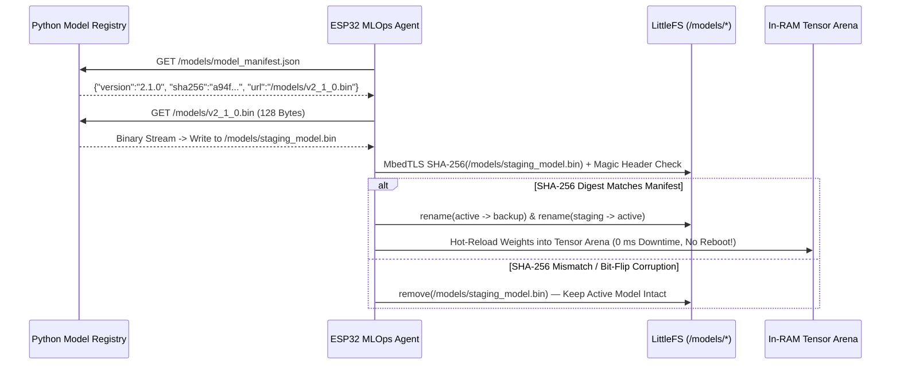

# Architecture & Training Guide — Edge MLOps Dynamic Model Hot-Swapping

## 1. Why Decouple Neural Network Weights from Application Firmware?

In traditional embedded ML deployments (`xxd -i model.tflite > model_data.h`), updating a neural network's weights to compensate for **sensor concept drift** requires recompiling the entire C++ firmware image ($\approx 900\text{ KB}$), streaming a full OTA flash partition update over Wi-Fi, and **rebooting the microcontroller** (halting real-time control loops and dropping network sockets).

This project implements a **Zero-Reboot Edge MLOps Pipeline** that separates the **C++ Inference Runtime** (compiled once in flash) from the **Quantized Model Binary (`/models/active_model.bin` on LittleFS)**:



---

## 2. Binary Model Container Format (`EML1`) & Cryptographic Verification

Every model file stored on LittleFS adheres to a strict 128-byte packed binary layout (`struct DynamicModelBinary`):

| Byte Offset | Field | Type | Description |
| :---: | :--- | :---: | :--- |
| `0x00 .. 0x03` | `magic[4]` | `uint8_t[4]` | ASCII `'E', 'M', 'L', '1'` (`0x314C4D45`) |
| `0x04 .. 0x09` | `version_{major,minor,patch}` | `uint16_t[3]` | Semantic version tuple (e.g., `2.1.0`) |
| `0x0A .. 0x0B` | `quant_scheme` | `uint16_t` | `0x0008` (Symmetric per-tensor `INT8`) |
| `0x0C .. 0x17` | `input_dim, hidden_dim, output_dim` | `uint32_t[3]` | Tensor dimensions (`4 -> 8 -> 3`) |
| `0x18 .. 0x1B` | `input_scale` | `float` | IEEE-754 input quantization scale factor |
| `0x1C .. 0x3B` | `w1[8][4]` | `int8_t[32]` | Quantized Layer-1 weights |
| `0x3C .. 0x5B` | `b1[8]` | `int32_t[8]` | Quantized Layer-1 biases |
| `0x5C .. 0x73` | `w2[3][8]` | `int8_t[24]` | Quantized Layer-2 weights |
| `0x74 .. 0x7F` | `b2[3]` | `int32_t[3]` | Quantized Layer-2 biases |

Before any downloaded file is promoted to `/models/active_model.bin`, `SHA256Verifier::computeFileHex()` streams the file through the ESP32's hardware-accelerated `mbedtls_md_context_t` (`MBEDTLS_MD_SHA256`):

$$\text{Accept}(\mathcal{M}_{\text{stage}}) \iff \Big(\text{SHA256}(\mathcal{M}_{\text{stage}}) \equiv H_{\text{manifest}}\Big) \;\land\; \Big(\text{magic} \equiv \texttt{"EML1"}\Big)$$

---

## 3. Python Model Registry & Binary Packager Script

Run the script below on your workstation to pack quantized `INT8` weights into `v2_1_0.bin`, compute its SHA-256 manifest, and serve both over HTTP for ESP32 fleet nodes:

```python
#!/usr/bin/env python3
"""
Edge MLOps Model Packager & HTTP Registry Server for Project 18.
Generates `v2_1_0.bin` and `model_manifest.json` with SHA-256 integrity hashes.
"""
import hashlib
import http.server
import json
import os
import socketserver
import struct

def pack_eml1_model(major, minor, patch, input_scale, w1, b1, w2, b2):
    header = struct.pack(
        "<4sHHHIII f",
        b"EML1",
        major, minor, patch,
        0x0008,
        4, 8, 3,
        input_scale
    )
    w1_bytes = struct.pack("<32b", *[val for row in w1 for val in row])
    b1_bytes = struct.pack("<8i", *b1)
    w2_bytes = struct.pack("<24b", *[val for row in w2 for val in row])
    b2_bytes = struct.pack("<3i", *b2)
    blob = header + w1_bytes + b1_bytes + w2_bytes + b2_bytes
    assert len(blob) == 128
    return blob

if __name__ == "__main__":
    os.makedirs("models", exist_ok=True)
    w1_v2 = [
        [-22, -28, -16, -12], [34, -14,  8, 20],
        [  6,  42,  24,  10], [ 8,  40, 22, 12],
        [-18, -22, -12, -10], [30, -12,  6, 18],
        [  4,  38,  20,   8], [-12, -16, -10, -8]
    ]
    b1_v2 = [480, -240, -680, -640, 400, -210, -620, 280]
    w2_v2 = [
        [ 34, -18, -28, -26,  30, -16, -24,  22],
        [-14,  38, -12, -10, -12,  36, -10, -10],
        [-28, -16,  42,  40, -24, -14,  38, -20]
    ]
    b2_v2 = [20, 15, -45]

    blob = pack_eml1_model(2, 1, 0, 1.5, w1_v2, b1_v2, w2_v2, b2_v2)
    sha256_hex = hashlib.sha256(blob).hexdigest()

    with open("models/v2_1_0.bin", "wb") as f:
        f.write(blob)

    manifest = {
        "model_version": "2.1.0",
        "quantization": "INT8_SYMMETRIC",
        "payload_bytes": len(blob),
        "sha256": sha256_hex,
        "download_url": "http://192.168.1.100:8080/models/v2_1_0.bin"
    }
    with open("models/model_manifest.json", "w") as f:
        json.dump(manifest, f, indent=2)

    print(f"Generated models/v2_1_0.bin (SHA-256: {sha256_hex})")
```
