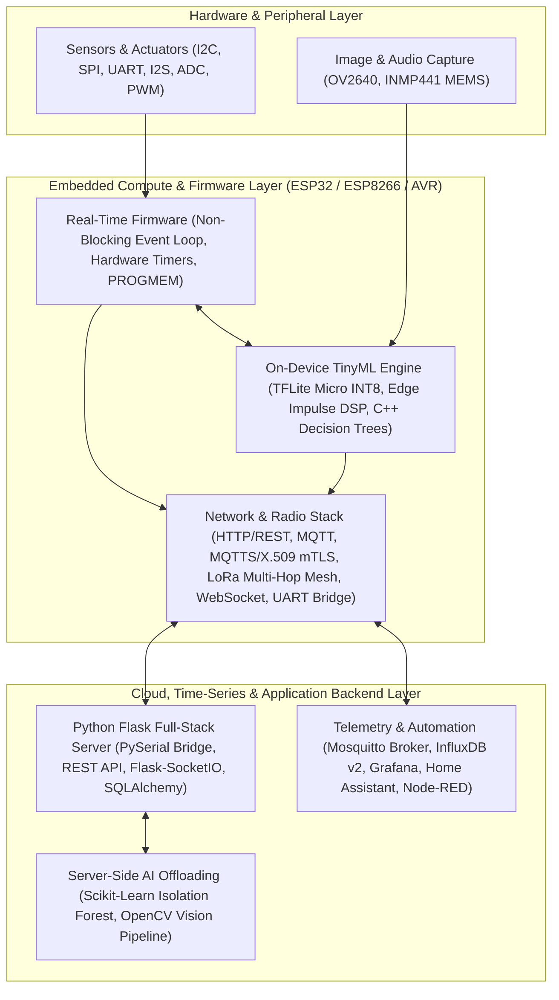

# Microcontroller IoT Journey — Embedded Systems, TinyML & Full-Stack IoT Lab (`microcontroller-iot-journey`)

A structured, production-oriented monorepo documenting **25 progressive Embedded Systems, Industrial IoT, On-Device TinyML, and Hybrid Full-Stack (MCU + Python Flask) projects**. Designed for **ESP32 / ESP32-S3**, **ESP8266**, and **AVR (Arduino Uno/Nano)** architectures using the **Arduino Core Framework**, **TensorFlow Lite for Microcontrollers (TFLM)**, and **Python Flask**.

---

## System Architecture Overview

This repository is organized into three engineering tracks spanning low-level peripheral interfacing, industrial telemetry protocols, quantized on-device neural network inference, and full-stack edge-to-server integration:



---

## Project Roadmap & Technical Matrix (01–25)

### Track I: Core Embedded & Cloud IoT Systems (Projects 01–10)

#### Phase 1: Embedded Networking, Local Peripherals & Webhook Telemetry
*Focus: Non-blocking peripheral acquisition, `PROGMEM` HTTP servers, I2C display buses, ADC signal filtering, and TLS webhook integration.*

| ID | Project Directory | Target MCU | Peripherals & Buses | Firmware Stack & Protocols | Status |
| :---: | :--- | :--- | :--- | :--- | :---: |
| **01** | [`01-web-smart-switch`](./01-web-smart-switch/) | ESP32 / ESP8266 | 2-Ch Opto-Isolated Relay, Tactile Switches (GPIO Pull-Up) | `WebServer` / `ESP8266WebServer`, `PROGMEM` SPA, Fetch REST API, Software Debounce | Completed |
| **02** | [`02-weather-room-monitor`](./02-weather-room-monitor/) | ESP32 / ESP8266 | DHT22 / BME280, SSD1306 OLED (`128x64`, I2C `0x3C`) | `Wire` (I2C), `Adafruit_SSD1306`, Heat Index Computation, ThingSpeak / ThingsBoard HTTP Client | Completed |
| **03** | [`03-smart-plant-watering`](./03-smart-plant-watering/) | ESP32 / ESP8266 | Capacitive Soil Moisture Sensor (ADC), 5V Submersible Pump + Relay | Multi-Sample Moving Average Filter, Hysteresis Controller, Cooldown State Machine, `WiFiClientSecure` (Telegram/Discord HTTPS Webhook) | Completed |

#### Phase 2: Industrial Telemetry Protocols, Time-Series Storage & Access Control
*Focus: Publish-Subscribe messaging (MQTT), Modbus-RTU energy metering, time-series ingestion (InfluxDB Line Protocol), and SPI cryptographic/UID peripherals.*

| ID | Project Directory | Target MCU | Peripherals & Buses | Firmware Stack & Protocols | Status |
| :---: | :--- | :--- | :--- | :--- | :---: |
| **04** | [`04-mqtt-home-automation`](./04-mqtt-home-automation/) | ESP32 + ESP8266 | DHT22, HC-SR501 PIR Motion Sensor, Relay Actuator | `PubSubClient` (MQTT v3.1.1), Retained State, Last Will & Testament (LWT), Home Assistant / Node-RED | Completed |
| **05** | [`05-smart-energy-meter`](./05-smart-energy-meter/) | ESP32 | PZEM-004T v3.0 (UART2 Modbus-RTU + CT Coil), SSD1306 OLED | `HardwareSerial` (`GPIO16/17`), True-RMS V/I/P/kWh/PF Acquisition, InfluxDB v2 Line Protocol (`POST /api/v2/write`), Grafana | Completed |
| **06** | [`06-rfid-smart-door-lock`](./06-rfid-smart-door-lock/) | ESP32 | MFRC522 RFID Reader (SPI), 12V Solenoid Lock, Active Buzzer | `SPI`, `MFRC522`, SNTP (`configTime`) ISO-8601 Timestamps, REST API Validation + Offline NVS/RAM Fallback Cache, FastAPI/SQLite | Completed |

#### Phase 3: Production Fleet Management, Long-Range Mesh & Cryptographic Security
*Focus: Dual-partition Over-The-Air (OTA) firmware lifecycle, custom Sub-GHz LoRa multi-hop mesh routing, and Mutual TLS (mTLS) with X.509 certificates.*

| ID | Project Directory | Target MCU | Peripherals & Buses | Firmware Stack & Protocols | Status |
| :---: | :--- | :--- | :--- | :--- | :---: |
| **07** | [`07-ota-firmware-manager`](./07-ota-firmware-manager/) | ESP32 / ESP8266 | Dual-OTA Flash Partitions (`app0` / `app1`), Trigger Input | `ArduinoOTA` (mDNS Push) + `HTTPUpdate` (Manifest JSON Pull), Semantic Version Comparator, Diagnostic Web UI | Completed |
| **08** | [`08-lora-mesh-telemetry`](./08-lora-mesh-telemetry/) | ESP32 (Multi-Node) | SX1278 (433 MHz) / RFM95 (915 MHz) LoRa (SPI), HC-SR04, DHT22 | Custom Multi-Hop Mesh Framing, Deduplication Ring Buffer, CSMA Random Backoff Repeater, RSSI/SNR Link Telemetry | Completed |
| **09** | [`09-edge-ai-anomaly-detection`](./09-edge-ai-anomaly-detection/) | ESP32 | MPU6050 6-DoF IMU (I2C `0x68`), Status LEDs, Piezo Alarm | 100 Hz Deterministic Sampling, Time-Domain DSP (RMS, Crest Factor, Variance, ZCR), Hybrid Softmax + Mahalanobis Classifier, Edge Impulse Forwarder | Completed |
| **10** | [`10-secure-tls-telemetry`](./10-secure-tls-telemetry/) | ESP32 | DHT22, Telemetry Trigger & Handshake Status Indicators | `WiFiClientSecure` (MQTTS Port 8883), X.509 Mutual TLS (`mTLS` Root CA + Client Cert + Private Key), NTP Cert Expiry Validation, AWS IoT Core / HiveMQ | Completed |

---

### Track II: On-Device TinyML & Edge AI Inference (Projects 11–18)

#### Phase 4: Classical Machine Learning, Sensor Fusion & Predictive Maintenance on MCU
*Focus: Time-series feature engineering, porting classical estimators (`Scikit-Learn` Decision Trees / Random Forests / K-Means) to zero-dependency C++, and multi-dimensional sensor fusion.*

| ID | Project Directory | Target MCU | Peripherals & Buses | ML Architecture & Embedded Stack | Status |
| :---: | :--- | :--- | :--- | :--- | :---: |
| **11** | [`11-ml-local-weather-predictor`](./11-ml-local-weather-predictor/) | ESP32 | BME280 (Temperature, Humidity, Barometric Pressure via I2C) | Barometric Pressure Derivative ($\Delta P / \Delta t$) Feature Window, `Scikit-Learn` Random Forest / Decision Tree ported to C++ via `micromlgen` / `emlearn` | Completed |
| **12** | [`12-ml-electronic-nose-gas`](./12-ml-electronic-nose-gas/) | ESP32 | Multi-Gas Sensor Array (MQ-135, MQ-2, BME680 VOC Sensor) | Multi-Channel ADC Normalization, Edge Impulse Fully Connected Neural Network (FCNN) Odor/VOC Classifier, MQTT Alerting | Completed |
| **13** | [`13-ml-air-gesture-controller`](./13-ml-air-gesture-controller/) | ESP32 / ESP32-S3 | MPU6050 6-Axis Accelerometer & Gyroscope (I2C Fast Mode 400 kHz) | 6-DoF Sliding Window Tensor, TensorFlow Lite for Microcontrollers (TFLM) Continuous Gesture Classifier | Completed |
| **14** | [`14-ml-motor-anomaly-detector`](./14-ml-motor-anomaly-detector/) | ESP32 | ADXL345 / MPU6050 Digital Accelerometer (SPI / I2C) | FFT Spectral Binning, Unsupervised K-Means Clustering / Autoencoder Reconstruction Error for Bearing Fault Detection | Completed |

#### Phase 5: Advanced Edge AI — Audio DSP, Embedded Computer Vision & Edge MLOps
*Focus: I2S DMA audio capture, Mel-Frequency Cepstral Coefficients (MFCC), quantized `INT8` Convolutional Neural Networks, and dynamic `.tflite` model hot-swapping over LittleFS.*

| ID | Project Directory | Target MCU | Peripherals & Buses | ML Architecture & Embedded Stack | Status |
| :---: | :--- | :--- | :--- | :--- | :---: |
| **15** | [`15-edge-offline-voice-command`](./15-edge-offline-voice-command/) | ESP32 / ESP32-S3 | INMP441 Omnidirectional MEMS Microphone (I2S DMA Bus) | 16 kHz I2S PCM Capture, On-Device MFCC Spectrogram Extraction, Quantized `INT8` 1D/2D-CNN Keyword Spotting (TFLM) | Completed |
| **16** | [`16-esp32s3-vision-object-counter`](./16-esp32s3-vision-object-counter/) | ESP32-S3 / ESP32-CAM | OV2640 Camera Sensor (DVP Parallel Interface + PSRAM) | Edge Impulse FOMO (*Faster Objects, More Objects*) / Quantized `INT8` MobileNetV2, Real-Time Centroid Tracking & Counting | Completed |
| **17** | [`17-ml-energy-disaggregation-nilm`](./17-ml-energy-disaggregation-nilm/) | ESP32 | SCT-013 Non-Invasive Current Transformer / PZEM-004T | High-Frequency Current Transient & Harmonic Signature Extraction, 1D-CNN / Lightweight LSTM Non-Intrusive Load Monitoring (NILM) | Completed |
| **18** | [`18-ota-tflite-model-updater`](./18-ota-tflite-model-updater/) | ESP32 | Onboard SPI Flash partitioned with `LittleFS` / `SPIFFS` | Decoupled TFLM Arena & Dynamic `.tflite` FlatBuffer Loader from `LittleFS`, HTTPS Model Binary Fetching without Firmware Reflash | Completed |

---

### Track III: Full-Stack Hybrid IoT Architectures — MCU + Python Flask (Projects 19–25)

#### Phase 6: Deterministic USB-UART Serial Bridge (AVR / Arduino + Flask)
*Focus: Framing full-duplex serial protocols over UART (`pyserial`), thread-safe hardware access in Python Flask, and relational persistence with SQLite.*

| ID | Project Directory | Target Hardware | Peripherals & Interface | Firmware & Backend Stack | Status |
| :---: | :--- | :--- | :--- | :--- | :---: |
| **19** | [`19-flask-serial-led-controller`](./19-flask-serial-led-controller/) | Arduino Uno / Nano / ESP32 | PWM LED Array, SG90 Servo Motor, Relay Module (UART USB) | ASCII Command Parser (`.ino`), Python Flask, `pyserial` Thread-Safe Serial Singleton, Responsive Control UI | Completed |
| **20** | [`20-flask-serial-sensor-logger`](./20-flask-serial-sensor-logger/) | Arduino Uno / Nano / ESP32 | DHT11 / LM35 Temperature Sensor (UART 115200 bps) | Background Serial Poller Thread, Flask REST Endpoints, SQLite3 Time-Series Persistence, Dynamic CSV Stream Export | Completed |

#### Phase 7: Wireless RESTful Telemetry & Bi-Directional WebSockets (ESP + Flask)
*Focus: Token-authenticated HTTP REST ingestion, low-latency full-duplex event synchronization via WebSockets (`Flask-SocketIO`), and ORM-backed access control.*

| ID | Project Directory | Target Hardware | Peripherals & Interface | Firmware & Backend Stack | Status |
| :---: | :--- | :--- | :--- | :--- | :---: |
| **21** | [`21-flask-rest-api-weather-station`](./21-flask-rest-api-weather-station/) | ESP32 / ESP8266 | BME280 Environmental Sensor (I2C), Wi-Fi Station | `HTTPClient` JSON POST with `X-API-Key` Auth Header, Flask RESTful Blueprint, SQLite/SQLAlchemy, Interactive `Chart.js` Frontend | Completed |
| **22** | [`22-flask-socketio-realtime-hub`](./22-flask-socketio-realtime-hub/) | ESP32 | Tactile Interrupt Buttons, Relay Actuators, Wi-Fi | WebSocket Client (`WebSocketsClient`), `Flask-SocketIO` Event Loop, Sub-50ms Bi-Directional State Synchronization | Completed |
| **23** | [`23-flask-rfid-attendance-system`](./23-flask-rfid-attendance-system/) | ESP32 / ESP8266 | MFRC522 RFID (SPI), SSD1306 OLED (I2C), Piezo Buzzer | UID Verification via Flask REST API, `Flask-SQLAlchemy` User & Attendance ORM, Admin Audit Dashboard, OLED Response Rendering | Completed |

#### Phase 8: Edge-to-Server AI & Computer Vision Offloading (MCU + Flask + ML/CV)
*Focus: Offloading compute-intensive anomaly detection (`Scikit-Learn`) and real-time video stream processing (`OpenCV`) from memory-constrained MCUs to a Python inference server.*

| ID | Project Directory | Target Hardware | Peripherals & Interface | Firmware & Backend Stack | Status |
| :---: | :--- | :--- | :--- | :--- | :---: |
| **24** | [`24-flask-ml-anomaly-offloading`](./24-flask-ml-anomaly-offloading/) | Arduino / ESP32 | MPU6050 IMU (I2C) + MQ-135 Gas Sensor (ADC) | Raw Telemetry Streaming (UART/HTTP), Flask Inference Engine (`Scikit-Learn` Isolation Forest / Random Forest), Closed-Loop Actuator Trip | Completed |
| **25** | [`25-flask-opencv-arduino-gate`](./25-flask-opencv-arduino-gate/) | Arduino Uno / ESP32-CAM | SG90/MG996R Gate Servo, Status Indicators, Camera Feed | Flask MJPEG Video Streaming, `OpenCV` (`cv2`) Face Recognition / QR Code Decoder, Serial/HTTP Servo Gate Actuation & Image Audit Log | Completed |

---

## Repository Directory Standards

To maintain a clean separation of concerns between embedded firmware, hardware schematics, and server-side application code, projects follow one of two standardized layouts:

### 1. Standalone Embedded & TinyML Projects (`01`–`18`)

```text
<project-id>-<project-slug>/
├── README.md                          # Architecture overview, BOM, pinout, and build instructions
├── src/
│   └── <sketch_name>/
│       ├── <sketch_name>.ino          # Main Arduino C++ firmware entry point
│       ├── secrets.example.h          # Sanitized template for Wi-Fi, API keys, and X.509 certs
│       └── *.h                        # PROGMEM web assets, DSP filters, or TinyML FlatBuffer headers
├── schematics/
│   ├── diagram.json                   # Interactive Wokwi circuit simulation descriptor
│   └── wiring-guide.md                # Pin mapping tables (ESP32/ESP8266/AVR) & electrical safety notes
└── docs/
    └── *.md                           # API specifications, cloud setup guides, and serial telemetry logs
```

### 2. Full-Stack Hybrid MCU + Python Flask Projects (`19`–`25`)

```text
<project-id>-<project-slug>/
├── README.md                          # End-to-end deployment guide (Firmware + Flask Server)
├── firmware/
│   └── <sketch_name>/
│       ├── <sketch_name>.ino          # Microcontroller C++ firmware (Serial Bridge or HTTP/WS Client)
│       └── secrets.example.h          # Network and endpoint configuration template
├── backend/
│   ├── app.py                         # Python Flask application entry point & route/socket handlers
│   ├── requirements.txt               # Locked Python dependencies (flask, pyserial, scikit-learn, etc.)
│   ├── models/                        # SQLAlchemy ORM schemas or serialized Scikit-Learn (.pkl) models
│   ├── templates/
│   │   └── index.html                 # Jinja2 / Chart.js / Socket.IO dashboard templates
│   └── static/
│       ├── css/
│       └── js/
├── schematics/
│   ├── diagram.json                   # Wokwi hardware simulation circuit
│   └── wiring-guide.md                # Hardware pinout and UART/I2C wiring reference
└── docs/
    └── *.md                           # Protocol framing specs, API payloads, and test logs
```

---

## Toolchain & Development Environment Setup

### 1. Embedded Firmware Toolchain (Arduino IDE 2.x / Arduino CLI)
1. Install **Arduino IDE 2.x** or `arduino-cli`.
2. Register the official Espressif and ESP8266 Board Manager indexes under **File > Preferences > Additional Boards Manager URLs**:
   ```text
   https://raw.githubusercontent.com/espressif/arduino-esp32/gh-pages/package_esp32_index.json
   http://arduino.esp8266.com/stable/package_esp8266com_index.json
   ```
3. Install the **esp32** (by Espressif Systems) and **esp8266** (by ESP8266 Community) core packages via the Boards Manager.
4. Install required third-party libraries via the Arduino Library Manager as documented in each project's `README.md` (e.g., `PubSubClient`, `Adafruit SSD1306`, `DHT sensor library`, `MFRC522`, `PZEM004Tv30`, `LoRa`, `Adafruit MPU6050`).

### 2. Python Flask Backend Environment (Projects 19–25)
Each hybrid project isolates its Python dependencies using a standard `virtualenv`:
```bash
cd <project-folder>/backend
python3 -m venv .venv
source .venv/bin/activate        # Linux / macOS
# .venv\Scripts\activate         # Windows
pip install -r requirements.txt
python app.py
```

### 3. Hardware-in-the-Loop & Wokwi Simulation
Every project includes a [`schematics/diagram.json`](./01-web-smart-switch/schematics/diagram.json) descriptor compatible with the **Wokwi Simulator** (via the VS Code Wokwi Extension or [wokwi.com](https://wokwi.com)). When `secrets.h` is omitted, network-enabled sketches automatically fall back to the `Wokwi-GUEST` virtual access point for zero-configuration simulation.

### 4. Credential & Cryptographic Key Hygiene
Sensitive credentials (`WIFI_SSID`, `WIFI_PASSWORD`, API tokens, and private X.509 `.pem`/`.key` material) are strictly excluded from version control via [`.gitignore`](./.gitignore):
- Copy `secrets.example.h` to `secrets.h` inside the sketch directory before compiling for physical hardware:
  ```bash
  cp src/<sketch_name>/secrets.example.h src/<sketch_name>/secrets.h
  ```
- Never commit `secrets.h` or `.env` files to public repositories.
